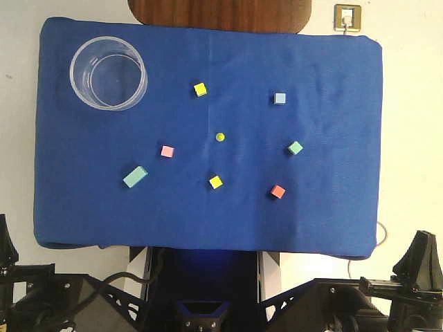

# VLA Robot

**从轻量视觉语言动作模型到 SmolVLM、π0.5，以及 PiPER 双臂数据采集。**

围绕语言指令驱动的机器人操作，整理模型设计、模仿学习、LIBERO 闭环评测和真机接口。研究部分覆盖双视角 CNN、动作分块、ResNet18、Transformer、SmolVLM LoRA 与 Flow Matching 对照；真机部分提供遥操作示范采集、质量检查、LeRobot 导出与 OpenPI 接口适配。

[快速运行](#快速运行) · [研究代码](research/README.md) · [评测记录](docs/RESULTS.md) · [真机与采集](robots/piper/README.md) · [视频](docs/media/robot_demo.mp4)

## 机器人演示

[](docs/media/robot_demo.mp4)

[播放 MP4](docs/media/robot_demo.mp4) · [WebM](docs/media/robot_demo.webm) · 完整视频：12 秒 / 50 FPS

## 模型路线

| 阶段 | 主要实现 | 关注的问题 |
|---|---|---|
| 基础策略 | 双视角 CNN + 文本 Embedding + 状态 MLP | 建立观测、动作监督、训练与闭环评测链路 |
| 动作分块 | 一次预测 K 个动作，执行前 H 步后重规划 | 动作时序与执行节拍 |
| 视觉与融合 | ResNet18 + Transformer + 可学习动作查询 | 预训练视觉特征与跨模态融合 |
| 预训练 VLM | SmolVLM + 视觉/语言 LoRA + 回归或 Flow 动作头 | 适配收益、动作生成方式与对照实验 |
| π0.5 | OpenPI 数据变换、LoRA 配置、训练及推理入口 | 完整 VLA 的任务适配 |
| 真机数据 | PiPER 主从遥操作、三路相机、LeRobot | 数据采集、时间对齐与训练输入一致性 |


## LIBERO 评测

LIBERO 四套共 **40 个任务、2,000 回合**，最终结果如下：

| 模型 | 最终成功率 |
|---|---:|
| CNN + 文本 Embedding + MLP 基线 | 15.80% |
| ResNet18 + Transformer + 动作分块 | 78.25% |
| SmolVLM + LoRA + 回归动作头 | 80.45% |
| **π0.5 + LoRA** | **90.15%** |

与项目简历一致的最终成绩汇总见 [RESULTS](docs/RESULTS.md)。

## 快速运行

先验证模型输入、动作形状及数据约定。以下示例仅使用 CPU 和合成输入，不需要数据集或模型权重。

```bash
git clone https://github.com/KyrieLQ/vla-robot.git
cd vla-robot
python -m venv .venv
# Linux / macOS
source .venv/bin/activate
# Windows PowerShell: .venv\Scripts\Activate.ps1

python -m pip install -r requirements-smoke.txt
python examples/model_smoke.py
python tools/check_repository.py
```

示例依次运行 CNN、动作分块、ResNet 和 Transformer，检查输出 `[B, 1, 7]` 或 `[B, 10, 7]`。数据边界、图像方向和归一化的原有测试可运行：

```bash
cd research
python -m unittest mini_vla.tests.test_contract -v
```

完整训练需要另外准备数据集和基础模型，参见 [研究环境与入口](research/README.md)。PiPER 的现场依赖、三视角映射与第一条示范流程见 [真机文档](robots/piper/README.md)。

## 目录

```text
research/
  mini_vla/                  模型、数据、训练、策略与评测实现
  scripts/                   实验辅助脚本与历史运行入口
  configs/                   划分、模型与评测协议
  reports/                   实验报告、OpenPI 补丁及统计资产
  results/                   精选评测记录
robots/piper/
  collection/                主从示范采集、回看、质检与导出
  openpi_overlay/            现场 OpenPI 适配文件
docs/                        结果说明、源码清单、演示视频
examples/                    CPU 模型示例
tools/                       仓库完整性检查
```

研究环境与真机环境分别管理；`research/scripts` 中保留的历史运行器可能绑定原实验路径和资源协议，推荐按文档中的入口使用。大体积数据集、训练权重、缓存、SSH 配置和登录凭据不随源码发布。上游版本、许可和适配文件范围见 [THIRD_PARTY](THIRD_PARTY.md)。
