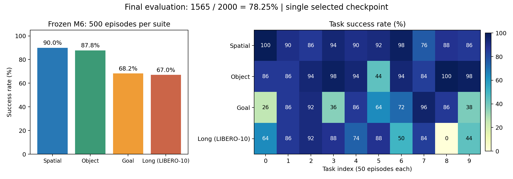

> **历史编号版存档。** 本文保留2026-10-21至22日使用的模型编号。2026-10-23起，请阅读[当前M1—M9课程总览](MINI_VLA_COURSE_M1_M9_CURRENT.md)及[新旧编号对照](MINI_VLA_NUMBERING_20261023.md)；旧M6对应新M5。

# Mini VLA完整课程与实验总览：M1到M9

这是本轮项目结束后的课程导航与技术复盘。实验阶段已经完成；学习进度仍以用户自己阅读和实践为准，目前用户已报告读完第一至第三课，第四课已讨论总体架构，第五课已提供，不假定已掌握全部内容。

## 1. 一张表定位全部阶段

| 阶段 | 学习重点 | 代码/详细课程 | 历史开发成绩 |
|---|---|---|---:|
| M1 | 数据预处理、监督学习、MLP、动作控制 | [第一课](MINI_VLA_LESSON_01.md)、[model.py](../mini_vla/model.py) | 18/50 |
| M2 | 动作块K与执行前缀H、末尾mask | [第二课](MINI_VLA_LESSON_02.md)、[chunk_model_v1.py](../mini_vla/chunk_model_v1.py) | H1为39/50，H5为41/50 |
| M3 | 通道标准化、残差网络、预训练 | [第三课](MINI_VLA_LESSON_03.md)、[visual_model_v1.py](../mini_vla/visual_model_v1.py) | 标准化36、随机ResNet39、预训练ResNet44/50 |
| M4 | token、Q/K/V、多头、动作查询 | [第四课](MINI_VLA_LESSON_04.md)、[attention_model_v1.py](../mini_vla/attention_model_v1.py) | 44/50 |
| M5 | 原定可选生成头节点，实际跳过 | 不存在已训练M5模型；生成建模在M9学习 | 无 |
| M6 | 四套联合数据、离线选点、最终评测规范 | [第五课](MINI_VLA_LESSON_05.md)、本文第5节 | 47/50 |
| M7a | 从单图向量改为显式空间token | 本文第6节、[spatial_tokens_model_v1.py](../mini_vla/spatial_tokens_model_v1.py) | 37/50 |
| M8 | 冻结预训练VLM、特征缓存、回归动作头 | 本文第7节、[vlm_action_heads_v1.py](../mini_vla/vlm_action_heads_v1.py) | 39/50 |
| M9 | 条件flow训练目标、时间与噪声、Euler采样 | 本文第8节、同一动作头文件 | 18/50 |

所有表中的50集都是历史固定Spatial开发集，不是四套完整测试。M1—M4在Spatial示范上训练；从M6开始四套联合训练，数据规模、词表和归一化改变。不能把这条曲线解释成仅增加一个组件、成绩就连续提升。


## 2. 全项目共用的数据与控制语言

数据层级是：**套件→任务→专家轨迹→时刻**。例如Spatial是套件，其中有10个任务，每个任务有多条示范，每条示范有多个时刻。一个训练样本通常以一个时刻的观测为输入，再取从该时刻开始的动作作为监督。

当前时刻输入包含两张相机RGB图、任务文字和8维本体状态。动作是7维控制命令，不能把它等同于机器人7个关节的绝对角度。8维状态包括末端位置3维、轴角姿态3维、两指夹爪位置2维；它不是与动作一一对应的8个控制量。

训练/离线验证按完整示范分组，不把同一轨迹的相邻帧随机拆到两侧。归一化参数和小模型词表只用训练示范拟合。

- `epoch`：遍历一遍训练样本。相邻帧不是独立轨迹；重复50轮不等于增加50倍独立示范。
- `update/step`：一次优化器参数更新。M1—M4为50轮共18400更新；四套训练为50轮共94950更新。
- `K=10`：每次预测10条未来动作。
- `H=5`：执行其中前5条，然后读取新观测重新预测。不是每步都执行整块10条。
- 离线验证MSE：对保留示范预测动作，衡量和专家动作的差异。
- 闭环成功率：预测动作真实作用于仿真，再观测、再预测，最终按任务成功谓词判断。离线MSE低不保证闭环成功率高。

## 3. M1到M4：打通并替换基础组件

M1用小CNN提取两路各256维视觉特征；整句平均词向量64维，状态MLP输出64维，拼接成640维。融合/动作MLP输出一个7维动作，执行一步再观察。你应能解释卷积尺寸、共享编码器、Embedding、mask和反标准化。

M2保留前端，最后一层输出70个数并reshape为`[B,10,7]`。轨迹末尾若不足10步，补位只用于构造等长数组，不参与MSE。K10/H1与K10/H5共用已训练的动作块模型，执行前缀变化应与训练架构变化区分。

M3先加RGB固定通道标准化作控制，再比较随机和ImageNet初始化ResNet18。保留4×4视觉网格后展平、投影为256维。预训练权重是起点，主干仍参与更新。三组实验说明“换结构”和“使用预训练”不是同一个变量。

M4把两路视觉、语言、状态分别投影为128维，堆成4个token；1层encoder融合，10个可学习查询经1层decoder读取观测，再逐查询Linear输出7维动作。语言仍平均、图像仍压成每图1个token，不能称为完整ACT或预训练VLM。

M3预训练与M4均44/50，配对救回3集、增加失败3集。该阶段学到了另一种结构及接口，没有观测到成功率净提升。

## 4. 为什么没有一个“训练好的M5”

M5原来是可选生成动作头阶段。当时选择先做四套数据与完整评测准备，跳过M5。之后用户明确要求向现代架构继续演进，才新增M7a、M8和M9。

所以编号不是必须逐个都有训练模型，也不是算法成熟度评分。不要给M5编一个成绩，或把后来的M9结果改名为已完成的M5实验。

## 5. M6：架构不变，数据与评测扩大

M6沿用M4结构，但联合学习Spatial、Object、Goal、Long共40个任务。1693条示范分成1506训练/187离线验证；243000训练帧、30465验证帧，总273465帧。训练侧词表71项，归一化用四套训练侧统计重新计算。

这一阶段要学的不是“又换了一个注意力模块”，而是完整多任务工程：

1. 不同套件的局部任务编号映射到全局任务，不混淆同号不同任务。
2. 示范分组隔离、语言与动作对齐，动作窗口不跨轨迹。
3. 训练50轮，按完整离线验证首动作MSE选择epoch3，不按闭环成绩挑epoch。
4. 先用历史Spatial50开发评测得到47/50。
5. 比较后续候选完成后冻结最终模型，再进行四套40×50的正式评测。

模型参数13,666,695；完整训练94950次更新，选中的epoch3检查点只有5697次更新历史。这里不矛盾：训练完整跑完，最后交付的是按验证规则选出的较早检查点。

M6比M4的开发成功数多3，数据范围、训练更新数、词表与归一化都改变，不能归因于架构升级。数据扩展本身也是有效的工程实验因素，报告时标明即可。

## 6. M7a：空间token是怎样保留下来的

M6每张图的ResNet输出`[B,512,4,4]`，经展平和投影得到一个向量。M7a在4×4网格处拆成16个位置：

```text
每图ResNet特征 [B,512,4,4]
 → flatten空间维并转置 [B,16,512]
 → 对每个位置共用Linear 512→128
 → 加16个可学习位置向量
 → 加相机类型向量
 → 两路图共32个token
 → 加整句语言1个token、状态1个token
 → [B,34,128] → encoder → 原10查询decoder → [B,10,7]
```

它让注意力能够访问显式空间位置，但删除了旧的展平大投影，参数量变成11,604,103。表示方式与投影容量同时改变，不能称纯参数匹配的空间信息消融。

结果为37/50，低于同四套数据M6的47/50。能说本轮配置没有带来开发收益；不能由此推出“空间token都没用”，也不能根据最终确认结果重新挑M7a的学习率或检查点。

自测：34从哪里来？为什么空间位置编码与相机类型编码都需要？这次不是只增加token，还删除了哪一组参数？

## 7. M8：从小词表和ResNet转向预训练VLM

M8使用固定revision的SmolVLM2-500M作为视觉—语言前端，其507,482,304个参数全部冻结。VLM接收两张按既定方向处理的原始256RGB图，经官方processor明确缩放到512、不切图，以及包含外部/腕部相机标记和任务文字的模板。

每次得到完整token序列`[L,960]`，其中两路视觉合计128个视觉token，此外还有文字与模板token，因此总长度L不是固定128。我们没有把所有token先平均成一个向量。

动作头结构：

```text
冻结VLM所有有效token [B,L,960] → Linear 960→128 ─┐
标准化8维状态 → MLP 8→64→128 → 1个状态token ──┤
                                               ↓
                               memory [B,L+1,128]
10个动作查询 [B,10,128] → decoder读取memory → Linear 128→7
                                               ↓
                                          [B,10,7]
```

有效token的mask转成attention所需的padding mask；注意“1表示有效”与“True表示屏蔽”的语义相反。补齐缓存位置先置零，避免无效值进入投影和注意力。状态token总是有效。

由于VLM冻结，可以把1693轨迹、273465帧的完整BF16特征只计算一次，后续50轮只训练动作头。BF16按原始uint16位模式保存，不是把数值随便转成整数。完整缓存约78.85GiB。

工程中曾发现缓存batch8与在线batch1的特征差异超出冻结门槛；用户批准改成batch1后，固定120输入的离线/在线一致性检查通过。缓存不是只要“形状一样”就能替代在线模型输出；还要保证图像方向、processor、模板、精度、batch行为和有效token顺序一致。

M8训练398,663个动作头参数，共50轮94950更新，验证规则选择epoch12。开发结果39/50，相对M6救回2集、增加失败10集。

这轮同时改变前端表示、分辨率、可训练范围和头部结构，不是单独只换语言编码器。冻结通用VLM特征不自动等于适合机器人接触控制。这里验证的是这个具体配置，不能替所有VLM微调路线下结论。

自测：为什么冻结后能缓存？为什么不能一边更新VLM一边继续使用旧特征缓存？L、960、128、10、7分别是什么？

## 8. M9：条件flow究竟学什么

M9复用M8相同的冻结VLM缓存和数据，不重新提特征。不同之处是动作头预测“从噪声到专家动作”的速度场，而不是直接输出最终动作块。这里的速度是动作空间中随生成时间变化的向量，不是直接等同于机器人末端的物理速度。

### 8.1 训练时

设标准化专家动作块为a，随机噪声为ε，生成时间为τ∈[0,1]，观测条件为c。构造：

\[
x_\tau=(1-\tau)\epsilon+\tau a,\qquad v^*=a-\epsilon.
\]

模型读入当前带噪动作x、时间τ和观测c，输出速度`vθ(xτ,τ,c)`，以有效动作位置上的MSE逼近`a−ε`。

τ不是机器人轨迹的第几步，而是这一次动作生成内部的插值时间。动作块长度仍是10，和τ的采样范围不是同一个维度。

代码将每个7维带噪动作投影到128维，再加动作查询和正弦/余弦时间编码经MLP得到的时间向量；decoder读取与M8相同的观测memory。

训练中的专家动作只参与构造带噪输入和速度监督，这是flow目标的组成部分。部署不能继续拿专家动作构造输入。

### 8.2 推理时

推理只有噪声，没有专家答案：

```text
x0 = 随机噪声 [B,10,7]
for i = 0...9:
    τ = i / 10
    x = x + vθ(x, τ, 当前观测) / 10
最终x → 动作反标准化 → 截断 → 执行前5步
```

这就是10步Euler积分。它不是10次环境执行；先在模型内部迭代出一整个10动作块，环境仍按H5执行。

验证时每个episode/frame的噪声由冻结身份哈希生成，在线按task/init/call_index生成，使用CPU float32私有随机数发生器。固定噪声让检查点比较可复现，不能为某个失败场景挑一个更容易成功的噪声种子。

动作末尾mask仅在有专家轨迹的训练端处理目标与补位；部署采样不读取未来标签或目标mask。这一训练/部署输入差异需要明确，不要描述为“两个阶段都知道未来还剩几步”。

M9头部432,711个可训练参数，VLM仍冻结；50轮94950更新，按完整生成后的首动作MSE选epoch43。开发结果18/50，低于M8的39/50。训练loss对应速度误差，选点与闭环对应生成动作效果，不能把不同意义的loss混作同一个指标。

可检验的结论是本轮flow头配置较差；原因尚不能归结为“flow不适合操作”。没有多种子训练、容量/优化充分控制，也没有真实机器人测试。保留负结果比更改指标把它包装成升级成功更有信息量。

## 9. 最终评测：为什么最终交付的是M6

已训练的四套候选在固定Spatial50上，M6=47、M7a=37、M8=39、M9=18。开发比较完成后选择M6，再冻结检查点、接口与执行配置，开启最终2000。这个模型选择使用了开发证据，不是预注册的独立优越性检验。

最终M6四套结果：Spatial450/500、Object439/500、Goal341/500、Long335/500，合计1565/2000=78.25%；确认部分936/1200=78.0%。



用的是官方任务/初态与上游seed7顺序reset规则，并保留K10/H5适配器；每套500集、每任务50集。它与历史canonical开发运行是不同的执行记录，不能拼接旧50集来凑数。

完整报告：[最终2000验收](../results/mini_vla_final2000_20261021_run3/REVIEWED_REPORT.md)。这是已知训练任务范围内保留初态上的绝对成绩，不称未见任务泛化，也不声称超过未按同协议全测的π0.5等基线。

## 10. 工程复盘与面试准备

本项目除了模型，还经历了完整缓存一致性、磁盘保留线、空卡准入、长任务监督、终止事件去重与中断恢复。最终续跑保留161个完整结果，物理重放恢复已有51步前缀，接着执行原队列剩余4步，而不是重新询问策略生成一条更幸运的轨迹。

讲项目时可按下面顺序：

1. 明确任务：用当前两相机图像、指令和状态输出连续控制动作。
2. 从M1画张量流，再用M2解释动作分块为何涉及训练与执行两个参数。
3. 用M3说明结构、标准化与预训练的对照；用M4解释注意力和查询。
4. 用M6解释多任务数据、验证选点和闭环评测。
5. 用M7a—M9讲表示粒度、预训练特征、生成动作头，并诚实解释负结果与归因边界。
6. 用最终2000说明选点先冻结、完整样本与失败保留，不拿开发成绩冒充最终结果。

对每个亲自在简历中声称掌握的模块，应能做到：说清输入输出、独立定位代码、解释训练与推理差异、修改一个实现并说明应如何验证。当前学习记录不会因为实验自动结束就把尚未读完的课程标成已掌握。

实验队列完成后不自动根据确认集调模型。将来若开启新研究，需要另定开发与确认数据使用方案，明确这些最终数据已经被看过。
