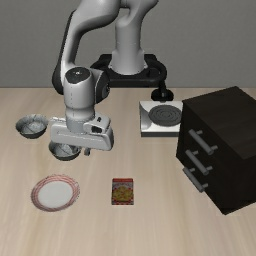

# 第一课：一条真实示范怎样变成一个动作预测

阅读提示（2026-10-20）：本课保留2026-10-15的原型阶段记录，下面“当前”“尚未训练/评测”等表述均指当时状态。后续M1、M2的真实训练与闭环评测已完成。读完本课，请继续[第二课：从单步动作到动作分块](MINI_VLA_LESSON_02.md)。

本课对应2026-10-15的M0数据合同与M1最小模型原型。当时完成了代码与CPU验收，尚未进行真实示范训练和机器人闭环评测。文中的786,599参数和数据数量来自该阶段实际检查；你的理解和个人代码实践可通过后面的阅读与修改练习建立。

## 1. 先明确现在要做的事

机器人每次接收两张图像、一句任务指令和自身状态，然后输出一个动作。训练数据提供专家在这个时刻做出的动作，我们让模型预测的动作接近专家动作。这是行为克隆，即监督模仿学习；此阶段没有强化学习奖励，也没有世界模型。

这里“从零实现”指自己组织模型结构、数据处理、训练目标和部署接口；可以使用PyTorch已有的卷积、线性层、自动求导和优化器。

## 2. 数据集、轨迹、帧、样本分别是什么

现有数据是432条完整专家示范，共52,970条时刻记录，覆盖10个Spatial任务。一条轨迹是专家完成一次操作所产生的有序记录；一帧/时刻记录包含当前观测与对应的专家动作，不只是单张图片。

当前单步模型将一个时刻作为一个训练样本。之后动作分块模型的一个样本仍以当前时刻为起点，但标签会扩展为后续K个动作。

| 名称 | 本轮实例 | 含义 |
|---|---|---|
| 原始episode ID | 1500 | 数据集中的轨迹标识，不代表本地第1500条 |
| Spatial任务ID | 0 | 本项目10个任务中的编号，与原数据task_index不是同一编号体系 |
| frame_index | 45 | 本轨迹第46个时刻，从0计数 |
| 轨迹长度 | 91 | 这条示范包含91个记录 |
| 标签 | 同一行的7维actions | 专家在当前观测下采取的控制命令 |

示例指令是：

> pick up the black bowl between the plate and the ramekin and place it on the plate

即拿起盘子与小烤碗之间的黑碗，把它放到盘子上。这个样例是task0训练轨迹按ID排序后的中间一条，再取轨迹中间时刻，用于教学展示；不能当作性能样本。

原始外部图像：



同一时刻的腕部图像：


图片直接提取自已有Parquet内嵌字节，没有生成或渲染新场景。完整原始数值和文件哈希在[example.json](../results/mini_vla_m0_20261015_v1/example.json)。

## 3. 观测和标签如何分开

观测是模型在行动前能拿到的信息：两张RGB图像、任务文字、8维本体状态。标签是专家动作，只在训练时用于计算损失。数据适配器明确返回两个字段：`observations`和`target_actions`；模型`forward`与`predict`不接收真实动作。

依照现有LIBERO适配器，8维状态由末端位置3维、轴角姿态3维及夹爪两侧位置2维组成；它不是8个关节角。该样例原始状态约为：

```text
[-0.079964, 0.147785, 0.915031, 3.155351, 0.301717, 0.093335, 0.007396, -0.018550]
```

7维动作由末端位移控制3维、旋转控制3维和夹爪命令1维组成，采用控制器约定的缩放命令，不应直接解释成“移动0.214米”或7个关节目标角。样例动作约为：

```text
[0.000000, 0.214286, 0.075000, -0.050357, 0.000000, -0.026786, 1.000000]
```

数值为1的最后一维是该记录的夹爪控制命令。具体控制映射由LIBERO/robosuite负责；闭环阶段要核对符号与控制频率，不能凭数值猜物理单位。数据元信息fps=10也不直接证明仿真控制器的真实更新频率。

## 4. 为什么先分轨迹，再计算统计

本轮使用固定种子20261015，对每个任务的完整轨迹按`sha256(seed:episode_id)`排序，前10%向上取整作为离线验证。得到：

| 部分 | 完整轨迹 | 时刻记录 | 用途 |
|---|---:|---:|---|
| 训练 | 384 | 46,982 | 后续更新参数、拟合归一化和词表 |
| 离线验证 | 48 | 5,988 | 后续检查对其他专家轨迹的预测误差 |

两部分均覆盖10个任务、没有共享轨迹。相邻帧非常相似，如果随机按帧划分，训练侧和验证侧会出现同一次操作的相邻画面，验证误差容易过度乐观。

这组384/48示范划分与已有200开发/300确认的闭环初态划分是两回事。前者用于离线学习，后者用于仿真任务评测。当前未使用300确认集。这里也不承诺未见任务或未见场景泛化。

原π0.5已使用过全部432条示范；因此它不能充当新48条示范上的严格未见数据基线。

## 5. 预处理到底做了什么

**图像**：已有RGB图片为256×256×3，保持存储方向，双线性缩放到128×128，转换成`[3,128,128]`的float32，像素除以255。两路都用相同处理，没有随机增强。在线原始相机图像需要按已有LIBERO方向约定转换，再调用本策略；本轮只验证已正确定向的输入，未启动仿真确认原始相机链路。

**文字**：转小写、按词切分，从训练指令构建词表。当前共28项，包含PAD和UNK；长度固定32，不足补PAD。词ID只表示查表位置，不表示词义大小。每个词查出一个64维可学习向量，对有效词求均值。样例有17个有效词，其余15个位置由mask排除。

**状态和动作**：分别对每个维度使用训练帧的均值与总体标准差，计算`z=(x-mean)/scale`；极小标准差用1代替。验证侧不参与统计。动作预测后按`x=z*scale+mean`还原，再限制到控制器约定的[-1,1]。

这是新Mini VLA的z-score预处理，与旧π0.5的分位数方案不同；没有复用旧模型基于全数据拟合的归一化文件。

## 6. 神经网络每一层的形状

下表中B是一次送入模型的样本数，例如B=8就是同时处理8个时刻。它不是轨迹条数，也不是训练更新次数。

| 操作 | 输出形状 | 作用 |
|---|---|---|
| 外部与腕部输入沿batch拼接 | `[2B,3,128,128]` | 一份共享CNN处理两路图像 |
| 卷积1：3→16，stride2 | `[2B,16,64,64]` | 提取局部视觉模式 |
| 卷积2：16→32，stride2 | `[2B,32,32,32]` | 聚合更大范围的信息 |
| 卷积3：32→64，stride2 | `[2B,64,16,16]` | 形成视觉特征图 |
| 池化成4×4网格、展平、线性投影 | `[2B,256]` | 保留粗略空间布局，得到视觉向量 |
| 按相机拆开并拼接 | `[B,512]` | 固定顺序保留相机身份 |
| 文字Embedding与带mask均值 | `[B,64]` | 把任务文字变成向量 |
| 本体MLP：8→64→64 | `[B,64]` | 编码机器人的当前状态 |
| 拼接视觉、语言、本体 | `[B,640]` | 汇集当前决策信息 |
| 融合MLP：640→512→256 | `[B,256]` | 学习观测与任务之间的关系 |
| 动作头：256→128→7 | `[B,7]` | 输出标准化的动作预测 |
| 增加长度为1的动作轴 | `[B,1,7]` | 为后续动作分块保留统一接口 |

参数总数实测786,599，均为可训练参数。目前全部随机初始化，没有加载视觉或语言预训练权重。

共享CNN不表示忽略相机身份，因为外部视图始终放在拼接向量的前半，腕部视图放在后半。4×4网格比直接全局池化保留更多位置线索；这只是设计动机，是否改善成功率还需后续实验。

## 7. 训练会怎样进行

第一版用标准化动作的均方误差：

```text
prediction = model(**batch['observations'])
loss = masked_mse(prediction, batch['target_actions'], batch['action_mask'])
optimizer.zero_grad()
loss.backward()
optimizer.step()
```

没有padding时，MSE就是所有样本、动作时刻、7个动作维度上的平方误差平均值。`backward()`计算每个参数如何影响误差，`step()`才真正更新参数。仅做前向或仅计算梯度，不等于已经训练了一步。

本轮在真实示范上做了前向和反向检查，但没有执行优化器更新。另一个独立模型对2个合成输入拟合固定已知动作30步，损失由0.149182降至0.000170650；该控制说明模型和优化器可以配合工作，不说明它已学会真实任务，控制权重也未保留。

以后若batch=32，一个优化器更新通常消费32个样本，1000步约消费32,000次样本。这是解释示例，不是已批准的训练配置。同一示范可以在不同epoch再次出现，“消费次数”不能当作新增数据量。

## 8. 推理与闭环还差什么

已实现的`MiniVLAPolicy.infer`把两张已定向RGB图、状态和任务文字转换成模型输入，输出反归一化后的`[1,7]`动作。它和训练样例处理路径的输出已逐值核对一致，保存/加载模型后的输出也完全一致。

完整闭环还需要：从LIBERO取观测→调用策略→`env.step(action)`→再次观察→记录任务是否成功。旧评测入口固定10步动作块和224尺寸，需要为本模型适配；本轮没有启动它。没有把CPU接口通过写成仿真已通过。

后续M2才引入预测K步、执行H步后重新观察。现在K=H=1，每一步都计划重新读取观测。

## 9. 当前模型的明确局限

- 词向量均值对词序不敏感，固定任务的文字嵌入不能代表通用语言理解。
- 单步MSE可能平均不同可行动作，尚未显式建模多峰动作分布。
- 图像与文字从零学习，数据规模有限；不能假定能追平预训练π0.5。
- 当前无历史记忆，部分遮挡或动作阶段可能需要额外时序信息。
- 不连续轨迹索引、padding及图像通道已通过工程检查，但真实闭环能力还未测量。

这些是结构性质或待检验风险，不是已观察到的失败原因。接下来的训练与视频才会告诉我们哪项实际限制最明显。

## 10. 建议按这个顺序读代码

1. 在`data.py`找`DemonstrationDataset.__getitem__`：指出哪些字段是观测，哪些是标签。
2. 在`model.py`找`MiniVLA.forward`：对照上表解释每次拼接和形状变化。
3. 在`masked_mse`解释分母为什么包含动作维度，以及为什么padding不计损失。
4. 在`policy.py`找`infer`：解释为什么没有专家动作参数，为什么输出前要反归一化。
5. 用纸笔回答：如果删掉语言分支，融合层输入从640变成多少？如果把4×4池化改成2×2，哪一层的输入维度要跟着改变？

学习检查的参考答案：无语言时为576；池化改变后，视觉投影输入由64×4×4=1024变为64×2×2=256。应先自己沿代码推导，再核对。

本轮代码由助手实现。项目记录不会据此认定你已经亲手完成或掌握这些模块。下一阶段结合你对这些核心路径的理解，另存M1真实示范训练与小规模闭环的具体配置和资源预算。

## 原始验收入口

- [CPU验收与参数统计](../results/mini_vla_m0_20261015_v1/acceptance.json)
- [全量数值检查](../results/mini_vla_m0_20261015_v1/numeric_audit.json)
- [训练侧预处理](../results/mini_vla_m0_20261015_v1/preprocessing.json)
- [冻结示范划分](../configs/mini_vla_split_20261015_v1.json)
- [阶段协议](../configs/mini_vla_m0_20261015_v1.json)
