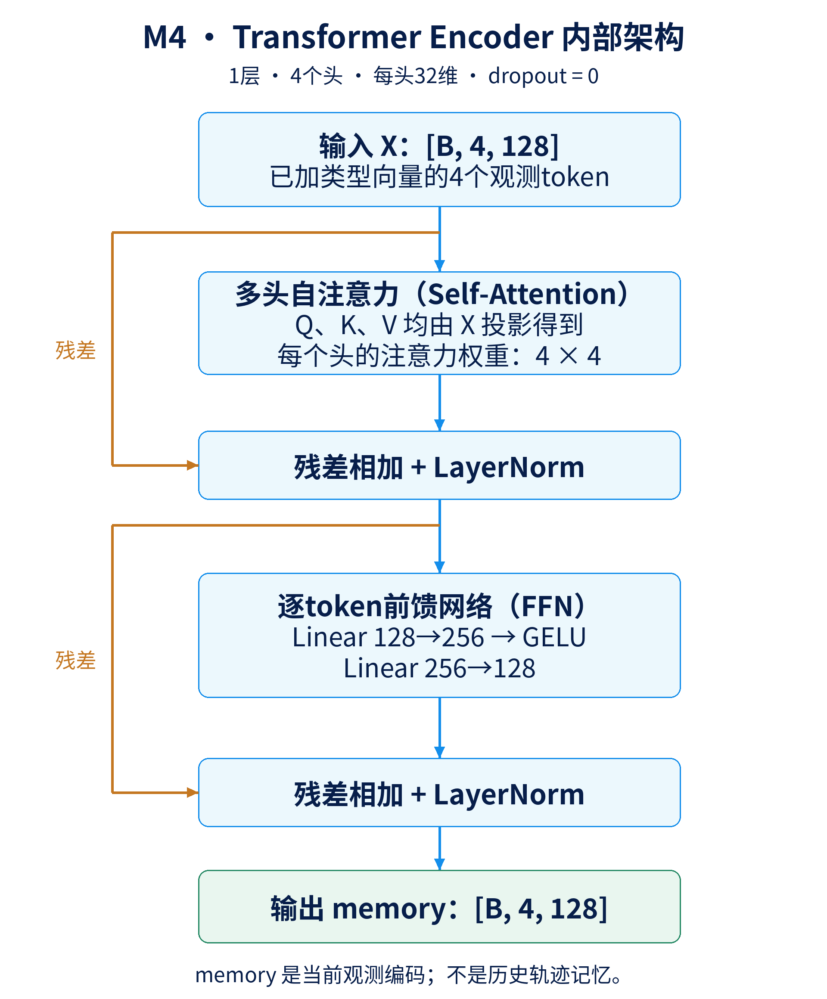
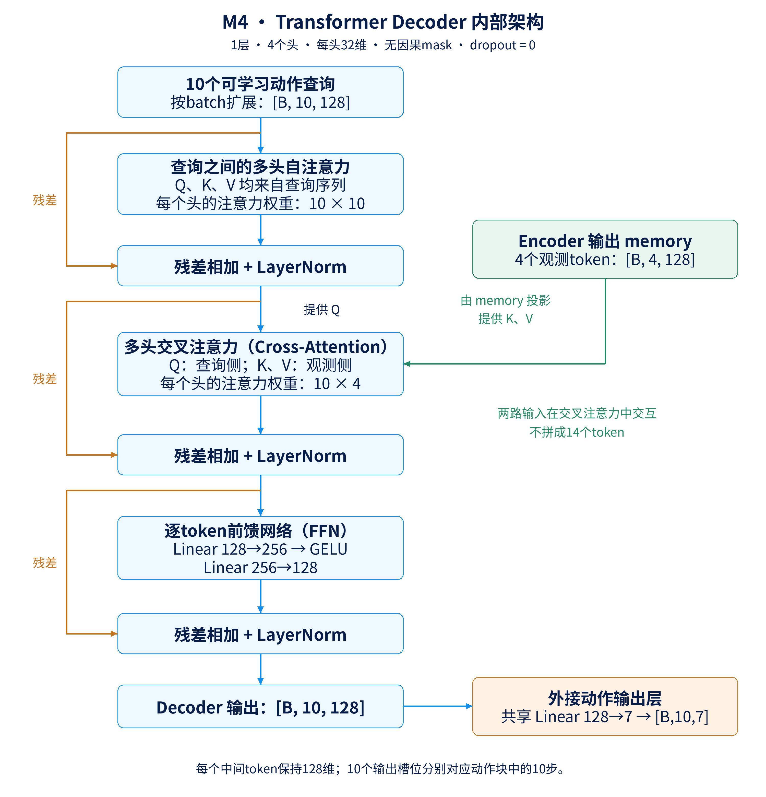

# 第四课：从MLP到Transformer——四个观测token与十个动作查询

本课接着[第三课](MINI_VLA_LESSON_03.md)。你对M3主线的理解是对的：用ResNet18替换小CNN；实验另外区分了RGB标准化、网络结构和ImageNet预训练初始化的影响。

M4保留M3的预训练ResNet18视觉编码器，改的是后面的**多模态融合和动作生成结构**：从“特征拼接＋MLP”变成“观测token＋Transformer编码器＋动作查询解码器”。

本课依据项目实际代码和已验收的2026-10-19历史实验编写。范围仍是Spatial的384条训练示范、48条离线验证示范、28项词表和固定50集开发评测；不要混入后续M5四套联合训练（历史实验编号M6）的数据或最终全测成绩。

建议分三遍阅读：先读1—5节理解架构；再读6—11节理解注意力；最后读12—17节对照代码、实验与自己的框架图。

## 1. 先看M3与M4的区别

M3已经会一次预测10步动作。因此，M4的新内容不是“开始预测动作块”，而是“换一种方法生成同样长度的动作块”。

| 环节 | M3预训练ResNet组 | M4 |
|---|---|---|
| 图像处理 | 缩放128、除以255、ImageNet通道标准化 | 相同 |
| 每路视觉特征 | 共享ResNet18与投影，输出256维 | 相同结构 |
| 语言特征 | 词Embedding＋有效词平均，64维 | 相同 |
| 本体状态特征 | 标准化8维状态＋MLP，64维 | 相同 |
| 组织观测 | 拼成一个640维向量 | 投影并堆成4个128维token |
| 多模态融合 | MLP | 1层Transformer encoder |
| 动作生成 | MLP输出70个数，再reshape | 10个动作查询＋1层Transformer decoder＋Linear |
| 输出 | `[B,10,7]` | `[B,10,7]` |
| 执行规则 | K=10，H=5 | 相同 |
| 训练目标 | 带有效位置mask的MSE | 相同 |

这里的“相同结构”不等于拿M3训练完的权重继续训练。M4实验重新按固定种子初始化，视觉主干使用相同ImageNet初始化；已核对视觉、语言和状态部分的初始权重与对应M3组一致。

## 2. 先把整条数据流看明白

```text
外部图像 → 共享视觉编码器 → [B,256] → Linear 256→128 ─┐
腕部图像 → 同一个编码器   → [B,256] → 同一个Linear ──┤
文字指令 → Embedding＋平均 → [B,64] → Linear 64→128 ─┤
本体状态 → 标准化＋状态MLP → [B,64] → Linear 64→128 ─┘
                                                      ↓
                                  堆成4个观测token：[B,4,128]
                                                      ↓
                                  加上4种可学习的类型向量
                                                      ↓
                                  Transformer encoder，1层
                                                      ↓
                                  编码后的观测：[B,4,128]
                                                      │
10个可学习的动作查询：[10,128]                         │
          ↓                                           │
扩展到batch：[B,10,128]                                │
          └────────→ Transformer decoder，1层 ←────────┘
                                  ↓
                      10个动作槽位特征：[B,10,128]
                                  ↓
                      每个槽位共用Linear 128→7
                                  ↓
                      标准化动作块：[B,10,7]
                                  ↓
                      反标准化、截断、执行前5步
                                  ↓
                      重新读图像与状态，再预测10步
```

`B`是一次处理的样本数。假设B=2，编码器输入是`[2,4,128]`，最终输出是`[2,10,7]`。两个样本不会互相做注意力；注意力在每个样本自己的token之间计算。

## 3. token到底是什么：这里为什么只有4个

在这里，token可以理解为“**带有特定含义、由一串数字表示的信息单元**”。它不必是一个单词，也不必是一小块图像。

M4规定每个样本有4个观测token：

| 编号 | 代表什么 | 投影之前 | 投影之后 |
|---|---|---|---|
| 0 | 整张外部相机图像的编码结果 | 256维 | 128维 |
| 1 | 整张腕部相机图像的编码结果 | 256维 | 128维 |
| 2 | 整条任务指令的平均词向量 | 64维 | 128维 |
| 3 | 当前本体状态的编码结果 | 64维 | 128维 |

注意两点：

- **每张图只有一个token**。虽然ResNet内部有空间特征图，但这里已经经过展平和投影压成256维，再投影到128维。M4没有把每个空间位置分别送进Transformer。
- **整句话只有一个token**。例如“pick up the black bowl”先得到各个词向量，再按语言mask平均成64维，之后才投影成一个128维token。

所以，“用了Transformer”不等于“自动有了逐词语言理解或逐区域视觉注意力”。它能处理的细粒度信息，取决于前面怎样组织输入。

## 4. 为什么要投影到128维，为什么用stack

### 4.1 投影就是一个可学习的Linear

外部图像的256维特征记作v：

$$
z_{ext}=W_vv+b_v,\qquad W_v\in\mathbb{R}^{128\times256}.
$$

得到128维向量。腕部图像使用**同一组**视觉投影参数；文字与状态分别使用自己的`Linear(64,128)`。

这里不额外接ReLU。实际代码中的三个token投影都是Linear，后续非线性来自Transformer内部。

统一维度后，四类信息可以进入同一个注意力模块。128是本项目选择的隐藏维度，不是机器人动作的维度，也不是某个物理定律要求的值。

### 4.2 拼接与堆叠的区别

四份`[B,128]`向量，如果沿特征轴拼接：

```python
torch.cat([ext, wrist, text, state], dim=1)  # [B,512]
```

得到每个样本一条512维长向量。

本项目使用：

```python
torch.stack([ext, wrist, text, state], dim=1)  # [B,4,128]
```

它新建一个长度为4的轴，保留“4个信息单元，每个128维”的形式。可以把一个样本想象成一张4行、128列的表格：行是token，列是特征。

不要在图上把`[B,4,128]`写成`[B,512]`。元素总数相同，但后续模块如何理解这些元素不同。

## 5. 类型向量：告诉模型这行信息来自哪里

项目定义了一个可学习的参数表：

```python
self.token_type = nn.Parameter(torch.empty(4,128))
```

4行分别对应外部视觉、腕部视觉、语言和状态。每一行也是128维。

把它加到观测token上：

$$
x_i=z_i+e_i,\qquad i=0,1,2,3.
$$

这里是逐元素相加，不是再拼接128维；因此输出仍是`[B,4,128]`。

它相当于给每个信息单元加上可学习的来源标记。两路图像共用编码器和投影，但其类型向量不同，模型可以利用这个区别判断相机来源。

这些向量在初始化时随机生成，训练时随梯度更新；不是每次推理重新随机生成。它们也不是给句子中每个词添加的位置编码，因为此时词序已经在平均操作中丢失了。

## 6. 自注意力：四个token怎样交换信息

MLP也能够联合利用视觉、语言和状态。Transformer的不同之处是：通过由当前输入计算出的注意力权重，让不同token之间进行加权信息汇聚。

例如，对应腕部相机的token可以汇聚外部相机、语言、本体状态以及自身的信息。权重来自学习后的计算，并不是我们手工规定“腕部图像必须占60%”。

### 6.1 Q、K、V分别是什么

对一个注意力头，用三组不同的可学习投影产生：

$$
Q=XW_Q,\qquad K=XW_K,\qquad V=XW_V.
$$

为了看清主线，公式暂省略投影偏置；实际PyTorch模块包含相应偏置。

- **Query，Q，查询**：当前这个token通过什么表示去匹配其他token。
- **Key，K，键**：其他token通过什么表示参与匹配。
- **Value，V，值**：匹配之后实际拿来加权汇总的信息。

Q、K、V都是数值向量，没有人工写好的自然语言问题或答案。“查找信息”只是帮助理解的比喻。

### 6.2 从相似度到加权汇总

单个头的计算是：

$$
A=\operatorname{softmax}\left(\frac{QK^T}{\sqrt{d_{head}}}\right),\qquad Y=AV.
$$

逐步看：

1. `QKᵀ`：让每个查询与所有键做点积，得到匹配分数。
2. 除以`√d_head`：调整分数尺度，缓和维度增大带来的数值尺度变化。
3. softmax：沿被关注的token轴，将每行分数转成非负且和为1的权重。
4. `AV`：用这些权重对Value向量求加权和。

M4的编码器有4个token，因此每个头的注意力矩阵是4×4。

以下只是假设数字，**不是从我们模型导出的注意力图**：某一行权重为`[0.1,0.6,0.2,0.1]`，对应输出就是：

$$
y=0.1v_{ext}+0.6v_{wrist}+0.2v_{text}+0.1v_{state}.
$$

每个输出token都能这样汇聚信息。所谓“自注意力”，指Q、K、V来源于同一组输入token，并不是每个token只能关注自己。

## 7. 多头注意力：4个头与128维是什么关系

实际配置是`d_model=128`、`n_heads=4`，所以每个头的维度是：

$$
d_{head}=128/4=32.
$$

这里的“4个头”与“执行前H=5步”无关，不要把两种H混用。

每个头学习不同的Q/K/V投影，分别计算注意力，再拼接4份32维结果并经过输出投影，恢复到128维。

```text
输入：每个token 128维
        ↓ 各头的Q/K/V投影
4个注意力头：每个头32维
        ↓ 每个头独立汇聚信息
拼接：32+32+32+32=128维
        ↓ 输出Linear
输出：每个token仍为128维
```

不是“一个头管外部图像、一个头管腕部图像”。**每个头都可以访问全部4个token**，没有预先规定的语义职责，也不保证不同头一定学到互不重复的功能。

## 8. Transformer encoder内部还有什么



[SVG矢量版](ppt_assets/MINI_VLA_M4_transformer_encoder.svg)可用于幻灯片排版；图中采用本项目实际的Post-LN顺序。另有与CNN示意图统一的[横向分栏PNG](ppt_assets/MINI_VLA_M4_encoder_horizontal.png)和[横向SVG](ppt_assets/MINI_VLA_M4_encoder_horizontal.svg)。

M4用了1个编码器层，层内结构如下：

```text
X：[B,4,128]
      │
      ├──────────────残差──────────────┐
      ↓                              │
多头自注意力：4头，每头32维            │
      ↓                              │
      加上原来的X ←───────────────────┘
      ↓
LayerNorm
      │
      ├──────────────残差──────────────┐
      ↓                              │
逐token前馈网络：Linear 128→256        │
                GELU                 │
                Linear 256→128        │
      ↓                              │
      相加 ←─────────────────────────┘
      ↓
LayerNorm
      ↓
memory：[B,4,128]
```

三个术语需要分清：

- **残差连接**：将模块输出与模块输入相加，为信息和梯度提供直接通路。
- **前馈网络，FFN**：这里仍然是一个小MLP。对每个token分别应用同一组参数；它不直接在4个token之间做混合，token之间的交换发生在注意力中。
- **LayerNorm**：在本实现中，对每个token的128个特征进行标准化，再使用可学习的缩放与偏移。它不是ResNet中按通道处理批次统计的BatchNorm，也不是图像输入的固定RGB通道标准化。

GELU是一种平滑非线性激活，可以先把它看作承担类似ReLU角色的函数。标准正态分布的精确形式为`GELU(x)=xΦ(x)`，其中Φ是标准正态累积分布函数；无需先背下推导才能理解数据流。

本项目`dropout=0`，使用PyTorch默认的`norm_first=False`，所以是“子模块→残差相加→LayerNorm”的顺序。不要把其他模型的Pre-LN架构图直接套过来。

代码中的`memory`只是当前观测经过编码后的张量名称。它没有自动保存过去的机器人轨迹，也不是世界模型或长期记忆。

## 9. 十个动作查询：没有输入专家动作，为什么能输出十步

现在有4个观测token，但我们需要10个动作输出。M4为此定义：

```python
self.action_queries = nn.Parameter(torch.empty(10,128))
```

可以把它理解成10个**可学习的输出槽位**：

```text
query[0] → 负责预测当前时刻t的动作
query[1] → 负责预测t+1的动作
...
query[9] → 负责预测t+9的动作
```

每行128个数是模型参数。初始化时随机生成，训练时根据各位置的动作误差更新。第0行被第0步目标监督，第1行被第1步目标监督，因此各行对应的时间位置由固定的输出顺序及监督建立。

对一个batch，代码把同一组查询扩展成`[B,10,128]`。所有样本共用这10个初始槽位参数；但每个样本的观测不同，经过解码器之后生成的动作也会不同。

**动作查询不等于专家动作标签，不等于上一次执行的动作，也不等于未来图像。** 查询中没有当前样本未来动作的答案。

M4没有额外加另一套动作位置编码；这10行不同的可学习查询本身提供了输出槽位身份。

## 10. Transformer decoder内部：自注意力＋交叉注意力



另有与CNN示意图统一的[横向分栏PNG](ppt_assets/MINI_VLA_M4_decoder_horizontal.png)和[横向SVG](ppt_assets/MINI_VLA_M4_decoder_horizontal.svg)。

[SVG矢量版](ppt_assets/MINI_VLA_M4_transformer_decoder.svg)。右侧绿色支路在交叉注意力处提供K/V，查询主干提供Q；橙色动作Linear是decoder外接输出层。

解码器接收两组输入：10个动作查询，以及编码器的4个观测token。

```text
动作查询：[B,10,128]
        ↓
① 查询之间的多头自注意力
   Q/K/V来自当前查询序列
   每个头的权重矩阵：10×10
        ↓ 残差相加＋LayerNorm
② 对观测的多头交叉注意力 ← memory：[B,4,128]
   Q来自更新后的查询序列
   K/V来自编码后的观测
   每个头的权重矩阵：10×4
        ↓ 残差相加＋LayerNorm
③ 逐token FFN：128→256→128，中间GELU
        ↓ 残差相加＋LayerNorm
动作槽位特征：[B,10,128]
        ↓ 共享Linear 128→7
标准化动作块：[B,10,7]
```

①让不同动作槽位的信息能够交换。注意当前只有一个decoder层，自注意力发生在读取观测之前，所以这一层中的查询自注意力本身还不依赖当前场景；场景信息在②交叉注意力处进入。

②让每个动作槽位根据当前观测生成自己的特征。交叉注意力中Q和K/V来自不同序列，因此称为“交叉”。

最后的`Linear(128,7)`是一套共享参数，分别作用于10个槽位的最后一维。**现在不需要把一个向量通过Linear变成70维再reshape。** 解码器已经保留了长度10这个轴。

最后一层没有ReLU，这样标准化动作的正值与负值都能输出。

## 11. 一次出十步，会不会偷看未来

本项目没有给解码器传入因果mask，因此10个槽位之间可以互相关注，10步动作并行产生。它不是语言模型那种“先生成一个词，再把该词喂回去生成下一个词”的流程。

这不构成未来标签泄漏，因为模型前向只拿到了当前图像、当前状态、任务指令和自身的可学习参数。槽位之间交换的是模型内部表示，没有未来专家动作。

训练时，专家未来10步动作只在输出之后用于计算损失；推理时不需要这些标签。

这时有三种容易混淆的mask：

| mask | M4是否使用 | 在哪里使用 |
|---|---|---|
| 语言有效词mask | 是 | 词向量求平均时，排除PAD |
| 动作目标有效位置mask | 是，仅训练/离线指标 | 排除轨迹末尾不存在的未来标签 |
| 解码器因果mask | 否 | 本模型并行预测，不限制后面查询槽位被前面槽位关注 |

动作目标mask不送入部署前向；真实运行时不可能预先知道专家轨迹还剩几步。M4输入4个观测token都存在，也无需把原来长度32的语言mask错传给长度4的encoder。

## 12. 用核心代码把整条流程连起来

下面与实际前向逻辑对应，为阅读拆开了紧凑写法，省略输入合法性检查：

```python
# 1. 两相机共用视觉编码器；这里只沿batch轴临时合并。
visual = self.vision(torch.cat([image, wrist_image], dim=0))
external_feature = visual[:B]   # [B,256]
wrist_feature = visual[B:]      # [B,256]

# 2. 先得到整句特征，未把32个词位置分别送入Transformer。
word_features = self.language(token_ids)                # [B,32,64]
mask = language_mask.unsqueeze(-1).to(visual.dtype)      # [B,32,1]
text_feature = (word_features * mask).sum(1) / mask.sum(1)
state_feature = self.proprioception(state)              # [B,64]

# 3. 四个信息单元统一到128维，再沿新的token轴堆叠。
tokens = torch.stack([
    self.visual_token(external_feature),
    self.visual_token(wrist_feature),
    self.language_token(text_feature),
    self.state_token(state_feature),
], dim=1)                                               # [B,4,128]

# 4. 标记来源，再做多模态编码。
memory = self.encoder(tokens + self.token_type.unsqueeze(0))

# 5. 十个可学习查询，读取当前观测后产生十个动作槽位。
queries = self.action_queries.unsqueeze(0).expand(B, -1, -1)
action_features = self.decoder(queries, memory)          # [B,10,128]
predicted_actions = self.action_output(action_features)  # [B,10,7]
```

`expand`共享参数的视图，不是为每个样本新建一套可学习查询参数。反向传播时，各样本的梯度会汇总到同一张`action_queries`参数表上。

## 13. 怎么训练，怎么执行

训练仍采用第二课的有效位置MSE：

$$
L=\frac{\sum_{b=1}^{B}\sum_{k=0}^{9}m_{b,k}\sum_{d=1}^{7}(\hat a_{b,k,d}-a_{b,k,d})^2}
{7\sum_{b=1}^{B}\sum_{k=0}^{9}m_{b,k}}.
$$

这里预测与标签都在标准化动作空间，`k`是动作块内偏移。若B=2、两条样本分别有10和3个有效目标，分母仍然是`7×(10+3)=91`，不会因为换了Transformer就变成140。

误差从动作输出层反向传播，经过decoder、encoder、token投影，继续更新视觉、语言和状态编码模块；动作查询和类型向量也是可学习参数。M4不是冻结ResNet只训练一个小头。

实际训练配置保留了50个epoch、batch128、seed42、AdamW学习率3e-4、weight decay 1e-4与梯度裁剪1。每轮遍历46982个训练帧，50轮共18400次优化更新。

检查点按完整5988帧离线验证集的**首动作MSE**选择，不按50集闭环成功率挑选。M4选择了epoch36，对应13248次更新；训练本身仍完整跑到了epoch50。

部署仍是K10/H5：

```text
t=0：读当前观测 → 预测a0...a9 → 执行a0...a4
t=5：读新观测   → 重新预测a5...a14 → 执行新预测的a5...a9
```

旧动作块没有执行的后5步被新预测替换；没有把两个重叠块做时间集成，也没有额外世界模型预测未来状态。

## 14. 我们实际测到了什么

以下是同一固定Spatial50开发集的历史结果。M3指其预训练ResNet18配置。

| 指标 | M3 | M4 |
|---|---:|---:|
| 闭环成功 | 44/50，88% | 44/50，88% |
| 模型参数量 | 13,781,894 | 13,663,943 |
| 离线验证选出的epoch | 50 | 36 |
| 训练记录的验证首动作MSE | 0.376050 | 0.400872 |
| 评测总策略调用 | 1193 | 1169 |
| 评测总执行步数 | 5874 | 5747 |
| RPC延迟中位数 | 7.637 ms | 7.497 ms |

独立审核又遍历了M4的全部5988个验证帧，得到首动作MSE约0.400877、动作块MSE约0.395009；与训练端记录的差异在既定数值容差内，不把不同计算路径误称为逐位相同。

逐集配对后，M4救回了M3失败的3集，同时又在M3成功的3集上失败。净成功数变化为0；按10个任务聚类的描述性95%差值区间为[-8,+8]个百分点。

据此可以说：**本轮实现了Transformer融合与动作查询预测，成功率与M3持平，没有观察到成功率提升。** 不能据此宣称Transformer必然无用，也不能说它已经比MLP更强。

两个模型并非参数量严格匹配，而且M4同时换了融合和输出结构，所以这不是单独隔离“attention本身”的实验。RPC的小差异也不足以作专门的加速结论；共享机器不同运行窗口的训练耗时不能直接归因于架构。

50集是开发用快速评测，不能写成完整LIBERO成绩或未见任务泛化成绩。

原始验收入口：[M4独立验收记录](../results/mini_vla_m4_20261019_run3/review/independent_acceptance.json)；可读总结：[M4验收报告](../results/mini_vla_m4_20261019_run3/REVIEWED_REPORT.md)。报告中的预算和后继状态是当时记录，不代表现在的实验进度。

## 15. 你的M3框架图应怎样改成M4

视觉编码器内部图可以继续保留M3的版本。图中主要改动集中在编码器之后：

1. 去掉“双相机特征拼成512维”的下游融合路径；分别画两路`[B,256]→Linear→[B,128]`，注明两路视觉投影共享参数。
2. 语言`[B,64]`与状态`[B,64]`之后，各补一个`Linear 64→128`。
3. 将“三类特征拼接[B,640]”改为“四个观测token堆叠[B,4,128]”，然后“加类型向量”。
4. 将原“融合预测MLP”换成Transformer encoder `[B,4,128]→[B,4,128]`。
5. 另画“可学习动作查询[10,128]→按batch扩展[B,10,128]”支路，和encoder输出一起接入decoder。
6. decoder之后画`[B,10,128]→共享Linear 128→7→[B,10,7]`。
7. 保留M2/M3的专家动作块、有效位置mask损失，以及反标准化、截断、执行前5步、重新观测的推理流程。

编码器与解码器可以各用一个展开框，分别采用第8节、第10节的顺序。箭头必须区分“动作查询流入decoder”和“观测memory流入交叉注意力”。

如果用火焰标注可训练参数，ResNet、语言Embedding、状态MLP、投影、类型向量、动作查询、encoder、decoder和输出Linear都是可训练的。RGB固定标准化与反标准化不是可学习层。

## 16. M4离现代VLA还差在哪里

这里已经练到了Transformer的核心接口，但仍有明确边界：

- 语言先取词向量平均，Transformer无法恢复已经丢失的词序。
- 每张图压成单个token，没有显式逐空间位置的注意力输入。
- 视觉主干有ImageNet预训练，但整个视觉—语言系统不是预训练VLM。
- 动作采用确定性回归，没有条件flow或扩散生成过程。
- 动作查询解码借鉴了这类策略的结构思路，但没有ACT的CVAE后验、潜变量与KL目标，不能称为完整ACT复现。

这些边界说明后续模块可以从哪里继续演进，却不保证加入更复杂的结构就会提高当前数据上的成功率。每一轮仍要以匹配的实验结果判断。

## 17. 读代码与自测

按这个顺序读即可：

1. [attention_model_v1.py](../mini_vla/attention_model_v1.py)：先看forward，逐行核对本课的形状；再回头看初始化。
2. [visual_model_v1.py](../mini_vla/visual_model_v1.py)：确认继承过来的视觉模块没有换成其他网络。
3. [M4冻结协议](../configs/mini_vla_m4_20261019_v2.json)：对照训练、数据和评测不变量。
4. [M4验收报告](../results/mini_vla_m4_20261019_run3/REVIEWED_REPORT.md)：区分模型设计、实测收益和归因边界。

先自己回答，再看括号里的参考：

- 为什么是4个观测token，而不是32个？（两相机各1、整句1、状态1；32个词位置已经平均。）
- `[B,4,128]`中的4与128分别是什么？（信息单元数量与每个单元的特征维度。）
- 编码器自注意力和解码器交叉注意力的矩阵分别多大？（每个头分别4×4、10×4；decoder还有10×10查询自注意力。）
- 为什么10个query没有偷看未来动作？（它们是共享模型参数，不是样本的未来标签。）
- 为什么不加因果mask也能预测有顺序的动作？（不同查询行有固定输出槽位，按相应时间偏移监督；全部槽位可并行生成。）
- 为什么最后只需Linear 128→7？（10这个轴已经由查询序列保留下来，共享Linear逐槽位输出7维。）
- 使用Transformer后，是否还含MLP？（有：状态编码、encoder/decoder中的逐token FFN等。）
- 44/50对44/50是否意味着逐集行为完全相同？（不是；有3集救回与3集新增失败。）

完成这课的目标是：你能自己画出4个观测token与10个动作查询的两条输入路径，说明每个注意力层的Q/K/V来自哪里，并跟踪到最终的`[B,10,7]`动作块。
