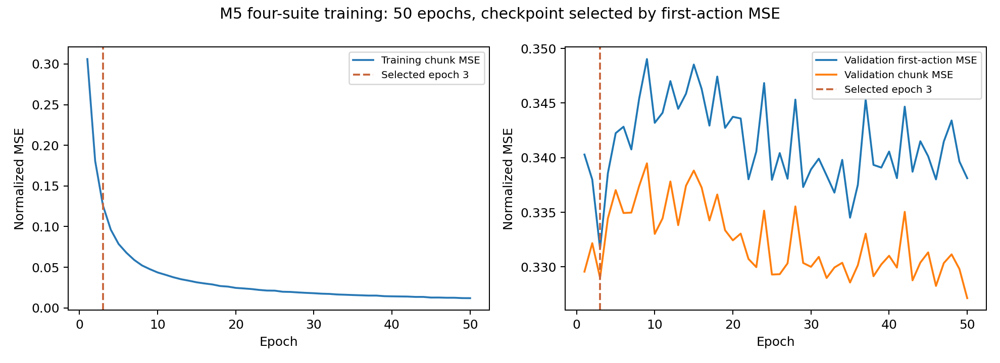
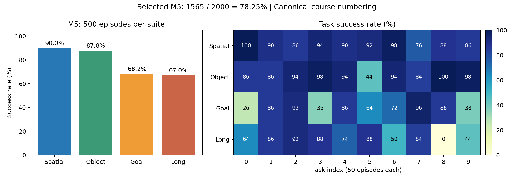

# 第五课：M5——四套联合训练、检查点选择与闭环评测

本课接着[第四课：Transformer融合与动作查询](MINI_VLA_LESSON_04.md)。前四课已经解释模型如何把图像、语言和状态转换成一个动作块；这一课把这些组件放进完整实验流程，解释数据如何组织、模型如何训练，以及怎样判断最终性能。

**第五课对应M5，后续第六课至第八课依次对应M6、M7、M8。** 按2026-10-23的新编号，本课M5就是历史实验记录中的M6；旧可选M5未运行，不再占用课号。正文使用新编号，历史目录和协议保留原名，详见[新旧编号对照](MINI_VLA_NUMBERING_20261023.md)。

本课全部实验数字来自既有产物。当前整轮实验已经结束，阅读或修改课程不会重新启动训练、下载或等卡。

阅读顺序：M5改了什么 → 数据与样本 → 一轮训练 → 离线选点 → 闭环开发 → 最终评测 → 怎样解释结果。

## 1. M5首先改变的是学习范围

M4主要在LIBERO-Spatial的示范上学习；M5让同一个模型联合学习四个套件的示范。

| 项目 | 原M4 | M5 |
|---|---:|---:|
| 训练任务范围 | Spatial的10个任务 | 四套共40个任务 |
| 训练示范轨迹 | 384 | 1506 |
| 离线验证示范轨迹 | 48 | 187 |
| 每轮训练帧 | 46982 | 243000 |
| 离线验证帧 | 5988 | 30465 |
| 小词表大小 | 28 | 71 |
| 训练轮数 | 50 | 50 |
| 优化更新总数 | 18400 | 94950 |
| 模型结构 | ResNet18＋4观测token＋Transformer＋10动作查询 | 相同结构 |
| K/H | 10/5 | 10/5 |

联合训练的意思是：不同任务的数据都用于更新**同一套模型参数**，不是分别训练40个模型，再根据任务编号选择其中一个。

M5也不是接着已经训练好的M4权重继续训练。它按固定seed42重新初始化；视觉主干加载指定ImageNet权重，之后参与训练。词表、状态和动作归一化重新按四套训练侧数据确定。

## 2. 架构图要改多少

第四课的整体架构基本可以保留：

```text
外部图像 ─ ResNet18 ─ 256维 ─ Linear ─ 128维 ─┐
腕部图像 ─ 同一编码器 ─256维─ 同一Linear─128维 ┤
文字指令 ─ Embedding＋有效词平均 ─ Linear─128维┤
本体状态 ─ 标准化＋MLP ─ Linear ─ 128维 ──────┘
                                                ↓
                            4个观测token＋各自类型向量
                                                ↓
                                         Encoder
                                                ↓
                                       [B,4,128]
                                                │
10个动作查询 [B,10,128] ─────────────→ Decoder ←──┘
                                                ↓
                                       [B,10,128]
                                                ↓
                                    共享Linear 128→7
                                                ↓
                                        [B,10,7]
```

图上需要更新的主要文字是：

- 数据来源：Spatial → 四套40任务联合示范。
- Embedding表：`28×64` → `71×64`。
- 状态/动作归一化：使用四套训练示范的统计。

语言特征仍是64维，token仍是128维，观测token数量仍是4。词表变大，不等于句子向量必须变长。

参数量从13,663,943变为13,666,695，差值正好为：

\[
(71-28)\times64=2752.
\]

这里增加的是Embedding表的行数，不是Transformer层数。

## 3. 数据集到底由什么组成

可以按下面的层级理解：

```text
四套数据
 ├─ Spatial
 │   ├─ 任务0
 │   │   ├─ 示范轨迹A：时刻0、1、2……
 │   │   ├─ 示范轨迹B：时刻0、1、2……
 │   │   └─ ……
 │   └─ ……共10个任务
 ├─ Object：10个任务
 ├─ Goal：10个任务
 └─ Long（代码名libero_10）：10个任务
```

本项目使用的实际数据划分如下，由冻结示范清单逐条统计：

| 套件 | 训练轨迹 | 验证轨迹 | 训练帧 | 验证帧 |
|---|---:|---:|---:|---:|
| Spatial | 384 | 48 | 46982 | 5988 |
| Object | 404 | 50 | 59590 | 7394 |
| Goal | 382 | 46 | 46445 | 5597 |
| Long | 336 | 43 | 89983 | 11486 |
| 合计 | **1506** | **187** | **243000** | **30465** |

总计1693条轨迹、273465个时刻。各条轨迹长度不同，因此“轨迹数最多”与“帧数最多”不是一回事。例如Long训练轨迹较少，但包含的训练帧最多。

这里是本项目固定版本数据的实际数量，不是要求每个LIBERO项目都必须具有完全相同的示范条数。

## 4. 一个训练样本如何从轨迹中取出来

设一条示范有100个时刻，我们选第20个时刻作为样本起点：

```text
输入：
  第20时刻的外部图像
  第20时刻的腕部图像
  第20时刻的8维本体状态
  这条示范对应的任务文字

监督标签：
  第20、21、……、29时刻的专家动作
  合成一个 [10,7] 的动作块
```

训练样本数按起点时刻计。因此243000帧对应243000个训练样本起点，而不是243000条独立轨迹。

取第95时刻时，只有95—99这5个真实动作，其余5个位置补齐，mask为：

```text
[1,1,1,1,1,0,0,0,0,0]
```

不能拿下一条轨迹的开头5步来补真实标签，因为它们不是当前场景的未来。窗口必须受轨迹边界约束。

相邻起点的动作标签会重叠。例如起点20和21都包含专家动作21—29。这是动作块训练的正常现象，不意味着获得了两份独立机器人经验。

## 5. 为什么按整条轨迹分训练和验证

假设同一条轨迹第20帧进训练、第21帧进验证，两张图通常非常相似，动作块也高度重叠。模型可能已经见过几乎相同的内容，验证会偏乐观。

本项目按**完整示范轨迹**分组：同一条轨迹的所有帧只能属于训练或离线验证之一。

```text
轨迹A的全部时刻 → 训练
轨迹B的全部时刻 → 验证
```

这种隔离减少相邻帧泄漏，但并不等于验证集是未见任务：同一个任务仍可以在训练侧和验证侧各有不同示范。

还要区别两种划分：

| 划分对象 | 用来做什么 |
|---|---|
| 专家示范的训练/离线验证划分 | 训练模型、选检查点 |
| 仿真初态的开发/确认划分 | 运行闭环、比较模型和最终报告 |

**187条离线验证示范与1200集最终确认评测不是同一批东西，也不是同一种统计单位。**

## 6. 四套任务编号为什么还要映射

每个套件都可能有一个“task0”。如果只记录数字0，就无法区分Spatial的task0和Object的task0。

缓存中使用全局编号：

\[
global\_task\_id=suite\_index\times10+local\_task\_id.
\]

本实现的套件顺序为Spatial、Object、Goal、Long，对应全局范围：

| 套件 | 全局任务编号 |
|---|---|
| Spatial | 0—9 |
| Object | 10—19 |
| Goal | 20—29 |
| Long | 30—39 |

例如Object的局部task3对应全局13。这个编号用于数据整理与逐任务统计；**当前模型的forward并不把task_id作为额外输入**。任务信息通过语言等实际观测进入模型。

## 7. 为什么词表和归一化都要重新计算

四套任务包含更多指令词，因此训练侧词表从28项变成71项。71是整个训练词表的大小，不是每条指令有71个词；指令仍按原长度32的位置数组编码与补齐。

状态与动作统计也从四套训练侧重新估计。对第d个动作分量：

\[
\widetilde a_d=\frac{a_d-\mu_d}{s_d}.
\]

其中μ是训练侧均值，s是预处理保存的有效尺度。验证和部署复用这同一组参数。不能在每个验证集上重新计算自己的均值，也不能部署时随手换成M4的旧统计。

RGB的ImageNet固定通道标准化仍保留，不是把相机像素也换成按四套数据重新拟合的统计。

一个容易忽略的影响：M4和M5的动作归一化尺度不同，离线验证的数据范围也不同，所以二者的标准化MSE不能直接拿来当统一量尺。例如0.40087与0.33165的大小不能单独证明架构性能提升。

## 8. 每一轮训练到底做了什么

本轮训练配置是：batch size 128、50个epoch、seed42、AdamW、学习率3e-4、weight decay 1e-4、梯度范数裁剪1、FP32，不做图像增强。

每一轮把全部243000个训练起点打乱，再分批送入模型。`drop_last=false`，所以最后一个不足128个样本的batch也保留。

\[
243000=1898\times128+56.
\]

因此，每轮有1898个完整batch和1个56样本batch，共1899次参数更新：

\[
50\times1899=94950\text{次更新}.
\]

50轮训练样本呈现次数为：

\[
243000\times50=12150000.
\]

1215万是重复呈现次数，不是独立采集了1215万帧新数据。动作块内的有效标签位置又是另一种计数，本轮每个epoch为2362230个有效目标动作位置。

**训练没有强制每个batch四套各占四分之一。** 当前是所有训练帧混合后打乱；长轨迹提供更多起点，Long占89983/243000，约37.03%的训练帧。联合训练并不自动等于各任务均衡采样，这也是解释实验时需要知道的实现选择。

## 9. 一个batch内部发生什么

```python
# 教学伪代码，对应实际训练逻辑；不作为直接启动实验的命令。
optimizer.zero_grad()
prediction = model(current_observations)  # [B,10,7]
loss = masked_mse(prediction, expert_actions, action_mask)
loss.backward()
clip_grad_norm_(model.parameters(), 1.0)
optimizer.step()
```

逐句解释：

1. 清空旧梯度：避免把前一个batch的梯度意外叠进来。
2. 前向：把当前观测变成10步预测动作。
3. 计算loss：在真实有效的动作位置比较预测与专家标签。
4. 反向传播：求出参数怎样变化能在局部降低损失。
5. 梯度裁剪：当梯度总范数过大时缩放梯度，限制一次更新所依据的梯度幅度；不是把每个模型权重截断到[-1,1]。
6. 优化器更新：根据梯度与AdamW的状态更新可学习参数。

视觉主干、词Embedding、状态MLP、Transformer和动作查询均更新，当前不是冻结前端训练小头的M7方案。

训练的MSE覆盖全部有效K10目标：

\[
L_{train}=\frac{\sum_{b,k}m_{b,k}\sum_{d=1}^{7}(\hat a_{b,k,d}-a_{b,k,d})^2}{7\sum_{b,k}m_{b,k}}.
\]

## 10. 离线验证为什么只用首动作MSE选点

每轮结束，模型在完整30465个验证帧上运行，关闭参数更新。程序同时记录首动作MSE和有效动作块MSE，但**事先冻结的检查点选择规则只看首动作MSE**。

若验证起点数为N，首动作指标为：

\[
L_{first}=\frac{1}{7N}\sum_{i=1}^{N}\sum_{d=1}^{7}
(\hat a_{i,0,d}-a_{i,0,d})^2.
\]

这里动作块内的0表示第一个预测动作，不是整条轨迹的第0帧。每一个验证起点都贡献一个首动作。

指标按全体验证帧汇总，不是先算各个batch均值再不加权平均，否则最后小batch会获得不合理的额外权重。它也不是先把40个任务等权平均的任务宏指标。

为什么选首动作？这是项目从前面阶段沿用的统一离线选点标准，方便保持选择规则一致。它不是一个已经证明最优的闭环代理指标；特别是在H=5的部署中，后续4步也会执行，因此需要明确承认首动作指标不能代表全部闭环表现。

训练loss、检查点选择指标、最终成功率可以不同，但必须提前定义并分别报告，不能出结果后随意换成更好看的那一个。

## 11. 为什么训练了50轮，最终却选第3轮

下面摘自真实的训练历史，保留六位小数：

| epoch | 累计更新 | 训练动作块MSE | 验证首动作MSE | 验证动作块MSE |
|---|---:|---:|---:|---:|
| 1 | 1899 | 0.306093 | 0.340287 | 0.329565 |
| 2 | 3798 | 0.180757 | 0.338000 | 0.332173 |
| **3** | **5697** | **0.125855** | **0.331655** | **0.328991** |
| 10 | 18990 | 0.043563 | 0.343191 | 0.333021 |
| 25 | 47475 | 0.021181 | 0.337972 | 0.329301 |
| 50 | 94950 | 0.011955 | 0.338120 | 0.327138 |

完整50轮中，验证首动作MSE最小值出现在第3轮。因此：

- 实际训练过程：完整50轮、94950次更新。
- 最终选中模型：epoch3的权重，累计5697次更新。

这不是“只训练了3轮”，也不是运行到3轮就提前停止。是完整训练后按固定验证规则选择较早的检查点。

训练误差持续下降，验证首动作指标没有持续改善，说明训练拟合越来越强，却没有相应改善这个保留数据指标。可以讨论泛化差距，但不能说所有验证指标都恶化：**第50轮的验证动作块MSE反而略低于第3轮。**

选点规则不会因此改成“改看动作块MSE选第50轮”。同样，后面闭环评测完成后，也不能再从50个epoch里挑一个更高成功率的结果来替换已冻结模型。



## 12. 检查点里不仅有神经网络权重

本阶段保留三个角色不同的文件：

| 文件 | 含义 |
|---|---|
| `initial.pt` | 动作任务训练开始前的模型快照；视觉已按协议加载ImageNet初始化 |
| `best.pt` | 按完整验证首动作MSE选中的最佳模型，此处epoch3 |
| `latest.pt` | 最近完整训练轮的状态，此处epoch50 |

训练检查点还包含模型配置、预处理信息、epoch、updates等；可恢复的训练状态包含优化器状态和历史记录。不要把部署理解成只随便复制一个权重矩阵：词表与归一化也必须和权重匹配。

文件哈希用于确认“现在加载的还是冻结时的那一份文件”，不证明模型正确或有效。模型效果需要独立的数值核验和闭环实验。

## 13. 从离线验证进入50集闭环开发评测

冻结epoch3之后，先运行原固定Spatial50初态，即10任务×每任务5集。此时不再读取专家动作来决定控制命令：

```text
读取初态 → 获得当前图像/状态/指令
       → 策略预测10步动作
       → 反标准化并截断到控制范围
       → 依次执行前5步，每一步检查任务是否成功
       → 未结束则读取新观测，再预测
       → 成功或达到最大步数后记录该集结局
```

同一集包含许多策略调用，不是调用一次模型就算一集。任务成功率的分母是集数，不是动作步数或模型调用次数。

M5在这50集上成功47集，成功率94%；原Spatial训练M4为44/50。逐集配对中，M5救回4集、新增失败1集，净增加3集。

按10任务聚类的描述性95%差值区间为[-4,+16]个百分点，包含0。因此这是开发信号，不足以宣称稳定的总体优越性。数据、更新数、词表和归一化均改变，也不能单独归因于网络结构或纯数据量。

## 14. 最终2000集与此前50集是什么关系

用户采用的是两阶段策略：中间模型先做固定50集开发评测，最终只对选定模型做四套全测。

实际时间线为：

```text
M5四套训练 → epoch3离线选点 → M5 Spatial50
                                      ↓
                       后续M6/M7/M8训练与开发比较
                                      ↓
                    根据开发证据选定M5并冻结执行配置
                                      ↓
                         四套40任务 × 每任务50集
                                      ↓
                              最终2000集报告
```

因此，最终2000不是M5训练一结束就立即运行，也没有给所有中间模型都跑2000集。

正式全测沿用上游seed7、同任务环境顺序reset/init0…49规则；历史Spatial50采用其原开发执行方式。二者不能直接拼接，也不能默认同名初态在所有reset历史下拥有完全一致的输入。

这里有三类种子要区别：

| 种子 | 本阶段用途 |
|---|---|
| 示范划分seed20261015 | 确定完整轨迹的训练/验证划分 |
| 训练seed42 | 固定这次训练的初始化/采样相关随机过程 |
| 最终环境seed7 | 控制正式仿真初始化过程 |

一个模型跑2000个初态，仍然只有一个训练种子；不能写成“2000种子训练验证”。

## 15. 已完成的最终成绩应怎样读

| 套件 | 成功/总数 | 成功率 |
|---|---:|---:|
| Spatial | 450/500 | 90.0% |
| Object | 439/500 | 87.8% |
| Goal | 341/500 | 68.2% |
| Long | 335/500 | 67.0% |
| **总计** | **1565/2000** | **78.25%** |



冻结清单另外把每个任务的50初态分成20个开发、30个确认，四套合计800/1200。全量结果中的开发部分为629/800=78.625%，确认部分为936/1200=78.0%。Spatial单独的200/300也完整保留。

这个“800开发部分”是最终清单的分区，不表示历史上每个中间模型都跑过800集。历史快速开发仍是50集。

四套样本数相同，总成功率与套件平均相同。按套件分层、以任务为聚类单位得到的总体描述性95%区间为71.80%—84.15%；它表达任务间差异，不是对未来任意机器人任务的性能承诺。

可以确定：模型在本项目已知训练任务范围内完成了全量闭环评测。不能据此确定：未见任务泛化、真实机械臂表现、超过π0.5或现代VLA整体水平，因为本轮没有对应的独立证据。

## 16. 全量验收为什么还检查轨迹与视频

单看一个“78.25%”不足以确认实验完整。本次最终验收核对了：2000个唯一场景、392508个执行步、79163次策略调用、80个预定视频，以及模型/适配器/源文件绑定。

运行曾因磁盘保留线中断。续跑保留161个完整结果、一个51步前缀，并继续执行原动作队列剩余4条动作，下一次新调用在第55步。没有因为失败而重新生成更幸运的结果。

这类检查保障“统计对应实际运行过的固定实验”，但仍有边界：全部调用的无损RGB没有永久保存，因此不能在事后逐个从原像素重算所有输入哈希；本次独立审核也没有重新仿真2000集。报告里保留这些限制。

如果最终结果已经用于分析，它就不再是可以反复拿来调参的未知测试集。未来新研究需要重新明确开发与独立确认的安排，本课不会自动启动后续调参。

## 17. 代码、证据与当前资产状态

按下面顺序阅读即可，不需要直接运行历史入口：

1. [四套示范划分](../configs/mini_vla_four_suite_demo_split_20261019_v1.json)：轨迹、任务、长度、指令的对应关系。
2. [四套数据准备逻辑](../mini_vla/prepare_m6_v1.py)：全局任务映射、训练统计和缓存结构；历史工程续跑还使用v2/v3。
3. [M5训练协议](../configs/mini_vla_m6_train_20261020_v1.json)：50轮、batch128、选点和隔离规则。
4. [M4训练入口适配](../mini_vla/experiment_m4_v1.py)与[共用训练循环](../mini_vla/experiment_m3_v1.py)：模型替换、batch更新、验证与保存。
5. [完整训练历史](../results/mini_vla_m6_train_20261020_run1/training/history.json)及[训练验收](../results/mini_vla_m6_train_20261020_run1/REVIEWED_REPORT.md)。
6. [Spatial50开发验收](../results/mini_vla_m6_fast50_20261020_run1/REVIEWED_REPORT.md)与[最终2000验收](../results/mini_vla_final2000_20261021_run3/REVIEWED_REPORT.md)：区分不同范围与时间点。

历史训练使用的两份128RGB缓存数组后来已按用户批准退役，以释放空间；原始示范、数值数组与模型保留。因此现在不能因为看到旧`complete.json`就认为图像缓存仍存在，也不能把历史启动命令当成无需准备即可重跑的命令。教学不会自动重建它们。

旧报告里“最终评测尚未开始/仍封存”等话是当时状态。当前最终评测已验收，自动等卡队列关闭。

## 18. 这一课读完应能回答什么

- **M5为什么不是新的Transformer架构？** 主体沿用M4，主要扩展数据范围与训练统计。
- **1506条轨迹、243000帧、94950更新是什么关系？** 轨迹包含帧，每帧作为起点形成样本；帧分batch，多轮产生更新。
- **为什么Long在训练中占比不是25%？** 当前按全部帧混合采样，轨迹长短不同，没有套件均衡重采样。
- **50轮训练后为什么用第3轮？** 完整验证首动作MSE最小，不是按最后轮或闭环成绩临时改选。
- **为什么训练loss下降，成功率不一定上升？** 动作拟合误差与误差累积后的闭环任务完成度不同。
- **94%与78.25%矛盾吗？** 前者是历史Spatial50开发结果，后者是四套2000正式全测；范围与执行记录不同。
- **为什么确认部分78%不等于未见任务泛化？** 初态保留与任务身份保留是不同维度，这些任务属于联合训练范围。
- **一份可复现模型至少还应绑定什么？** 词表、归一化、图像方向/尺寸、动作接口、K/H、选点规则、环境初始化规则和版本。

下一课可以进入实际M6：把“每张图一个token”改为“每张图16个空间token”。那一课继续改变模型内部表示；本课先把训练与评测这套完整流程讲清楚。
