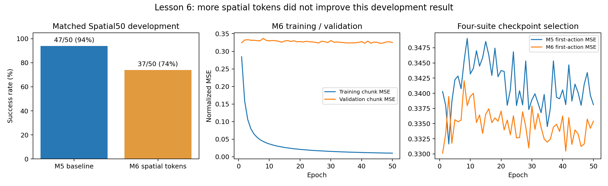

# 第六课：M6——从整图向量到空间token

本课接着[第五课：M5四套联合训练与评测](MINI_VLA_LESSON_05.md)。M5沿用M4结构，主要扩大数据与训练范围；M6则改变模型内部组织视觉信息的方式：**每张图从1个视觉token，改成16个空间token。**

全文使用2026-10-23统一编号：本课M6对应历史实验M7a，作为对照的M5对应历史实验M6。原文件名中的`m7a`、`m6`保持不变，详见[编号对照](MINI_VLA_NUMBERING_20261023.md)。本课介绍已完成的实验，不启动训练或恢复队列。

先记住两条：M6的观测token变成34个，动作查询仍是10个；本轮开发成功率下降，因此“结构更细”不能直接写成“效果更好”。

建议阅读：改动位置 → 特征图与空间向量 → flatten/transpose → 位置与相机类型 → 34token注意力 → 参数变化 → 实验解释 → 修改架构图。

## 1. 先比较M5与M6

| 项目 | M5 | M6 |
|---|---|---|
| 输入图像 | 两张128×128 RGB | 相同 |
| RGB处理 | 除以255，再ImageNet通道标准化 | 相同 |
| 视觉主干 | ImageNet初始化ResNet18，可训练 | 相同结构与主干初始化 |
| 主干每图输出 | `[B,512,4,4]` | 相同 |
| 视觉信息组织 | 整张特征图展平，压成一个token | 每个网格位置各成为一个token |
| 每张图的token数 | 1 | 16 |
| 总观测token数 | 2＋1＋1＝4 | 16＋16＋1＋1＝34 |
| token宽度 | 128 | 128 |
| 语言 | 71词表、64维Embedding、有效词平均 | 相同 |
| 本体状态 | 标准化8维输入，经MLP编码 | 相同 |
| encoder/decoder | 各1层、4头、FFN宽度256 | 相同配置 |
| 动作查询 | 10个，每个128维 | 相同 |
| 动作预测与执行 | K10/H5，回归动作头 | 相同 |
| 训练数据与训练量 | 四套1506/187示范，50轮 | 相同 |

这里的“相同”指结构与被冻结的实验设置，不意味着直接拿M5训练好的参数继续训练M6。M6重新训练；已审核共有模块的初始张量与M5一致。

## 2. M5怎样把一张图变成一个token

回忆第三课：ResNet18去掉原分类器后，对一张128×128图像输出512通道、4×4空间网格的特征图。

M5后续路径为：

```text
ResNet18特征图：[B,512,4,4]
       ↓ 自适应平均池化到4×4
       ↓ Flatten：将512×4×4全部展平
整图向量：[B,8192]
       ↓ Linear 8192→256 + ReLU
视觉特征：[B,256]
       ↓ Linear 256→128
一个视觉token：[B,128]
```

自适应池化的目标也是4×4，因此在本固定输入分辨率下，它没有进一步缩小这个网格。

**展平并不等于抹掉全部空间信息。** 展平的排列顺序固定，后面的Linear可以给不同位置、不同通道设置不同权重。M5有能力利用位置差异，只是进入Transformer时，整张图已经压缩成一个向量，不再有独立的16个空间槽位。

所以，M6改变的是“让空间位置以独立token形式进入注意力”，不能说M5根本不知道物体在哪。

## 3. `[512,4,4]`到底表示什么

你可以从两个角度看同一个张量：

```text
按通道看：512张4×4特征图

按空间位置看：16个位置，每个位置都有512个通道值
```

例如位置`(row=1, col=2)`对应的向量是：

```text
[第0通道在(1,2)的值,
 第1通道在(1,2)的值,
 ……,
 第511通道在(1,2)的值]
```

这就是一个512维的空间特征向量。它不是一个RGB像素，也不是人为填写的物体坐标。

4×4网格可以编号为：

```text
       col0  col1  col2  col3
row0     0     1     2     3
row1     4     5     6     7
row2     8     9    10    11
row3    12    13    14    15
```

每个格子都对应一个512维向量。编号规则为`p = 4×row + col`。

这些是CNN计算后的特征位置。不能把它们理解成直接将原图切成16块互不重叠的小图片：卷积会汇聚邻域信息，深层特征的感受野可以重叠。这里没有额外裁切16张RGB图送进模型。

## 4. M6怎样得到16个空间token

新的视觉路径是：

```text
ResNet18特征图：[B,512,4,4]
       ↓ 只展平最后两个空间维度
[B,512,16]
       ↓ 交换通道轴与位置轴
[B,16,512]
       ↓ 每个位置使用同一个Linear 512→128
[B,16,128]
       ↓ 加空间位置向量、相机类型向量
16个视觉token：[B,16,128]
```

一个token现在对应一个特征网格位置；整张图拥有16个这样的token。

128仍然是Transformer的特征宽度，不是图像坐标数，也不是动作维度。

## 5. `flatten(2)`与`transpose(1,2)`逐步解释

实际代码的核心是：

```python
features.flatten(2).transpose(1, 2)
```

输入形状是`[B,512,4,4]`，各轴为：

| 轴编号 | 含义 | 长度 |
|---|---|---:|
| 0 | batch | B |
| 1 | 通道 | 512 |
| 2 | 网格行 | 4 |
| 3 | 网格列 | 4 |

`flatten(2)`从轴2开始展平，把行列合成一个位置轴：

```text
[B,512,4,4] → [B,512,16]
```

`transpose(1,2)`交换轴1与轴2：

```text
[B,512,16] → [B,16,512]
```

这样最后一维就是一个位置的全部512个通道，Linear便能逐位置读取它。

这两步只是重新组织已有数值，不增加可学习参数。真正的可学习变换在后面的`Linear(512,128)`。

不要与M5的展平混淆：

| 写法 | 得到什么 |
|---|---|
| 从轴1开始整体展平 | `[B,8192]`：一整张图的长向量 |
| 从轴2展平，再交换轴 | `[B,16,512]`：16个空间向量 |

## 6. 16个位置各有一个Linear吗

**不是16套Linear，而是所有位置共用一套`Linear 512→128`。两路相机也共用这一套投影。**

设第p个位置的512维特征为fₚ：

$$
z_p=W_gf_p+b_g,
\qquad W_g\in\mathbb{R}^{128\times512}.
$$

对于每一个位置，用相同的W和b计算，得到128维向量。这里采用列向量公式；PyTorch存储的权重也为`[128,512]`。

输入内容不同，输出自然可以不同。共享参数让模型在不同网格位置应用同一种特征投影规则，随后再通过位置编码标明位置。

本实现的`grid_projection`只有Linear，没有在它后面额外插入ReLU。不要沿用旧视觉投影的ReLU画法。

## 7. 空间位置向量是什么

M6新增一张可学习参数表：

```python
self.spatial_position = nn.Parameter(torch.empty(16,128))
```

它有16行，每行对应一个4×4网格位置：

```text
position[0]  → 网格(0,0)
position[1]  → 网格(0,1)
……
position[15] → 网格(3,3)
```

第p个位置的特征加上自己的位置向量：

$$
u_p=z_p+e_p^{pos}.
$$

加法是逐元素相加，因此维度仍是128，没有变成256。

位置向量在训练开始时随机初始化，之后通过反向传播学习；推理时使用训练好的表，不为每个episode重建。它是长度16的一维学习表，按固定顺序对应4×4位置，没有单独的行表/列表，也不是正弦位置编码。

这张表告诉注意力“当前特征来自哪个网格槽位”，但不包含相机标定矩阵或真实三维坐标。`position[0]`也不是人为规定成`[0,0,...]`的左上角数值坐标。

若不添加显式位置向量，注意力不会自动把序列索引当成空间坐标。不过CNN本身可能携带边界、布局等位置线索，不能据此断言去掉显式位置编码后模型完全没有空间信息。

## 8. 为什么还要加相机类型向量

外部相机和腕部相机都各有16个位置。同为第0个网格位置，在两张图中代表的观测方向不同，因此还需要区分相机来源。

本实现中，两相机共享空间位置表，但各加不同的类型向量：

$$
x_{ext,p}=W_gf_{ext,p}+b_g+e_p^{pos}+e_{ext}^{type},
$$

$$
x_{wrist,p}=W_gf_{wrist,p}+b_g+e_p^{pos}+e_{wrist}^{type}.
$$

可以这样区分：

| 向量 | 回答什么 | 数量 |
|---|---|---:|
| 空间位置向量 | 来自该相机网格的哪个位置 | 16个，共用于两相机 |
| 视觉类型向量 | 来自哪一台相机 | 外部、腕部各1个 |
| 语言/状态类型向量 | 这个token属于哪种信息 | 各1个 |

四种类型仍共用原来那张`[4,128]`表。外部相机的16个token都加同一个外部类型向量；腕部相机同理。**没有因为视觉token变多，就把类型表扩成34行。**

类型向量也不能使两相机的同编号网格自动对齐到同一个物理点；当前没有加入几何投影或相机外参计算。

## 9. 为什么总数是34个token

两相机各16个，加上语言与状态各1个：

$$
16+16+1+1=34.
$$

实际拼接顺序为：

```text
token  0—15：外部相机的16个网格位置
token 16—31：腕部相机的16个网格位置
token    32：整句语言
token    33：本体状态
```

得到：

```text
[B,16,128] 外部视觉 ─┐
[B,16,128] 腕部视觉 ─┤
[B, 1,128] 整句语言 ─┼→ 沿token轴拼接 → [B,34,128]
[B, 1,128] 本体状态 ─┘
```

语言仍然先对有效词向量取平均，再投影成1个token。视觉token变细，不意味着语言同时改成逐词Transformer输入。

## 10. Encoder和decoder内部哪些尺寸改变

encoder仍使用128维、4头，每头32维。现在它在34个观测token之间进行自注意力：

```text
输入：[B,34,128]
Q/K/V每头：[B,34,32]
每头注意力权重：[B,34,34]
输出memory：[B,34,128]
```

decoder动作查询仍为10个：

```text
查询侧：[B,10,128] → 每头Q：[B,10,32]
观测侧：[B,34,128] → 每头K/V：[B,34,32]

交叉注意力每头：
[10,32] × [32,34] → [10,34]
[10,34] × [34,32] → [10,32]

4头拼接、输出投影 → [B,10,128]
最终Linear 128→7 → [B,10,7]
```

这意味着每个动作槽位现在可以对34个观测位置分配权重，不是只对4个压缩向量分配权重。但encoder已经让token互相交换过信息，某个位置的权重仍不能直接当作那个图像区域的因果贡献。

| 位置 | M5 | M6 |
|---|---|---|
| encoder输入/输出 | `[B,4,128]` | `[B,34,128]` |
| encoder每头自注意力权重 | 4×4 | 34×34 |
| decoder查询自注意力权重 | 10×10 | 10×10 |
| decoder每头交叉注意力权重 | 10×4 | 10×34 |
| decoder输出 | `[B,10,128]` | `[B,10,128]` |
| 动作块 | `[B,10,7]` | `[B,10,7]` |

你之前问到的“固定动作查询先做self-attention有什么作用”，在M6里仍有同样边界：当前仍是单层decoder、固定初始查询，第一段查询自注意力没有提前读入场景信息。

## 11. 对照实际forward代码

以下把紧凑代码拆开，并注释每个中间量；这里只演示结构，不运行模型：

```python
# 两相机沿batch轴合并，以共享ResNet参数。
images = torch.cat([image, wrist_image], dim=0)       # [2B,3,128,128]
features = self.vision.backbone(
    self.vision.standardize(images)
)                                                   # [2B,512,4,4]

grids = features.flatten(2).transpose(1, 2)           # [2B,16,512]
visual = self.grid_projection(grids)                 # [2B,16,128]
visual = visual + self.spatial_position              # 加[16,128]，广播到batch

external = visual[:B] + self.token_type[0]            # [B,16,128]
wrist = visual[B:] + self.token_type[1]               # [B,16,128]

# 语言和状态的编码方法不变，以下省略其前端细节。
text = self.language_token(mean_word_features) + self.token_type[2]
robot = self.state_token(state_features) + self.token_type[3]

tokens = torch.cat([
    external, wrist, text[:, None], robot[:, None]
], dim=1)                                           # [B,34,128]

memory = self.encoder(tokens)                       # [B,34,128]
queries = self.action_queries[None].expand(B,-1,-1)  # [B,10,128]
features = self.decoder(queries, memory)             # [B,10,128]
actions = self.action_output(features)               # [B,10,7]
```

位置表与类型表已经在构造token时加入，送入encoder后不要再重复加一次。原始完整实现见[spatial_tokens_model_v1.py](../mini_vla/spatial_tokens_model_v1.py)。

## 12. token更多，为什么参数反而更少

这次删掉了两层大的视觉投影，并换成一个逐位置的小投影：

| 变化 | 参数量 |
|---|---:|
| 删除旧Linear 8192→256 | 8192×256＋256＝2,097,408 |
| 删除旧Linear 256→128 | 256×128＋128＝32,896 |
| 增加共享Linear 512→128 | 512×128＋128＝65,664 |
| 增加空间位置表 | 16×128＝2,048 |
| 净减少 | **2,062,592** |

总参数从M5的13,666,695变成M6的11,604,103。

原来的展平投影允许为各个位置设置不同的特征组合权重；新的逐位置投影共享权重，并依靠位置向量和后续注意力处理空间关系。这既改变了表示组织方式，也改变了投影容量与结构偏好。

因此本轮不是“参数和其他一切都不变，只保留更多空间信息”的严格单因素消融。报告时要同时说明这两项变化。

## 13. 参数更少，计算是否一定更快

不一定。参数量主要反映可学习权重的数量，token数量还会影响运行时的中间张量和注意力计算。

例如，只比较每头注意力权重矩阵的元素数：

$$
\frac{34\times34}{4\times4}=72.25
$$

encoder的这个矩阵元素数变为原来的72.25倍。decoder交叉注意力则是：

$$
\frac{10\times34}{10\times4}=8.5.
$$

但这些**不是整个模型耗时或显存增长倍数**：ResNet未变，旧大投影被删除，具体实现也会影响计算。因此不能直接写“M6慢72倍”，也不能只因参数少就写“M6更快”。

本次两个运行窗口的RPC中位延迟约为M5 8.611ms、M6 8.128ms；共享服务器、运行时间不同，并非受控加速实验。M6的总执行步与策略调用反而更多，不能从单次延迟略低推断任务完成效率更好。

## 14. 实际实验：没有得到成功率提升

两者使用相同四套数据、训练划分、归一化、词表、seed42、优化器、50轮/94950更新及K10/H5。

| 指标 | M5基线 | M6空间token |
|---|---:|---:|
| 固定Spatial开发成功 | 47/50，94% | **37/50，74%** |
| 验证规则选出的epoch | 3 | 1 |
| 选中检查点更新数 | 5697 | 1899 |
| 完整四套验证首动作MSE（训练记录） | 0.331654740 | 0.330130580 |
| 参数量 | 13,666,695 | 11,604,103 |
| 50集执行步数 | 5755 | 7134 |
| 策略调用次数 | 1171 | 1439 |

配对比较为0集救回、10集新增失败，净下降20个百分点。10任务聚类的描述性95%差值区间为[-32,-8]个百分点；这是自适应开发集上的一个训练种子结果，不是独立确认集或多训练种子的普遍结论。

M6确实训练完50轮，按事先冻结的完整验证首动作MSE选中了第1轮，并不是只训练一轮就放弃。选择规则与M5一致，最终使用的epoch不同是该规则产生的结果。



## 15. 为什么MSE略低，成功率却更低

首先，两种指标衡量的事情不同：

- 离线MSE：在专家轨迹的观测上，预测动作与专家动作有多接近。
- 闭环成功率：模型自己的动作改变环境后，能否持续控制并完成任务。

某些时刻很小的抓取、位置或释放误差也可能改变后续状态。专家示范上的平均误差不直接描述模型进入偏离状态后的表现。这是一般性的解释，不能当作本轮已验证的具体失败原因。

其次，表中的MSE覆盖四套验证示范，而50集闭环只测Spatial。已有独立复算给出：

| 验证数据范围 | M5首动作MSE | M6首动作MSE |
|---|---:|---:|
| Spatial | 0.388325 | 0.394073 |
| Object | 0.232111 | 0.233783 |
| Goal | 0.399981 | 0.402816 |
| Long | 0.332897 | 0.323400 |
| 全部帧加权 | 0.331655 | 0.330131 |

Long在离线验证中有所改善，其他三个套件略差，按帧汇总后全局指标仍略低。因此，不能拿“四套总MSE更好”直接预测“Spatial闭环一定更好”。

这张表有助于理解统计范围，但不能证明Spatial的微小MSE差值导致了20个百分点成功率下降。真正的根因仍可能涉及投影容量、表示方式、优化适配、选点指标与闭环的差异等。

训练曲线中，M6训练动作块MSE从约0.284414降至0.010175，而验证首动作MSE从约0.330131变为0.335410。模型对训练样本拟合加强，验证没有同步改善；没有对其他epoch进行闭环评测，所以不能宣称“后续每多训练一轮就让成功率下降”。

## 16. 已排除哪些工程问题，还有哪些不能确定

既有完整验收覆盖了全部训练轮次、30465个验证帧及两模型共100条闭环轨迹。已核对：

- 对应初态的物理量和初始图像一致。
- 每一步实际执行动作与预测块的H5队列一致。
- 检查点按冻结的验证规则选择，没有按闭环结果重新挑点。
- 网格投影、位置参数与其他可训练模块确实参与更新。
- 缺失样本、执行错块等已检查的问题没有解释本轮分数差。

报告中的部分失败视频表现为碗移动到盘附近但成功判据未满足，另一些未有效搬运目标。单视角关键帧不足以区分目标身份、接触、释放或语言问题，不能把视频现象当成唯一因果解释。

结论只到：**本轮M6配置在固定Spatial50上比M5差，作为结构演进的负结果保留。** 没有给M6做最终四套2000全测，也不能借用M5的78.25%作为它的成绩。

## 17. 你的M5总体架构图怎样改成M6

主要修改视觉支路和注意力尺寸：

1. 视觉编码器展开图在ResNet输出`[B,512,4,4]`处接新分支，删除旧的`Flatten→8192→256→128`路径。
2. 换成`flatten空间维→transpose→[B,16,512]→共享Linear512→128`。
3. 每路输出`[B,16,128]`，加16位置向量和相机类型向量。注明位置表共用、类型向量分相机。
4. 双相机合计`[B,32,128]`；加语言和状态后，总输入改成`[B,34,128]`。
5. encoder输入和memory均改为`[B,34,128]`，每头权重改为34×34。
6. decoder交叉注意力的memory改为34个token，每头权重10×34。
7. 动作查询仍10个、查询自注意力仍10×10、FFN仍128→256→128，最后动作块仍`[B,10,7]`。

损失、反标准化、截断和K10/H5执行循环可以沿用。不要把“34个观测token”画成“预测34步动作”。

## 18. 阅读代码和自测

建议从最短的模型文件开始：

- [空间token模型实现](../mini_vla/spatial_tokens_model_v1.py)：重点看删除旧投影、`observation_tokens()`与forward。
- [模型工厂适配](../mini_vla/experiment_m7a_v1.py)：复用原训练循环，替换模型类。
- [冻结实验协议](../configs/mini_vla_m7a_20261020_v1.json)：与基线相同和改变的实验条件。
- [训练独立验收](../results/mini_vla_m7a_20261020_run1/review/training_acceptance.json)、[闭环配对验收](../results/mini_vla_m7a_20261020_run1/review/independent_acceptance.json)、[完整历史报告](../results/mini_vla_m7a_20261020_run1/REVIEWED_REPORT.md)。这些原始文件中的M7a＝本课M6，M6＝本课M5。

自测问题：

1. 512张4×4特征图，怎样改看成16个512维向量？
2. 为什么只用`flatten(2)`还不够，需要再`transpose(1,2)`？
3. 16个位置是否各有自己的Linear？两相机是否共享这个Linear？
4. 位置向量与相机类型向量分别提供什么信息？为什么不能当作三维坐标？
5. 为什么token从4变34，参数量却减少约206万？
6. encoder权重34×34与decoder权重10×34，两个轴分别表示什么？
7. 为什么四套总体MSE略低不能推出Spatial闭环成功率一定更高？
8. 哪些实验设置保持一致，哪些变化让本轮不能称为纯空间信息消融？

下一课是M7：用冻结预训练VLM处理图像和语言，再训练动作头。它对应历史M8实验，仍按第N课对应MN的编号讲解。
