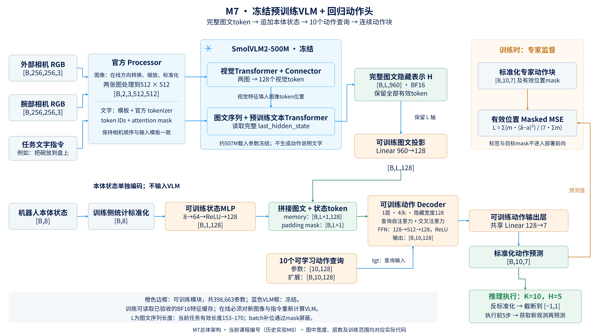
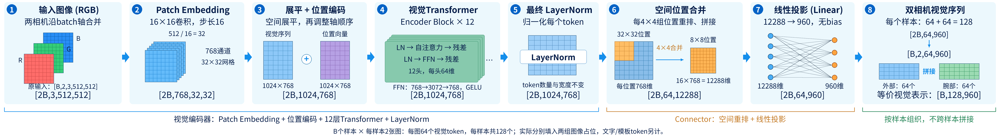
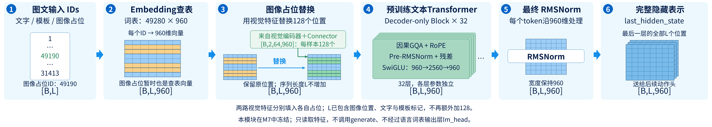
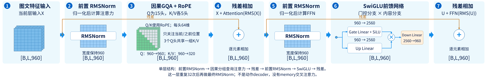
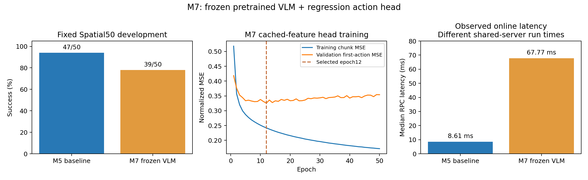

# 第七课：M7——冻结预训练VLM，训练回归动作头

本课讲实际完成的M7：使用SmolVLM2-500M处理两张图像与任务文字，保留完整图文token序列，然后训练一个回归动作头。

沿用第N课对应MN的编号：本课M7是历史文件中的M8；下一课M8是历史M9的flow动作头；第九课M9将复盘已有π0.5微调。目录和冻结报告保留原名，详见[编号对照](MINI_VLA_NUMBERING_20261023.md)。

M7没有沿用M6的ResNet空间token模块。即使PPT主线不展开M6，也可以从M5直接理解这一课。当前新增VLM微调仍暂缓；这里只讲已完成的冻结VLM实验，不启动新任务。

先记住本课核心：**VLM负责生成固定的图文表示；可训练动作头读取这些表示和本体状态，输出10步连续动作。**

## 1. 从M5到M7，究竟换了什么

M5中，图像与语言分别经过我们熟悉的模块：

```text
两张图 → ResNet18 → 两个视觉token ─┐
文字 → 小词表Embedding＋平均 ──────┼→ 4token encoder → 动作decoder
状态 → MLP ───────────────────────┘
```

M7改成：

```text
两张图＋任务文字 → 预训练VLM → 完整图文token序列 ─┐
                                                 ├→ 动作decoder
本体状态 → 可训练状态MLP → 一个状态token ─────────┘
```

主要变化如下：

| 项目 | M5 | M7 |
|---|---|---|
| 图像处理 | 原始256缩到128，ImageNet标准化 | 原始256经VLM官方processor处理到512 |
| 视觉编码 | ImageNet初始化ResNet18 | VLM自带视觉Transformer |
| 语言编码 | 71项训练词表、Embedding、有效词平均 | 预训练tokenizer、Embedding与文本Transformer |
| 图文交互 | 自写4token encoder | VLM内部图文计算 |
| 对动作头提供的信息 | 4个128维观测token | 完整L个960维图文token，投影后另加状态token |
| 模型训练范围 | 视觉、语言和动作相关模块共同更新 | VLM冻结，只更新动作头 |
| 动作输出 | 10查询decoder＋Linear回归 | 同类查询回归思路，但具体头部配置有变化 |

因此，这不是只把一个CNN换成另一个CNN，也不是严格保持其他条件不变的单因素对照。

## 2. VLM是什么，为什么不直接输出机器人动作

VLM是Vision-Language Model，视觉—语言模型：能够处理图像与文字的模型。它可以用于图文表示、问答或文字生成，具体能力取决于模型和使用方式。

本项目选择`HuggingFaceTB/SmolVLM2-500M-Video-Instruct`，使用固定版本权重。模型名称包含Video，但我们在此只输入当前时刻两路相机图像，没有输入一段时间视频。

通用图文模型的内部向量不自动具有我们机器人控制器所要求的7维动作含义。因此还需要一个模块学习：

```text
当前图文表示＋机器人状态 → 机器人应该执行的动作
```

这个模块就是动作头。VLM与动作头组合起来，才构成我们这里的语言条件操作策略。不能把“接入VLM”说成已经加载了一个完成机器人动作预训练的完整VLA；这一点与后续π0.5不同。

## 3. 先看完整张量流程



[高清PNG](ppt_assets/MINI_VLA_M7_overall_architecture.png)与[SVG矢量图](ppt_assets/MINI_VLA_M7_overall_architecture.svg)可用于PPT；橙色边框标明可训练模块，VLM蓝框标明冻结。

```text
当前外部图像：[B,256,256,3] ─┐
当前腕部图像：[B,256,256,3] ─┼→ 官方processor：方向已按LIBERO约定处理
任务文字 ───────────────────┘   图像缩放/标准化、模板、分词
                                             ↓
                         图像张量：[B,2,3,512,512]
                         token IDs / attention mask
                                             ↓
                         冻结SmolVLM2图文前端
                                             ↓
                         last_hidden_state：[B,L,960]
                                             ↓
                         可训练Linear：960→128
                                             ↓
                         图文memory：[B,L,128] ─────────┐
                                                      │
标准化状态：[B,8] → MLP：8→64→128 → [B,1,128] ────────┘
                                             ↓
                         拼成memory：[B,L+1,128]
                                             │
10个可学习动作查询：[B,10,128] ──→ 动作decoder ←┘
                                             ↓
                                  [B,10,128]
                                             ↓
                              共享Linear：128→7
                                             ↓
                       标准化动作块：[B,10,7]
                                             ↓
                       反标准化、截断、执行前5步
                                             ↓
                       读取新图像/状态，再次预测
```

批处理时L是当前batch补齐后的长度；每个样本真实有效的token数量由mask标识。在线单样本输入通常没有这种跨样本长度补齐。

## 4. processor做什么，为什么不用原来的预处理直接接上

processor可以理解成与预训练模型配套的输入处理器。它负责两部分：图像处理和文字/token组织。

对于本项目：

1. 原始相机数据是256×256 RGB。
2. 在线先按已有LIBERO约定旋转图像；示范中保存的RGB按既有训练方向读取，不重复旋转。
3. 将两张RGB图与任务文字交给官方processor。
4. 明确设置最长边512、关闭额外图像切分，由processor执行其规定的缩放、缩放像素数值及标准化。

不能把原来已处理成128大小、已除以255或已ImageNet标准化的数组，不加区分地继续交给这套图像处理器。那可能造成输入尺寸、数值尺度和训练时预期不一致。

本项目专门使用原始256RGB来源，而不是把旧128缓存再放大到512。放大已有图像也不会创造原图中不存在的细节；512是这次适配预训练前端的处理配置，不是新相机分辨率。

## 5. 两张图和文字怎样组成一条输入

实际消息模板的内容结构是：

```text
用户消息：
    "External camera:"
    <外部图像>
    "Wrist camera:"
    <腕部图像>
    <任务指令>
```

代码还使用官方chat template添加角色与必要的特殊标记，并启用`add_generation_prompt=True`。

这里的generation prompt是模板内容的一部分。**我们的代码没有调用`generate()`生成一段动作说明文字，而是直接读取图文序列的隐藏表示。**

文字不再经过自己建立的71词小词表。现在使用预训练模型配套的tokenizer，可能将一个单词拆成多个子词，也会产生角色、图像位置等特殊token。因此：

- 一条指令有5个英文单词，不代表一定只有5个文本token。
- 模型的词表大小不等于当前输入序列长度。
- “External camera”和“Wrist camera”等模板内容同样影响输入，离线和在线必须保持一致。

## 6. 两张图为什么对应128个视觉token



[高清PNG](ppt_assets/MINI_VLA_M7_visual_transformer_connector.png) · [SVG矢量图](ppt_assets/MINI_VLA_M7_visual_transformer_connector.svg)。图中明确使用2B表示B个样本的两路相机；第⑦栏是每张图64个token的`[2B,64,960]`，第⑧栏恢复为`[B,2,64,960]`，每样本视觉部分等价为`[B,128,960]`。实际这些视觉向量分别填入两组图像占位，不包括文字/模板token。

这里要分清“视觉编码器内部的patch序列”和“送入文本主干的视觉token”。

固定配置中的图像大小为512，patch边长16，因此每张图的视觉主干先有：

$$
(512/16)\times(512/16)=32\times32=1024
$$

个patch位置，每个位置的视觉特征宽度为768。

之后，模型自带connector按4倍空间尺度进行重排，把每4×4组位置合到一起：

```text
每图1024个768维位置
       ↓ 4×4位置重排合并
每图64个12288维向量       12288 = 16×768
       ↓ 预训练Linear：12288→960
每图64个960维视觉token
```

因此两相机合计：

$$
2\times64=128\text{个视觉token}.
$$

这个connector是预训练VLM的一部分，本轮随VLM一起冻结。它不是M6里的`Linear 512→128`，也没有复用M6的位置参数。

注意：前端已经计算过1024个视觉patch位置，不能根据最终只有64个token，就认为每张图从头到尾只处理了64个位置。

## 7. 为什么输出长度L不等于128

128只统计两张图对应的视觉token。输入还包括任务文字、相机说明和模板特殊标记。

在本项目固定40个任务指令下，实测有效序列长度为153—170。这个范围只对应当前模板和这40条指令，不是该模型对任意输入的固定长度限制。

例如，一个有效长度为161的样本输出：

```text
[161,960]
  ↑   ↑
序列  每个位置的隐藏特征维度
长度
```

960来自预训练模型配置，不是我们手工给每个token定义960种物理属性。

本体状态没有被写入这个VLM消息模板，而是在动作头中单独编码、追加成一个状态token。因此后面的memory长度是L＋1。

## 8. `last_hidden_state`是什么



[PNG](ppt_assets/MINI_VLA_M7_text_transformer_overview.png) · [SVG](ppt_assets/MINI_VLA_M7_text_transformer_overview.svg)。先将ID映射为Embedding，再用视觉特征替换128个图像占位；序列长度L不增加。

代码使用：

```python
hidden = model.model(
    **inputs,
    use_cache=False,
    return_dict=True,
).last_hidden_state
```

它表示最后一层输出的**所有序列位置**的特征，形状为`[B,L,960]`。名字中的last指最后一层，不是只取最后一个token。

我们没有只取一句话的最后位置，也没有把整个序列平均成一个向量。完整序列都会送给动作头。

模型会把视觉表示放入相应图像token位置，与文本嵌入一起经过其文本Transformer。这里保留模型原有的因果注意力：较早的图像位置不能被简单认为已经读到后面才出现的全部指令。后面的文本位置可以读取前面的上下文，动作头则可以访问完整有效序列。

因此，“图文token”描述的是它们属于同一图文计算序列，不意味着每个位置都通过双向注意力看过全部其他位置。

## 9. VLM内部的decoder和动作decoder有何区别



[PNG](ppt_assets/MINI_VLA_M7_text_transformer_block.png) · [SVG](ppt_assets/MINI_VLA_M7_text_transformer_block.svg)。当前文本主干为32层、960维、15个Q头与5个K/V头（头维64），采用前置RMSNorm、RoPE、因果分组查询注意力及SwiGLU（中间宽度2560）；最后再经过一次RMSNorm。图中展示的是VLM内部结构，不是外接动作头。

前面学到的“Transformer decoder”不是一个只有一种用途的名称。这里需要区分两个模块：

| 模块 | 做什么 | 本轮是否更新 |
|---|---|---|
| VLM内部文本Transformer | 处理图文输入序列，输出960维隐藏表示 | 冻结 |
| 外接动作Transformer decoder | 用10个动作查询读取图文/状态memory，生成动作特征 | 训练 |

我们的动作decoder没有调用VLM的文字输出层，也没有把动作先翻译成自然语言再解析回来。输入给动作decoder的是连续特征，最终Linear直接输出连续动作数值。

M7也没有在VLM后再加一层原M4的4token encoder。VLM输出经投影、追加状态后，直接作为动作decoder的memory。

## 10. 怎么把960维接到128维动作头

动作头的隐藏宽度仍为128，所以首先使用：

```python
self.observation_projection = nn.Linear(960,128)
```

它对每一个图文token应用同一组参数：

```text
[B,L,960] → 逐token Linear 960→128 → [B,L,128]
```

这里不是展平全部L个位置后再压缩。L这个轴始终保留。

本体状态分支是：

```text
[B,8] → Linear 8→64 → ReLU → Linear 64→128 → [B,128]
                                                       ↓ 加一个token轴
                                                    [B,1,128]
```

再把它追加到图文序列末尾：

```python
memory = torch.cat([projected_hidden, state_token], dim=1)
```

得到`[B,L+1,128]`。当前实现没有额外加原来的4类token_type参数表；图文前端已包含自己的位置/模板处理，状态通过独立MLP投影后作为末尾token接入。

## 11. 三种mask要分清楚

不同指令长度不同，batch内需要补齐到最长序列。假设两个样本的真实L分别为153和170：

```text
hidden：[2,170,960]
hidden_mask：[2,170]

样本A：153个True + 17个False
样本B：170个True
```

这里`hidden_mask=True`表示有效。PyTorch交叉注意力的`memory_key_padding_mask=True`却表示屏蔽，因此代码需要取反：

```python
memory_padding = torch.cat([
    ~hidden_mask,
    torch.zeros(B,1,dtype=torch.bool),  # 状态token始终有效，不屏蔽
], dim=1)
```

| mask | 含义 | 使用位置 |
|---|---|---|
| VLM的attention mask | 图文输入中哪些位置有效 | 冻结VLM前端 |
| 动作头memory padding mask | memory中哪些补位要屏蔽 | decoder交叉注意力 |
| 动作标签有效mask | 专家轨迹末尾哪些未来动作真实存在 | 训练MSE与离线指标 |

回归头部署前向不接收动作标签mask。不能把未来轨迹还剩几步泄漏给策略。

代码还先将无效hidden位置置零再投影，避免补位中的异常数值进入后续运算；不能仅凭“最后有attention mask”就忽略前面可能产生的NaN。

## 12. 动作decoder与M4/M5相比有哪些变化

基本流程仍然是：

```text
10个动作查询
 → 查询自注意力
 → 残差＋LayerNorm
 → 对图文/状态memory的交叉注意力
 → 残差＋LayerNorm
 → FFN
 → 残差＋LayerNorm
 → 共享Linear128→7
```

但具体配置要按实际代码画：

| 配置 | M4/M5动作decoder | M7动作decoder |
|---|---|---|
| 层数、头数、隐藏宽度 | 1层、4头、128维 | 相同 |
| FFN | 128→256→128，GELU | **128→512→128，ReLU** |
| memory长度 | 4 | **L＋1** |
| 交叉注意力每头权重 | 10×4 | **10×(L＋1)** |
| 动作查询自注意力 | 10×10 | 相同 |
| 因果mask、dropout | 无查询因果mask、dropout0 | 相同 |
| 最后动作Linear | 128→7 | 相同 |

所以不能把旧decoder展开图原封不动地放到M7里：至少需要修改FFN宽度/激活和memory长度。

10个动作查询依然是随机初始化后学习的参数，不是VLM生成的文字token，也不是专家动作。单层decoder的查询自注意力在读取memory前，仍只处理这组查询参数；场景相关信息从交叉注意力进入。

## 13. “回归动作头”中的回归是什么意思

这里的回归是预测连续数值。例如每个动作位置输出一个7维控制向量，而不是从“抓取/放置/抬起”几个离散类别中选一个。

动作头输出形状为`[B,10,7]`，没有softmax分类层，也没有把输出限制为非负的ReLU。训练时，与标准化专家动作比较：

$$
L=\frac{\sum_{b,k}m_{b,k}\sum_{d=1}^{7}(\hat a_{b,k,d}-a_{b,k,d})^2}
{7\sum_{b,k}m_{b,k}}.
$$

推理时再反标准化并截断到控制器范围：

$$
a_{real}=\hat a_{normalized}\,s_a+\mu_a.
$$

最后执行前5步，重新读取观测。M7仍是K10/H5，没有因为换成VLM就改变动作时序。

## 14. 哪些参数在训练，梯度到哪里停止

VLM前端通过以下方式冻结：

```python
model.eval().requires_grad_(False)

@torch.inference_mode()
def encode(...):
    ...
```

载入的VLM共507,482,304个参数全部冻结，其中也包含当前提特征路径没有调用的语言词表输出层。被冻结不代表推理时不用计算，而是不会根据动作loss更新这些参数。

动作头共有398,663个可训练参数，可以分解成：

| 模块 | 可训练参数 |
|---|---:|
| 图文投影Linear 960→128 | 123,008 |
| 状态MLP 8→64→128 | 8,896 |
| 10×128动作查询 | 1,280 |
| 1层动作decoder | 264,576 |
| 动作输出Linear 128→7 | 903 |
| 合计 | **398,663** |

训练更新发生在这些动作头模块中。可以写“训练了基于冻结VLM特征的动作头”，不能写成“完成SmolVLM2端到端微调”。

VLM被冻结是当时控制成本、复用缓存和比较动作头的方案选择，不是VLM永远不能微调。新的SmolVLM微调现在仍按用户要求暂缓。

## 15. 为什么能缓存，为什么缓存这么大

参数、输入、模板和处理过程固定后，同一训练输入的VLM特征可以提前计算一次，供多轮训练读取：

```text
准备阶段：所有原始示范图像＋指令 → 冻结VLM → 特征缓存

训练阶段：特征缓存＋状态＋专家标签 → 动作头 → loss → 只更新动作头
```

本项目对全部1693条轨迹、273465帧保存完整token序列。按固定指令长度统计，所有帧共有44096499个有效token，每个token有960个BF16数值、每个数2字节：

$$
44096499\times960\times2=84665278080\text{字节}\approx78.85\text{ GiB}.
$$

这只是hidden数值本体，不含索引和其他文件。保存的是完整序列，不能拿“每张图一个向量”的体积估算它。

BF16缓存以uint16容器保存原始位模式：`view(uint16)`只是保存这些位，不是将浮点数四舍五入成整数。读取时再按BF16位模式还原，随后在动作头中转为FP32计算。

## 16. 离线缓存与在线输入一致性为什么重要

动作头训练时读取的是缓存；实际闭环必须重新计算VLM特征。如果两条路径对同一图像和文字生成不同表示，训练输入与部署输入就发生偏移。

需要一致的环节包括：图像方向与分辨率、数值标准化、相机顺序、提示模板、tokenizer、模型权重、精度、有效token顺序。

本项目曾测得离线batch8与在线batch1的差异超出冻结门槛。经过单独批准，完整缓存改用batch1，保留模型、输入和原门槛。后续120个既有训练输入的在线/缓存特征逐位一致，动作头归一化输出最大差为0。

这并不意味着任何模型都必须batch1才正确。它说明这次实现里不能先假定不同批处理设置数值完全相同，再忽略已经观察到的不一致。

缓存后来被M8复用，用于对照flow动作头。但如果更新VLM参数，旧的完整输出缓存通常不再代表更新后的VLM，不能继续照用它来做端到端微调。

## 17. 训练时和部署时计算路径有什么不同

训练时：

```text
磁盘BF16缓存 → FP32动作头 → loss → 反向更新动作头
```

部署时：

```text
当前新图像＋指令 → BF16冻结VLM → FP32动作头 → 当前动作块
```

**冻结VLM仍然需要处理新的在线观测。** 它不是用缓存检索一个旧场景来代替当前相机画面，也不是因为冻结就没有推理延迟。

因此，本次动作头训练约62分钟、峰值Torch allocated约240MiB，只对应缓存上的小头训练，不是在线完整VLM只要240MiB，也不是微调整个VLM只需要62分钟。

## 18. 实际训练和闭环结果

M7仍使用四套联合示范：1506训练/187验证轨迹，243000训练/30465验证帧；batch128、seed42、50轮94950次正式更新。按完整验证首动作MSE选出epoch12，对应22788次更新。

| 指标 | M5基线 | M7冻结VLM回归头 |
|---|---:|---:|
| 四套验证首动作MSE | 0.331655 | 0.325639 |
| 固定Spatial开发成功 | 47/50，94% | **39/50，78%** |
| 50集动作步数 | 5755 | 6557 |
| 策略调用次数 | 1171 | 1325 |
| RPC中位延迟 | 8.61ms | 67.77ms |

配对结果为救回2集、新增失败10集，共同成功37集、共同失败1集，净差-16个百分点。10任务聚类的描述性95%区间为[-32,-4]个百分点。这个结果来自开发集与单训练种子，不是独立确认或四套完整成绩。



M5与M7在不同时间运行，延迟不是严格控制服务器负载的硬件测试。但当次记录确实显示M7在线调用更慢；VLM特征缓存加快离线训练，不能据此宣称在线推理也免费。

## 19. 为什么预训练VLM没有带来更高成功率

已测到的是：这个冻结VLM＋回归头配置没有超过M5。原因尚不能直接归结为一个模块。

可能的竞争解释包括：冻结图文表示与精细动作控制不充分适配、头部容量与优化设置、输入处理差异、回归生成方式等。当前实验同时改变视觉/语言骨干、分辨率、表示和可训练范围，没有逐项隔离这些因素。

离线MSE略低，也不意味着闭环任务必然完成得更好。原验收检查了配对初态、缓存/在线一致性、动作队列和全部样本，保留了所有失败。视频中某些场景已经把碗带到盘附近但未满足成功判据；仅凭这些画面不能证明是“没理解语言”或“MSE把动作平均坏了”。

M7没有进行最终2000集评测，不能使用M5的78.25%作为它的分数。选用预训练模型是结构与训练策略上的探索，不能把它预先称为性能升级成功。

## 20. PPT总体图怎样从M5改成M7

可以直接以M5为起点，不要求保留M6分支：

1. 用一个“冻结VLM”大框替换旧ResNet、71词Embedding平均及4token encoder。
2. 将两张原始图像和任务文字接到同一个processor/VLM输入框，注明两相机512处理、官方tokenizer和模板。
3. VLM输出标成完整序列`[B,L,960]`，不要标成一个句子向量或固定128个总token。
4. 加可训练`Linear 960→128`，保留L这个轴。
5. 本体状态独立走`8→64→128`，追加为1个状态token，得到`[B,L+1,128]`。
6. 10个动作查询接入动作decoder；交叉注意力权重改为`10×(L+1)`，FFN改为`128→512→128＋ReLU`。
7. 输出Linear、K10/H5、标准化动作MSE、反标准化和执行循环保留。
8. VLM框用“冻结”或雪花标志；投影、状态MLP、查询、动作decoder和输出层标为可训练。

训练缓存建议另画一条旁路或独立小图，不要把“读缓存”放进实时机器人推理流程。

## 21. M8与M9怎样接下去

M8复用同一冻结VLM和缓存，把动作生成方式换成条件flow。这让我们继续学习带噪动作、生成时间、速度场和Euler积分。M8也已经完成实验，本轮不重跑。

M9将纳入以前已经完成的π0.5微调：从官方预训练完整VLA出发，更新视觉编码器、语言/动作专家的LoRA等参数，再做LIBERO闭环验证。它不是把M8权重继续训练成π0.5，也不是新增一个尚未执行的SmolVLM微调阶段。

旧π0.5专项训练主要使用Spatial数据，训练与评测范围不同；后续课程会单独解释其参数更新和证据边界，不把它与当前四套实验直接按分数排名。

## 22. 代码入口与自测

- [VLM输入与隐藏表示](../mini_vla/vlm_frontend_v1.py)：`prompt_for()`、`FrozenFrontend.encode()`、BF16位模式。
- [processor配置](../mini_vla/preflight_m8_v2.py)：显式512、关闭图像切分。
- [回归动作头](../mini_vla/vlm_action_heads_v1.py)：先只读`HeadConfig`和`RegressionHead`，flow留给下一课。
- [缓存数据与padding](../mini_vla/vlm_cached_data_v2.py)：整轨迹窗口、token长度补齐、状态与动作对齐。
- [训练验收报告](../results/mini_vla_m8_regression_train_20261021_run1/REVIEWED_REPORT.md)、[闭环验收报告](../results/mini_vla_m8_dev50_20261021_run1/REVIEWED_REPORT.md)：历史标题M8＝本课M7；其中历史基线M6＝当前M5。

自测：

1. 为什么不用原来的71词表？token数量与单词数是什么关系？
2. 两张图共128个视觉token，为什么hidden长度可能为161？
3. `last_hidden_state`中的last指最后一个token吗？
4. 本体状态在VLM里处理，还是在动作头里追加？
5. `hidden_mask=True`与`memory_key_padding_mask=True`分别表示什么？
6. 为什么VLM被冻结，在线仍需要执行它？
7. 哪些参数有梯度，为什么只训练约39.9万参数也要存约79GiB特征？
8. 相比M5，除了VLM替换，还有哪些结构与训练条件变了？
9. 为什么不能把“动作头训练62分钟”作为完整VLM微调耗时？
10. M7的冻结VLM方案，与M9已有π0.5微调，最关键的区别是什么？


下一课：[第八课——条件Flow动作生成](MINI_VLA_LESSON_08.md)，对应你PPT主线中的M7。

## 2026年10月29日补充 同起点冻结与LoRA续训

本课原模型对应PPT M6，原39/50保留。从同epoch12起点，冻结VLM只续训动作头，与视觉/文本attention LoRA r8加动作头各完整续训一轮；数据顺序、有效batch128、头部学习率相同，两臂重置优化器。验证MSE分别0.3177976和0.3175933，差异很小；固定Spatial50闭环结果为44/50与46/50。LoRA救回2个冻结组失败场景、无新增失败，观察到4个百分点差异，但任务聚类描述性区间含0，一个种子的50开发集不能证明稳定优势。

这也是公平对照的作用：原78%到LoRA92%的全部改善不能归因于微调VLM，因为冻结头续训已经达到88%。离线动作MSE很接近，也不意味着闭环结局完全一样。两组训练加验证分别1.94/23.05小时，必须同时报告成本；全部100轨迹和视频已独立验收，不自动追加训练或最终2000。

[完整训练验收](../results/mini_vla_m6_paired_20261028_run1/REVIEWED_REPORT.md) · [闭环验收与差异视频](../results/mini_vla_m6_paired_dev50_20261029_run3/REVIEWED_REPORT.md)。


## 2026-11-05 SmolVLM回归头主线训练验收

同适配VLM冻结骨干，两组随机头完整50轮/94,950更新已验收。新单层epoch14首动作MSE0.32756226，新双层epoch7为0.31987897；现有LoRAendpoint为0.31759333，历史不同。双层相对同起点单层离线降低约2.35%，尚无新闭环成功率。原4卡提取，头训练因双卡轨迹门槛及吞吐未过而回退单卡，未改阈值。学习曲线、全部验证/源数据/优化器复核见results/mini_vla_m6_regression_pair_20261104_run2/REVIEWED_REPORT.md。

后继固定四套dev200×3共600回合，执行协议configs/mini_vla_m6_regression_dev200_20261105_v2.json；120预定视频及全部600动作/物理状态日志。首次启动因快照占用在0回合被阶段存储守卫拦截，旧证据保留；v2只减少重复快照及无损保存物理浮点数组，不扩大1GiB阶段产物包。不是2000最终成绩，不承诺80+。π0.5新正式训练尚未启动。


## 2026-11-05 SmolVLM四套开发600回合验收

三组各200回合：现有LoRA141/200（70.5%），新单层126/200（63%），新双层118/200（59%）。每组Spatial/Object/Goal/Long分别为现有40/48/35/18、单层40/41/32/13、双层26/44/36/12（各套50）。双层对同训练单层救回30、新增失败38，净−4pp，任务聚类描述性95%区间[−12.5,+4.5]pp。保持现有LoRA，不采用新头；Long为主要短板。离线MSE改进未转化为闭环收益，负结果保留。

全部600原轨迹/120预定视频验收，另查看24段代表性片段关键帧；耗时42.84分钟。新开发面板与旧Spatial50/seed7最终2000不同，不直接横比旧92%或78.25%。未达到80+目标，最终2000继续后置。π0.5官方base四套/紧凑checkpoint/多GPU预检为已授权后继，正式训练尚未启动。完整证据：reports/MINI_VLA_SMOL_REGRESSION_DEV200_20261105.md。
