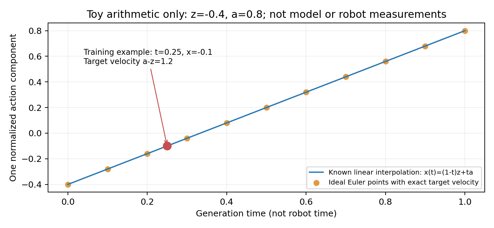
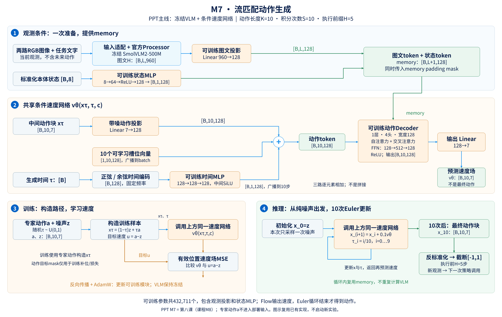
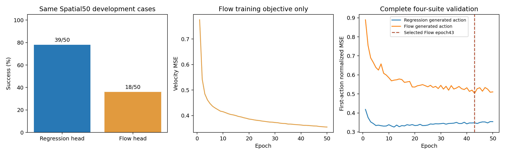

# 第八课：流匹配动作生成

本课对应**课程M8、PPT主线M7、历史实验M9**。上一课是冻结VLM＋回归动作头（课程M7、PPT M6）；本课沿用同一VLM与图文特征缓存，改变动作生成方式。下文优先称“回归头”和“Flow头”，避免三套编号混淆。

本课基于已经完成的真实实验。新VLM微调继续暂缓，不启动训练、评测或等卡；下一课将复盘已有π0.5工作（课程M9、PPT M8）。

阅读顺序：与回归头的区别 → 噪声和生成时间 → 训练路径与目标 → 动作token → Euler推理 → 三种步数 → 实验结果 → PPT改图。

## 1. 先回忆上一课的动作回归

回归头读取当前图文与状态条件c，直接预测动作块：

$$
\hat a=f_\theta(c),\qquad \hat a\in\mathbb{R}^{10\times7}.
$$

```text
固定VLM图文特征＋当前状态
             ↓
10个动作查询＋动作decoder
             ↓
一次前向，输出完整动作块 [B,10,7]
```

训练时用预测动作与标准化专家动作计算有效位置MSE。普通推理中，没有随机初始动作，也没有动作空间内的迭代生成循环。

本课把“直接预测最终动作块”改成“预测动作空间中的变化方向，再迭代更新当前动作块”。

## 2. Flow头的整体想法

Flow Matching的一种做法，是为噪声与数据之间规定一条路径，训练网络预测这条路径对应的向量场，生成时通过数值积分逐步移动样本。更一般的方法背景可参阅[Flow Matching原论文](https://arxiv.org/abs/2210.02747)。本课以下公式与步骤以我们的实际实现为准。

```text
随机噪声动作块 x₀
       ↓ 网络给出变化方向
更新后的 x₁
       ↓ 网络再次给出变化方向
更新后的 x₂
       ↓ ……
最终生成动作块
```

整个过程中，网络还会读取同一份当前图文和机器人状态条件，指导动作块向符合当前任务的方向变化。

“向符合任务的方向变化”是训练目标，不保证每次生成都成功。本轮实际结果较差，后面会据实说明。

## 3. 本课的符号先分清

| 符号 | 含义 | 单个样本的形状 |
|---|---|---|
| c | 当前图文与状态条件 | 在动作头中形成memory |
| a | 标准化专家动作块，仅训练/计分时可用 | `[10,7]` |
| z | 标准正态随机噪声 | `[10,7]` |
| τ | 动作生成过程中的时间，范围0到1 | 一个标量 |
| xτ | 生成时间τ对应的中间动作块 | `[10,7]` |
| vθ | 网络预测的动作空间速度场 | `[10,7]` |

为了与机器人的物理时刻区分，正文用τ；代码变量名是`time`。

**这里的“速度”是中间动作表示相对于生成时间τ的变化率，不是直接等于机械臂末端的米/秒，也不是给机器人额外输出一组物理速度指令。**

## 4. 训练样本怎样构造

从原数据读取一个当前观测与它的专家动作块a，再采样：

$$
z\sim\mathcal N(0,I),\qquad \tau\sim\mathrm{Uniform}(0,1).
$$

实际实现对每个样本采一个τ，同一个样本的10×7个动作分量共用这个τ；z则为完整10×7噪声矩阵。

然后构造线性路径：

$$
x_\tau=(1-\tau)z+\tau a.
$$

三个特殊位置容易理解：

```text
τ=0：xτ = z                完全是噪声
τ=0.5：xτ = 0.5z + 0.5a    噪声与专家动作的混合
τ=1：xτ = a                到达专家动作
```

训练时通常随机抽取中间时间，不是对每个样本都把τ从0到1循环计算10次。

此处a已经使用训练侧统计标准化。噪声和路径也在这个标准化动作空间里构造，而不是直接对真实物理控制量随意加高斯数。

## 5. 目标速度为什么是a−z

对刚才的路径关于τ求导：

$$
\frac{\mathrm d x_\tau}{\mathrm d\tau}
=\frac{\mathrm d[(1-\tau)z+\tau a]}{\mathrm d\tau}
=a-z.
$$

因此，训练目标为：

$$
v^*=a-z.
$$

网络输入当前中间动作xτ、生成时间τ、观测条件c，输出vθ，学习逼近这个目标。

注意两个区别：

- 本实现的目标是`a−z`，不是直接预测最终动作a。
- 也不是直接用`a−xτ`作为速度标签。后者还带有剩余生成时间的缩放关系，不能不加说明地替换目标。

对于固定的一对a、z，线性路径的目标速度恒定。但网络要处理许多不同配对，并不知道当前样本的专家答案，所以实际学到的速度函数仍依赖xτ、τ、c，不能在推理时只算一次速度就默认全程不变。

## 6. 用一个数理解，之后再扩展到70个数

下面是教学算术示例，不是模型实测或机器人控制记录。

假设一个动作分量：

```text
专家动作 a = 0.8
噪声     z = -0.4
时间     τ = 0.25
```

则：

$$
x_{0.25}=0.75\times(-0.4)+0.25\times0.8=-0.1,
$$

$$
v^*=0.8-(-0.4)=1.2.
$$

这一条训练样本就是：模型看到观测c、当前中间值-0.1、时间0.25，学习输出速度1.2。

对真实动作块，只需对10×7个数逐元素构造这条路径，得到：

```text
xτ：[B,10,7]
τ： [B]
目标速度a−z：[B,10,7]
```



## 7. 为什么训练时能使用专家动作，推理时却不需要

这是生成模型训练与推理的角色区别：

| 阶段 | 是否知道专家动作a | 怎么得到输入动作块 |
|---|---|---|
| 训练 | 知道 | 用a与噪声混合，构造xτ；同时产生速度标签a−z |
| 推理 | 不知道 | 从纯噪声z开始，用模型预测的速度逐步更新 |

训练中使用真实动作构造带噪输入，是本训练目标的定义，并不等于部署偷看答案。真正需要防止的是：验证生成或在线推理时，仍用专家动作来构造起点、选择轨迹，或修正输出。

本项目的独立验证按固定噪声从头生成动作，专家动作只用于最后计分；在线也不读取专家未来动作。

## 8. 为什么仍然用MSE，和上一课有什么不同

回归头的监督对象是最终动作：

$$
L_{reg}\propto\|f_\theta(c)-a\|^2.
$$

Flow头的监督对象是速度场：

$$
L_{flow}=\frac{\sum_{b,k}m_{b,k}\sum_{d=1}^{7}
\left(v_\theta(x_\tau,\tau,c)_{b,k,d}-(a-z)_{b,k,d}\right)^2}
{7\sum_{b,k}m_{b,k}}.
$$

虽然都用了平方误差，**输入条件和预测目标都不同**，不能把两种训练loss的数值直接比较大小来判断哪个模型更好。

从建模能力看，直接确定性回归只为给定观测输出一个动作块；Flow模型还可以通过不同噪声起点生成不同动作块，提供描述多种可能动作的方式。

但“使用Flow”不保证一定学到合理的多个动作模式，也不保证避开所有平均化问题。速度场的MSE本身仍在其输入条件下学习平均意义的目标；不同之处是其条件包括中间样本xτ和时间τ，最后通过整条生成过程得到动作。不能仅凭“回归可能平均不同动作”就断言这是本项目失败的根因。

## 9. 轨迹末尾的mask怎样处理

如果当前示范只剩3步动作，后面7个位置没有真实标签。代码在训练中：

1. 将无效位置的专家动作和噪声都置零。
2. 构造xτ及目标速度。
3. 给动作自注意力传入目标补位mask，屏蔽无效位置作为被关注的键。
4. 速度MSE只计算真实有效位置。

```text
有效动作mask：[1,1,1,0,0,0,0,0,0,0]
```

部署时没有专家轨迹末尾信息，因此采样入口不传这个动作目标mask，完整生成10步。这是本实现的训练/推理输入差异，要如实说明；不能在在线运行时查询专家轨迹剩余长度。

图文memory padding mask仍然保留，用于屏蔽图文token补齐位置。它与动作目标mask是两种不同用途的mask。

## 10. 带噪动作怎样进入decoder

上一课的decoder输入只有10个可学习查询。Flow头把三类信息相加，构造新的动作token：

$$
q_k=W_ax_{\tau,k}+b_a+e_k^{slot}+e(\tau).
$$

其中：

| 部分 | 来源 | 输出形状 |
|---|---|---|
| 带噪动作投影 | 每个7维中间动作，经Linear 7→128 | `[B,10,128]` |
| 槽位向量 | 保留原10个可学习动作查询参数 | `[1,10,128]`，广播到batch |
| 时间向量 | τ经过时间编码与MLP | `[B,1,128]`，广播到10个位置 |

逐元素相加后，形状仍为`[B,10,128]`。

这时的动作token不再只有固定查询参数，还包含当前中间动作和生成时间。在最初的采样步，中间动作是噪声；后续更新后的中间动作已受到观测条件影响。

因此，动作自注意力可以基于当前中间动作在10个位置之间交换信息，与上一课“单层decoder先对固定查询做自注意力”的输入情形不同。

## 11. 时间编码是什么

直接给网络一个τ标量也可以是一种设计，但当前代码把τ先转换成128维正弦/余弦特征，再通过MLP。

64个固定频率为：

$$
\omega_j=\exp\left(-\log(10000)\frac{j}{64}\right),\qquad j=0,\ldots,63.
$$

构造：

$$
s(\tau)=\operatorname{concat}\left[
\sin(1000\tau\omega),\cos(1000\tau\omega)
\right]\in\mathbb R^{128}.
$$

再经过：

```text
128维正弦/余弦编码
      ↓ Linear 128→128
      ↓ SiLU
      ↓ Linear 128→128
128维时间向量
```

这里1000是代码中的相位缩放系数，不代表训练1000步、环境执行1000步或1000次去噪。

时间MLP中用的是SiLU；动作decoder内部FFN仍用ReLU。不要把这两个模块的激活函数混为一谈。

## 12. 完整训练架构

下面的架构图按PPT主线标为M7，对应本课的课程M8。左侧构造观测条件，中间是训练与推理共用的速度网络，下方分别展示训练监督和Euler推理循环。



[高清PNG](ppt_assets/MINI_VLA_PPT_M7_flow_architecture.png) · [矢量SVG](ppt_assets/MINI_VLA_PPT_M7_flow_architecture.svg)

```text
当前图像＋指令 → 同一冻结VLM/既有缓存 → 图文投影 ─┐
当前本体状态 ─────────────────────→ 状态MLP ────┘
                                                        ↓
                                              memory：[B,L+1,128]
                                                        │
专家动作a＋噪声z＋随机τ → xτ → Linear 7→128 ─┐           │
10个可学习槽位向量 ─────────────────────────┼→ 动作token │
τ → 正弦/余弦编码 → 时间MLP ─────────────────┘  [B,10,128]│
                                                   │    │
                                                   ▼    ▼
                                              动作Transformer decoder
                                                        ↓
                                                Linear 128→7
                                                        ↓
                                               预测速度 [B,10,7]
                                                        ↓
                                      与速度标签a−z计算有效位置MSE
```

这张图是训练路径，专家动作进入xτ的构造。部署架构不能照搬这条专家输入箭头，后面会单独给出推理循环。

Transformer仍为1层、4头、宽度128，FFN为128→512→128、ReLU。最后Linear的尺寸没变，但输出的含义变成**速度场**，不是本次就已经完成的最终动作。

## 13. 哪些参数新增，哪些保持冻结

回归头398663个可训练参数，Flow头432711个，相差34048个：

| 新增模块 | 参数量 |
|---|---:|
| 带噪动作Linear 7→128 | 7×128＋128＝1024 |
| 时间MLP，两层Linear 128→128 | 2×(128×128＋128)＝33024 |
| 总新增 | **34048** |

固定频率不是可学习参数。VLM仍是507482304个载入参数冻结，共用原特征缓存，没有重新提取或更新VLM。

代码的`FlowHead`继承`RegressionHead`类来复用结构；实际训练按seed42重新初始化Flow模型，**不是加载上一课回归头的best权重再继续训练**。

图文投影、状态MLP、动作查询、decoder、输出层，以及新增动作投影和时间MLP都属于可训练动作头。

## 14. 推理时怎样一步一步生成

推理开始，先计算当前观测memory，并采样纯噪声：

$$
x_0=z\sim\mathcal N(0,I).
$$

采用10步显式Euler，步长Δτ=0.1：

$$
\tau_i=i/10,\qquad
x_{i+1}=x_i+0.1\,v_\theta(x_i,\tau_i,c),\quad i=0,\ldots,9.
$$

实际计算顺序为：

```text
τ=0.0：读取x₀，预测速度，得到x₁
τ=0.1：读取x₁，预测速度，得到x₂
……
τ=0.9：读取x₉，预测速度，得到x₁₀
```

最后的x₁₀对应积分到τ=1的结果。当前循环不会额外再在τ=1调用一次速度网络。

```python
# 对应实际sample逻辑的教学伪代码。
memory, padding = build_memory(current_observations)
x = noise.clone()                          # [B,10,7]
for i in range(10):
    tau = full_batch_scalar(i / 10)
    velocity = predict_velocity(memory, padding, x, tau)
    x = x + velocity / 10
return x                                   # 标准化空间的生成动作块
```

同一个模型、同一组参数连续使用10次，不是10个不同动作模型。当前观测在这10次内部更新中保持不变；生成过程中机器人还没有执行这组动作。

## 15. 为什么不是每次都重新跑一遍VLM

一次策略调用中：

```text
新观测 → VLM一次 → 图文投影和状态编码一次 → memory
                                                    ↓ 复用
                              速度网络反复计算10次 → 最终动作块
```

复用memory并不代表所有计算都被缓存：当前decoder调用仍会执行自己的注意力投影与运算。准确说法是没有重复跑10次完整VLM，不是“10次速度预测完全没有额外成本”。

生成结束后，动作块才进行反标准化和截断。当前代码不在每一次Euler内部更新时将x截断到控制范围；中间x属于生成空间。

## 16. 三种“步”必须分开

| 名称 | 本项目取值 | 在数什么 |
|---|---:|---|
| 动作预测长度K | 10 | 每次输出多少条机器人动作 |
| Flow积分步数S | 10 | 内部调用速度网络更新多少次 |
| 执行前缀H | 5 | 生成后真正先执行多少条动作 |

它们碰巧有两个10，但不是同一个概念：

```text
一次策略调用
  ├─ 先执行S=10次内部Euler更新
  ├─ 得到K=10条机器人动作
  └─ 实际执行前H=5条，然后重新读取观测
```

94950次训练更新又是第四种计数，表示优化器更新次数，不能与上述任何一种步数互换。

## 17. 为什么训练通常只预测一次速度，推理却要预测10次

训练时，我们知道专家动作a，可以直接采样任意τ并构造对应的xτ和速度标签。因此一个batch中通常只需一次速度网络前向、一次反向更新，不必先积分生成整条路径。

推理时没有a，不能直接计算某个中间xτ的正确值，只能从噪声出发，用自己刚刚更新出的x继续预测，所以需要多次积分。

离线验证虽然不更新参数，但需要检查实际生成效果，因此也会从噪声出发跑完整10步，再与专家动作计分。

## 18. 噪声与可复现性

训练中随机采噪声与时间。验证中则给每个示范episode/frame确定一份固定噪声，跨epoch不变，避免选点时额外混入每次不同噪声造成的波动。

本项目规则为：

```text
离线验证：SHA256(20261020, episode, frame) → 种子
在线调用：SHA256(20261020, task, init, call_index) → 种子
```

再使用独立CPU float32随机数发生器生成`[10,7]`噪声。这里哈希产生的是可复现种子，不是模型特征或动作答案。

在线每次调用只按规定生成一次，不尝试多个噪声然后挑最成功的结果。不同噪声可能生成不同动作，但本次没有做多噪声策略性能统计，不能把一次固定噪声结果当成完整分布评估。

## 19. 训练与选点的真实记录

本轮与回归头共用四套1506/187示范、243000/30465帧、归一化、完整token缓存、seed42、batch128、50轮94950更新和K10/H5。

训练优化的是**速度场MSE**；检查点选择使用的是**生成后首动作的标准化MSE**：

```text
每个验证输入 → 固定噪声 → 10步Euler → 生成动作块
                                      ↓
                           首动作与专家首动作比较
                                      ↓
                           全30465帧汇总，选择最小值
```

按这个规则，Flow头选择epoch43，对应81657次更新。完整训练仍跑完了50轮。

| 指标 | 回归头（课程M7 / PPT M6） | Flow头（课程M8 / PPT M7） |
|---|---:|---:|
| 可训练动作头参数 | 398663 | 432711 |
| 被选epoch | 12 | 43 |
| 独立验证首动作MSE | 0.325639 | 0.503268 |
| 独立验证动作块MSE | 0.314913 | 0.482336 |
| Spatial50成功 | 39/50，78% | **18/50，36%** |
| 策略调用次数 | 1325 | 1841 |
| RPC中位延迟 | 67.77ms | 82.29ms |

两种生成动作MSE可以按同一验证数据和标准化规则描述比较，但Flow此处只使用每帧一份固定噪声样本，对单条专家轨迹计算误差，不是对完整动作分布质量的评价。



## 20. 怎样解释这次负结果

相对回归头，Flow头救回1集、新增失败22集，净下降42个百分点；10任务聚类描述性95%区间为[-56,-30]个百分点。这是已经反复使用的开发集、一个训练种子结果，不能外推为所有Flow策略都较差。

验收核对了全部50集、1841次在线噪声生成、动作队列、图像和物理初态，以及10步Euler配置；完整验证集也由独立噪声/Euler实现复算通过。没有通过重抽样、修改阈值或另选检查点来改善表面分数。

候选解释包括动作头容量、优化配置、固定10步积分误差、冻结表征、数据和目标mask处理等。当前没有对应干预实验来确定唯一原因，不能直接说“采样步数太少”或“只要微调VLM就能解决”。

视频中既有抓取未完成，也有物体移动后仍不满足目标的情况。另有动作命令跳变统计，但两策略的物理轨迹已经分叉，不能把相关现象直接当作失败原因。

这次实现覆盖的是一个小型条件Flow头，不等于复现π0.5或SmolVLA的完整网络、机器人预训练数据和训练配方。VLM没有解冻；本轮也没有给Flow模型跑最终2000集。Mini VLA全测选中的仍是M5四套联合模型。

## 21. 在上一张PPT架构图上怎样改

你的上一张PPT叫“M6：接入冻结预训练VLM”。这一页可以叫：

> **M7：条件Flow动作生成**

VLM、图文投影、本体状态、memory和padding mask可以保留。动作生成支路需要明确改变：

1. 原“可学习动作查询”改为三路相加：带噪动作投影＋槽位向量＋时间向量。
2. 增加`xτ [B,10,7]→Linear7→128`与`τ→时间编码→时间MLP`。
3. decoder后面的`Linear128→7`输出标签改成“预测速度场”，不能仍直接标成最终动作。
4. 训练部分增加`xτ=(1−τ)z+τa`与目标`a−z`，损失改成有效位置速度场MSE。
5. 推理部分画内部Euler循环：从z出发，用速度更新x，循环10次得到最终标准化动作块。
6. Euler完成后再接反标准化、截断、执行H5与重新观测。
7. VLM仍标冻结；动作头包括新增的动作投影和时间MLP，均标可训练。

建议把“训练构造路径”和“推理Euler循环”分成两个展开框，不能让专家a的箭头出现在在线推理输入里。

## 22. 代码入口与自测

- [FlowHead及flow_loss](../mini_vla/vlm_action_heads_v1.py)：先看`flow_loss`，再看`velocity`、`sample`。
- [训练循环与固定验证噪声](../mini_vla/train_vlm_flow_v1.py)：区分`training_loss()`与`evaluate()`。
- [独立训练验收](../results/mini_vla_m9_flow_train_20261021_run1/review/independent_acceptance.json)。
- [闭环验收报告](../results/mini_vla_m9_dev50_20261021_run1/REVIEWED_REPORT.md)。历史文件中的M9就是本课Flow模型，不是下一课的π0.5。
- [PPT/课程/历史实验编号对照](MINI_VLA_PPT_NUMBERING_20261024.md)。

自测问题：

1. 为什么目标速度是a−z，不是直接a？
2. τ、K、S、H分别表示什么？
3. 带噪动作、槽位向量与时间向量如何对齐成`[B,10,128]`？
4. 为什么速度网络的最终Linear仍为128→7，但输出含义变了？
5. 训练时专家a参与构造输入，为什么不等于部署偷看未来？
6. 为什么一轮推理调用10次速度网络，不等于调用10次VLM？
7. 推理时是否知道专家轨迹还剩几步？
8. 训练速度MSE与验证生成动作MSE为什么不能混为一个loss？
9. 为什么不能根据一个固定噪声样本的MSE判断完整生成分布质量？
10. 本轮负结果能支持什么结论，不能支持什么结论？

下一课进入已有π0.5：学习完整预训练VLA的组成、实际LoRA/视觉参数更新范围，以及Spatial微调与部署证据。它是已有实验的复盘，不是启动新的VLM微调任务。

## 2026年10月30日补充 固定已适配骨干重训Flow最终结果

本课对应PPT M7。原冻结VLM Flow为18/50；固定已完成LoRA适配的骨干、随机重训同规模Flow头50轮后，新结果21/50。相对旧Flow救回7集、增加4集失败，净+6个百分点，但单种子50开发集的任务聚类描述性差值区间−2至14个百分点包含0。

同一适配骨干的回归模型为46/50，新Flow与之相比救回2集、增加27集失败。换成已适配骨干没有解决这套Flow配置的性能差距；不能据此推广为Flow Matching一般无效，或把唯一原因归到某个模块。两种头的训练历史不同，不是严格等预算消融。

本轮新头432711参数，VLM/LoRA0更新，50epoch94950更新，按完整固定噪声/Euler10生成首动作MSE选新epoch43。MSE0.500068只比旧0.503268略低。120在线输入检查、全部50轨迹/噪声/队列/初态及50视频8895帧验收通过。完整特征仅在RAM，训练结束已释放；保存的门槛样本、权重和日志仍保留。本轮结束，不自动加轮或最终2000。

[训练验收](../results/mini_vla_m7_fixed_lora_flow_20261029_run1/REVIEWED_REPORT.md) · [闭环结果与视频](../results/mini_vla_m7_fixed_lora_flow_dev50_20261030_run1/REVIEWED_REPORT.md)。


## 2026-11-03 Flow 固定回合噪声对照

同一适配骨干与epoch43，固定每回合call0噪声7/50（14%），原逐次噪声21/50（42%）。配对救回2、增加失败16，差值−28个百分点，任务聚类描述性95%区间−42.05至−12个百分点。动作预测重叠MSE由0.52181降到0.36115，实际交接动作变化MSE由0.50518降到0.25109，但成功率下降；较平滑不能替代成功率。不采用这个噪声改动，下一尾部输入一致性对照继续原fresh噪声。原模型、全部阴性结果保留。

120线上特征/动作、阳性物理重放、50初态/首调用、2069噪声与动作队列、全部50视频10383帧通过独立验收；另独立复算并查看3组成败差异。0训练更新，监督执行20.97分钟。仅Spatial50开发，一训练种子，不打开旧最终2000。报告：[完整验收](../results/mini_vla_m7_flow_noise_dev50_20261103_run1/REVIEWED_REPORT.md)。


## 2026-11-03 尾部输入一致性训练完成

新头完整50轮94950更新，按完整30465帧验证首动作MSE选第50轮：0.492674，原同骨干Flow为0.500068，离线降低约1.48%。尾部1683帧MSE0.650496→0.599318，非尾部0.491272→0.486438，夹爪符号准确率92.959%→92.900%，不能预言成功率改善。新闭环尚待评测。

四卡完整提取273465帧/1693episode，全部适配特征receipt与原结果一致；本次提取2.33h、50轮训练验证1.08h、监督3.45h，旧单卡迁移/失败/检查成本保留。原始初始权重和全部验证initial预测逐位相同；骨干/LoRA0更新，完整缓存只在RAM且已释放。选定epoch50使用原fresh噪声，不采用固定回合噪声7/50方案。后继四卡按完整任务评测原Spatial50，仍总计50、不访问旧2000。

[训练验收报告](../results/mini_vla_m7_flow_tail_train_20261103_run2/REVIEWED_REPORT.md)。


## 2026-11-03 尾部输入一致性闭环验收

尾部一致性22/50（44%），原同骨干Flow21/50（42%），救回13/新增失败12，净+2个百分点，任务聚类描述性95%区间−12至16个百分点，不能认定稳定提升。输入约定没有解决与回归46/50的主要差距。四worker总共50回合，各120线上门槛与73步阳性重放后统一放行；全部50初态/1766噪声与队列/视频8840帧通过独立验收，另查看3组代表性结果。环境阶段240.32秒、监督6.56分钟，非严格卡数加速实验。原fresh规则继续，固定回合噪声7/50不采用。下一步独立测试Decoder1→2层，其他配置不变。

[闭环报告](../results/mini_vla_m7_flow_tail_dev50_20261103_run1/REVIEWED_REPORT.md)。


## 2026-11-04 双层 Decoder 训练验收

在相同固定适配VLM、尾部输入约定及50轮94,950次更新下，Decoder由1层增至2层，参数432711→697287。全30,465帧验证选中epoch42：首动作MSE 0.492674→0.463634（下降5.89%）；前5步0.475889→0.451414，全块0.475284→0.447184。尾部1683帧0.599318→0.550189，夹爪符号准确率92.900%→93.376%。初始共享参数逐位相同，新增块是独立deepcopy，不是等参数量对照。训练验收PASS，闭环结果待四卡原Spatial50评测，主对照单层22/50；不能把离线改善当成功率提升。

[训练验收报告](../results/mini_vla_m7_flow_depth2_train_20261103_run1/REVIEWED_REPORT.md)。


## 2026-11-04 双层 Decoder 闭环验收

完整原Spatial50：单层尾部22/50→双层28/50（44%→56%），救回17、新增失败11，净+12个百分点；10任务聚类描述性95%区间−6到30个百分点。方向积极但不能确认稳定提升；回归参考46/50，训练历史不同。相对原适配Flow21/50救回14、新增失败7，但同时改变尾部与深度，不能只归因于深度。全部50轨迹/1574噪声与队列/50视频7854帧审核PASS，查看3组成败差异。监督290.11秒，旧客户端身份校验失败87.957秒及审核成本保留；原失败0新回合，无重采。

最后时间条件对照以双层为匹配控制，只新增零初始化逐层时间scale/shift，原query时间编码保留，初始预测恒等；另完整训练50轮和评测50，结束3头/200新回合范围。

[闭环验收报告](../results/mini_vla_m7_flow_depth2_dev50_20261104_run2/REVIEWED_REPORT.md)。


## 2026-11-04 时间条件闭环与本轮改进收尾

逐层时间仿射29/50（58%），原双层28/50；救回9、新增失败8，净+2个百分点，10任务聚类描述性95%区间−20到24个百分点，无稳定增量证据。全30465验证首动作MSE0.466621，对照0.463634。全部50轨迹、1533次噪声/队列、50视频7652帧审核PASS，另看3组代表性时间线；环境210.11秒、监督311.78秒，失败/检查账保留。

完整序列：原Flow21/50，固定回合噪声7/50，尾部22/50，双层28/50，时间条件29/50；回归46/50为训练历史不同的背景。3训练头各50轮、4组200新回合均验收，重复的是相同50初态，不能写成200独立场景或最终2000。完成后关闭当前队列，新架构优化和2000均未自动启动。

[本轮完整总结](MINI_VLA_FLOW_IMPROVEMENT_CLOSEOUT_20261104.md)。
