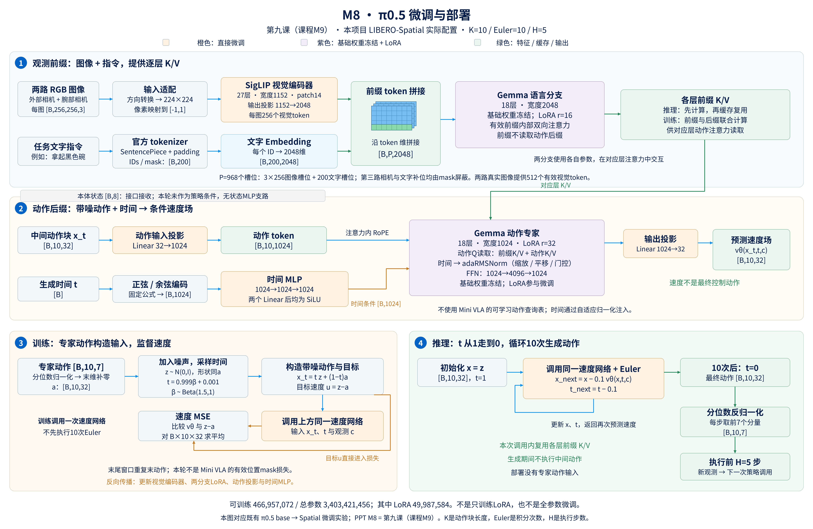
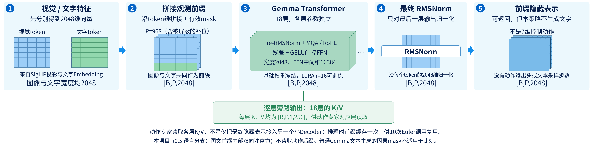
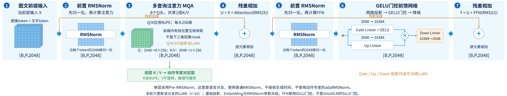
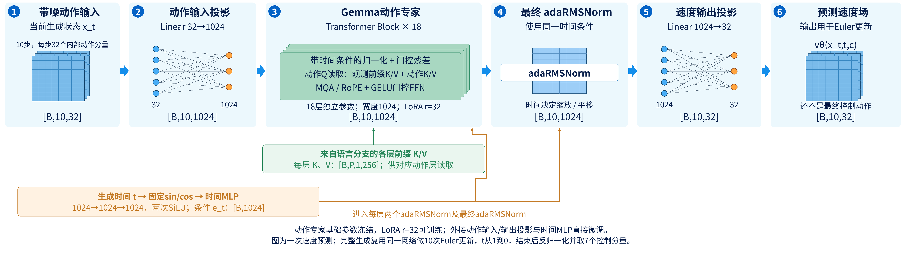
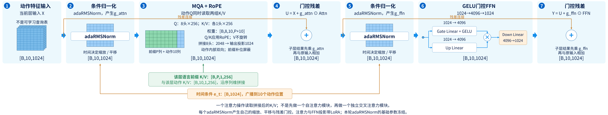
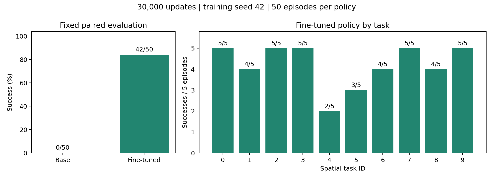
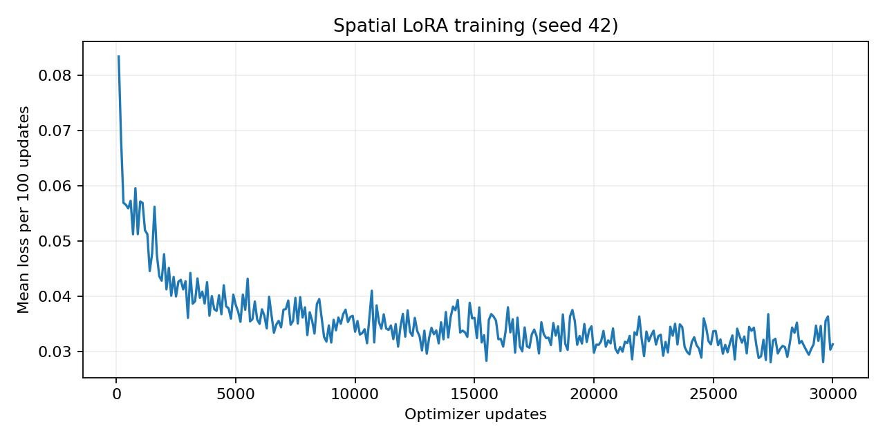

# 第九课：π0.5 微调与部署

本课对应**课程 M9、PPT M8**。上一课是自己搭建的冻结 SmolVLM＋Flow 动作头；这一课复盘已经完成的 π0.5 适配实验：从完整预训练 VLA 出发，在 LIBERO-Spatial 示范上微调，并放进仿真闭环评测。

这是一条已有实验分支，不是把上一课的模型权重接着训练。课程编号表示学习顺序，不表示实验发生顺序。本课只整理已有代码、训练和评测，不启动新的微调。

读完后，应能回答：π0.5 与我们的小 Flow 模型有什么不同？LoRA 更新什么？30k 步实际看了多少数据？动作如何从噪声生成并驱动仿真？42/50 能证明什么？

## 1. 从自己搭组件，到适配完整预训练 VLA

上一课，我们使用通用预训练 SmolVLM 提供图文特征，再训练自己搭建的小动作网络。虽然用了预训练 VLM，动作生成部分仍要用本项目示范学习。

这一课加载的是官方 `pi05_base`。它是包含视觉语言主干和动作专家的完整 VLA 检查点，已有机器人动作生成的预训练基础。本项目的任务是把它适配到当前 LIBERO 数据与控制接口。

| 比较项 | 上一课：PPT M7 | 本课：PPT M8 |
|---|---|---|
| 起点 | 冻结 SmolVLM＋自建小 Flow 头 | 官方 π0.5 base 完整 VLA |
| 前端 | SmolVLM2-500M | PaliGemma 路径，含 SigLIP 视觉编码器与 Gemma 语言分支 |
| 动作网络 | 1 层、宽度 128 的小 Decoder | 18 层、宽度 1024 的动作专家 |
| 训练范围 | VLM 冻结，训练小头 | 更新视觉编码器、两分支 LoRA、动作投影与时间 MLP |
| 数据 | 四套联合训练 | 本次历史实验只用 Spatial |
| 优化量 | 50 epoch，94950 次更新 | 30000 次更新，全局 batch 2 |
| 部署行为 | K10、Euler10、H5 | 本次同样 K10、Euler10、H5 |

π0.5 不是“一个 VLM 的别名”。VLM 主要处理视觉与语言；完整 VLA 还需要把观测转成机器人动作。官方 π0.5 研究涉及异构数据联合训练与泛化，本项目使用公开权重做下游适配，并未重做官方全部预训练。参见[官方 π0.5 介绍](https://www.pi.website/blog/pi05)与[openpi 仓库](https://github.com/Physical-Intelligence/openpi)。

## 2. 先理解整体结构：观测前缀与动作后缀

[高清 PNG](ppt_assets/MINI_VLA_PPT_M8_pi05_architecture.png) · [矢量 SVG](ppt_assets/MINI_VLA_PPT_M8_pi05_architecture.svg)。图中采用PPT编号M8；橙色表示直接微调，紫色表示基础权重冻结并更新LoRA。状态支路、32维动作接口和反向生成时间均按本轮实际代码绘制。

把本次模型分成两条路径理解：

- **观测前缀**：当前两张图像和任务指令，经视觉编码、文字嵌入与语言分支处理，提供任务上下文。
- **动作后缀**：带噪动作经过投影，进入动作专家，在观测上下文和生成时间的条件下预测速度。

“前缀”和“后缀”表示同一次策略调用内部的 token 分组，不是前一集与后一集，也不是过去视频与未来视频。

两条路径在各层注意力中交互。不同组使用各自的投影和 FFN 参数；投影后的注意力空间兼容，因此动作能够读取视觉语言信息。本地实现不是把完整 VLM 最后输出压成 128 维，再连接我们上一课的单层 Decoder。

注意力关系为：

| 查询来自哪里 | 能读取观测前缀吗 | 能读取动作后缀吗 |
|---|---|---|
| 观测前缀 | 能，前缀内部有效 token 可互相读取 | 不能 |
| 动作后缀 | 能 | 能，动作块内部可互相读取 |

因此，观测表示不依赖正在迭代的带噪动作；推理时可以先计算前缀的各层 K/V 缓存，再供动作专家反复读取。

**Gemma语言分支展开**

先对照语言分支的整体结构与单层细节。它处理图文前缀，并向动作专家提供对应层的K/V；图中的最终隐藏表示不是动作专家唯一读取的信息。

[整体图 PNG](ppt_assets/MINI_VLA_PPT_M8_gemma_overview.png) · [整体图 SVG](ppt_assets/MINI_VLA_PPT_M8_gemma_overview.svg)

[单层图 PNG](ppt_assets/MINI_VLA_PPT_M8_gemma_block.png) · [单层图 SVG](ppt_assets/MINI_VLA_PPT_M8_gemma_block.svg)

## 3. 图像怎样进入模型

外部相机和腕部相机原始图像都是 256×256 RGB。本次在线适配器先按 LIBERO 约定同时翻转两个空间轴，再缩放到 224×224；模型输入转换将 uint8 像素映射到约 [-1,1]：

$$
I_{\mathrm{model}}=2\frac{I_{\mathrm{uint8}}}{255}-1.
$$

这与前面 SmolVLM 的 512 分辨率及其官方 Processor 流程不同，不能只换模型名字而保留全部预处理。

视觉编码器采用 SigLIP So400m/14。每张 224×224 图像按 14×14 patch 划分：

$$
224/14=16,\qquad16\times16=256\text{ 个 patch}.
$$

视觉主干宽度为 1152，最终投影到语言分支的 2048 维。因此一张真实图像提供 256 个 2048 维 token，两张真实图像合计 512 个视觉 token。

本地通用接口还有第三路相机槽位。LIBERO 没有这路图像，适配器填零并把其 image mask 设为 False。画图时可以画“两路有效图像”，但不能把第三个占位槽位称为真实相机。

训练时还应用图像增强：外部图像有随机裁剪/缩放和小角度旋转，各路图像有颜色扰动；推理时没有这些随机训练增强。

## 4. 文字与状态：本次配置有一个特别重要的区别

任务文字经 PaliGemma 的 SentencePiece tokenizer 转成 ID，再查语言嵌入表。当前最大文字 token 长度为 200，短序列补齐并带有效位置 mask。200 是文字槽位容量，不是整个图像＋文字序列长度。

π0.5 的默认配置支持把归一化状态离散化，再以数字文本加入提示，例如 `Task: ..., State: ...; Action: ...`。但**本次 LIBERO 冻结配置明确设置了 `discrete_state_input=False`**。

需要把这件事与上一课区分开：

1. 适配器确实采集、传递了 8 维状态。
2. `TokenizePrompt` 在该开关为 False 时，不把状态传给 tokenizer。
3. `pi05=True` 时，动作后缀也不创建 π0 所用的连续状态 token。
4. 本次没有额外的 state MLP 分支；也没有额外的状态转相对动作变换。

**所以，按当前核对的冻结配置与模型代码，本轮动作预测未把这 8 个状态数值作为条件特征。状态字段仍保留在通用数据结构中，并用于获取 batch 形状等接口工作。**

这是代码路径核对结论，不是新做了一轮“去掉状态”的闭环消融。它也不表示机器人状态没有价值；不能据这轮单配置判断加入状态是否会改善结果。

如果在 PPT 上画本次实际实验，应删去上一课的“状态 MLP → memory”箭头，或把状态画成虚线接口框并注明“本轮未作为策略条件”。若讲 π0.5 默认状态离散化机制，要另标“默认设计，本轮关闭”。

依据：[冻结 LIBERO 配置](../results/formal_pipeline_20261013_v2/frozen_source/repos/openpi/src/openpi/training/config.py)、[TokenizePrompt](../repos/openpi/src/openpi/transforms.py)、[Pi0.embed_suffix](../repos/openpi/src/openpi/models/pi0.py)、[参数结构审计](parameter_audit.json)。

## 5. 为什么环境动作是 7 维，模型内部却是 32 维

LIBERO 每步控制动作有 7 个分量，但本次 π0.5 使用通用的 `action_dim=32` 接口。

输入专家动作经过归一化后，末维补零：

$$
[B,10,7]\longrightarrow[B,10,32].
$$

模型内部的动作投影为：

$$
\operatorname{Linear}(32,1024):
[B,10,32]\longrightarrow[B,10,1024].
$$

输出投影则为：

$$
\operatorname{Linear}(1024,32):
[B,10,1024]\longrightarrow[B,10,32].
$$

生成结束后，输出变换反归一化，LIBERO 适配器取最后一维的前 7 个分量，得到 `[B,10,7]`。这里取的是“每个动作的前7个分量”，不是“只保留前7步动作”。

补出的25维是通用模型接口的一部分，不代表机器人实际有32个控制自由度。

## 6. 本次使用分位数归一化

前几课 Mini VLA 常用均值与标准差进行标准化。本次 π0.5 配置使用训练数据的 1% 和 99% 分位数，分别记为 q01、q99。

以某一动作分量为例：

$$
\widetilde a=
2\frac{a-q_{01}}{q_{99}-q_{01}+\epsilon}-1,
\qquad\epsilon=10^{-6}.
$$

反归一化为：

$$
a=\frac{\widetilde a+1}{2}
(q_{99}-q_{01}+\epsilon)+q_{01}.
$$

分位数由训练侧数据计算；base 与微调模型评测使用相同数值内容的统计量。这个线性变换不会自动把所有离群值截断到 [-1,1]。

LIBERO 原始动作已经采用其控制器的增量表达，本次 `extra_delta_transform=False`，没有再减一次当前状态。不要把“分位数归一化”“绝对动作转增量动作”和“控制器范围限制”混成同一个操作。

## 7. 动作专家是什么

动作专家是专门处理连续动作表示的 Transformer 分支。这里“专家”指一组模型参数，不是数据集里的专家示范，也不是机器人外部调用的规划器。

以下两图是**动作专家**，与第2节的语言分支图区分开。

[整体图 PNG](ppt_assets/MINI_VLA_PPT_M8_action_expert_overview.png) · [整体图 SVG](ppt_assets/MINI_VLA_PPT_M8_action_expert_overview.svg)

[单层图 PNG](ppt_assets/MINI_VLA_PPT_M8_action_expert_block.png) · [单层图 SVG](ppt_assets/MINI_VLA_PPT_M8_action_expert_block.svg)

单层顺序是：时间条件adaRMSNorm → MQA/RoPE → 门控残差 → 时间条件adaRMSNorm → GELU门控FFN → 门控残差。18层之后还有最终adaRMSNorm，随后外接1024→32的速度输出投影。

动作Q形状为`[B,10,8,256]`；该层语言前缀K/V与动作K/V分别为`[B,P,1,256]`、`[B,10,1,256]`，沿序列维拼接为`[B,P+10,1,256]`后，在**同一次注意力计算**中读取。注意力权重为`[B,8,10,P+10]`，8个头输出拼为2048维，再投影回1024维用于残差相加。不要把它画成M4中两个独立的自注意力和交叉注意力模块。

本地两分支结构为：

| 分支 | 隐藏宽度 | 层数 | FFN 中间宽度 |
|---|---:|---:|---:|
| 语言分支 Gemma 2B | 2048 | 18 | 16384 |
| 动作专家 Gemma 300M | 1024 | 18 | 4096 |

两者注意力均配置 8 个查询头、1 个 K/V 头、每头维度 256。不要机械用“隐藏宽度÷头数”推导所有架构的头宽：本实现显式设置 head_dim，再由投影层映射到所需注意力空间。

带噪动作投影后进入动作专家；动作后缀通过注意力同时读取观测前缀与动作块内其他位置。动作顺序使用模型的位置编码，本分支没有我们 Mini VLA 中那张 `[10,128]` 的可学习动作查询表。

## 8. 时间通过 adaRMSNorm 注入

上一课把时间向量加到动作 token 上。本次 π0.5 先计算正弦/余弦时间编码，再通过两层时间 MLP；两个 Linear 后都使用 Swish，也就是这里的 SiLU。

时间条件宽度为 1024。它提供给动作专家的自适应 RMSNorm，简称 adaRMSNorm。

普通 RMS 归一化的核心操作是：

$$
\operatorname{RMS}(h)=
\frac{h}{\sqrt{\frac1D\sum_{j=1}^{D}h_j^2+\epsilon}}.
$$

自适应版本根据时间条件得到缩放、平移和残差门控。用教学符号表示：

$$
(\gamma_t,\beta_t,g_t)=\operatorname{Linear}(e_t),
$$

$$
\widetilde h=(1+\gamma_t)\odot\operatorname{RMS}(h)+\beta_t.
$$

相应子层的残差更新可写为：

$$
h_{\mathrm{new}}=h+g_t\odot F(\widetilde h).
$$

这让生成阶段影响每层特征处理，而非只在输入处相加一次。上述是结构说明；某个模块是否更新仍由本轮冻结规则决定，不能因为存在时间调制，就把所有归一化参数都标成可训练。

## 9. Flow 的方向与上一课相反

上一课定义：τ=0 是噪声，τ=1 是动作。本地 openpi 采用另一种约定：**t=1 是噪声，t=0 是动作**。

令归一化并补到32维的专家动作为 a，噪声为 z，本次训练构造：

$$
x_t=t z+(1-t)a,
$$

$$
u_t=z-a.
$$

本地时间采样也不完全相同：先采样 `Beta(1.5,1)`，再变换到接近 [0.001,1] 的范围，而非上一课的均匀采样。

| 约定 | 上一课 Mini VLA | 本地 π0.5 |
|---|---|---|
| 噪声端 | τ=0 | t=1 |
| 动作端 | τ=1 | t=0 |
| 训练目标速度 | a−z | z−a |
| 推理步长 | +0.1 | −0.1 |

这两种时间方向都能描述从噪声生成动作。令 τ=1−t，就能看出坐标方向变化导致速度符号变化。不能只把目标改成 z−a，却仍沿用上一课的正步长。

## 10. 训练损失也不能照搬上一课的 mask 公式

当前 openpi 先对32个动作分量的平方误差求平均，训练脚本再对 batch 和10个动作位置求平均。对应本次实际计算可写为：

$$
L=\frac{1}{B\cdot10\cdot32}
\sum_{b=1}^{B}\sum_{k=0}^{9}\sum_{d=1}^{32}
\left[v_\theta(x_t,t,c)_{b,k,d}-(z-a)_{b,k,d}\right]^2.
$$

本次路径没有 Mini VLA 的有效动作位置 mask 损失。示范尾部动作窗口采用末动作重复补齐，额外动作维度在归一化后补零；噪声和速度监督覆盖内部32维。

因此，两个模型的原始 loss 数字不能直接比较：动作维度、时间分布、尾部处理和归一化均不同。尾部重复补齐是原数据管线的行为，本课如实解释，不改旧实验。

## 11. 推理时做什么

每次动作队列耗尽后，取得新观测，执行以下过程：

1. 两张图像和指令进入模型，计算观测前缀各层的 K/V 缓存。
2. 采样 `[B,10,32]` 的初始高斯噪声，令 t=1。
3. 将当前带噪动作投影为 `[B,10,1024]`，时间条件进入动作专家。
4. 动作专家读取前缀缓存，输出 `[B,10,32]` 的速度。
5. Euler 更新，重复10次。
6. 得到归一化动作，反归一化并取前7个控制分量。
7. 把前5步放入执行队列，执行后获取新观测，再开始下一次策略调用。

为了不把“数组下标”与“生成时间”混淆，令上标表示迭代编号：

$$
x^{(0)}=z,\qquad t_i=1-\frac{i}{10},
$$

$$
x^{(i+1)}=x^{(i)}-0.1\,v_\theta(x^{(i)},t_i,c),
\qquad i=0,\ldots,9.
$$

最后的 x⁽¹⁰⁾ 对应生成时间 t=0。生成过程中复用观测前缀缓存，不重复拍10次图，也不在每次 Euler 更新后执行机器人动作。

原正式评测脚本将适配后的动作直接交给 `env.step`，没有 Mini VLA 图里那个独立的 `np.clip` 框。PPT 应画到“动作反归一化／取7维 → 控制器执行”，不要把后续 Mini VLA 的显式截断实现追溯到这轮历史代码。

## 12. 为什么还需要微调

预训练让模型具备已有的视觉语言和动作生成基础，但目标环境的相机画面、指令分布、机器人控制接口、动作尺度与操作任务仍需适配。

本次从 `pi05_base` 加载完整预训练权重，使用当前 Spatial 示范做行为模仿训练。训练监督来自专家动作，而非环境奖励；不是强化学习，也没有 PPO 或 GRPO 更新。

这与“从随机初始化训练所有参数”不同，也与“加载官方 LIBERO 已适配检查点再测一次”不同。本轮没有从官方 LIBERO expert 权重起步。

## 13. LoRA 是什么

设某线性层原权重为 W。普通全量微调直接更新 W；LoRA 冻结原矩阵，增加一个低秩修正。

采用列向量记号：

$$
y=(W+sUV)x,
$$

其中：

$$
W\in\mathbb R^{d_{\mathrm{out}}\times d_{\mathrm{in}}},\quad
U\in\mathbb R^{d_{\mathrm{out}}\times r},\quad
V\in\mathbb R^{r\times d_{\mathrm{in}}},\quad s=\alpha/r.
$$

这里用 U、V 避免与 batch 大小 B 混淆。r 是低秩维度；训练 U、V 相当于学习一个受限形式的权重修正。

例如一个 2048→2048 的线性层，原矩阵有 4,194,304 个参数。若 r=16，两块低秩矩阵合计：

$$
2048\times16+16\times2048=65536.
$$

这个例子忽略 bias，用来说明参数节省，不是整个模型的参数量。本次语言分支 LoRA 的 r=16、α=16；动作专家 r=32、α=32，均对应缩放系数1。

冻结 W 也不等于可以完全跳过该层的反向传播：梯度仍可能需要穿过它，传给前面的可训练层。LoRA 减少可训练参数和相关优化器状态，不保证把所有计算与显存按同一比例减少。

## 14. 我们究竟训练了哪些参数

这轮不是“只有 LoRA 可训练”。参数审计与训练后的哈希检查显示：

| 模块 | 本轮更新方式 | 可训练参数 |
|---|---|---:|
| SigLIP 视觉编码器及其输出投影 | 更新原有权重 | 414,803,696 |
| 语言分支 | 基础参数冻结，更新 LoRA | 27,869,184 |
| 动作专家 Transformer | 基础参数冻结，更新 LoRA | 22,118,400 |
| 动作输入／输出投影、时间 MLP | 更新原有权重 | 2,165,792 |
| 合计 | 混合微调 | 466,957,072 |

总参数为 3,403,421,456，可训练比例约13.72%。其中 LoRA 合计49,987,584，非 LoRA 可训练参数416,969,488。

为什么配置名有 LoRA，却还训练视觉编码器？因为冻结筛选规则主要针对 `llm` 下的非 LoRA 参数；视觉 `img` 与外部投影／时间 MLP 不在这一冻结集合里。

参数结构审计最初是形状级检查；正式训练的后续检查进一步记录：20个冻结参数叶子保持一致，51个可训练叶子实际变化，其中20个是 LoRA 叶子。叶子是参数树中的数组节点，不是单个标量参数。

所以本轮提升属于**整个适配方案**，不能单独归因于 LoRA，更不能写“VLM 完全冻结、只训练动作头”。

## 15. 30k 步究竟训练了多少

这轮使用10个 Spatial 任务的432条完整示范，共52970帧。一个训练样本以一个观测时刻为起点，读取当前观测和从该时刻开始的10步动作标签。

配置为：全局 batch=2、两张 GPU、30000 次优化器更新、训练种子42。

因此样本位置的累计呈现次数为：

$$
30000\times2=60000.
$$

相当于原始帧位置总数的：

$$
60000/52970\approx1.13\text{ 遍}.
$$

这是按样本位置数量计算的数据等效遍数，不表示每帧恰好访问1.13次，也不是30000个 epoch。每个样本虽然包含10步动作标签，但相邻窗口高度重叠，不能把它说成600000条独立示范。

本轮预先固定交付第30000步检查点；与前面 Mini VLA 按离线验证 MSE 选 epoch 的流程不同，没有根据这50集闭环成绩反选检查点。

## 16. 两张 3090 怎样承载训练

本轮使用双卡 FSDP。可以把它理解为将模型训练所需的大数组按设备分片管理，计算时配合通信读取所需部分，而非让每张卡始终单独保有完全相同的全部训练状态。

全局 batch 为2，每卡处理1个样本。本轮训练阶段报告约8.27小时，包含检查点及检查等开销；纯同步更新合计约6.95小时，整个正式流水线约8.67小时。

这些是已完成历史运行的耗时，不是现在重跑的保证。整卡显存采样也包含共享进程影响，不能据此声称单卡全量微调已验证可行。

视觉权重参与训练，特征会随更新改变。因此，不能像冻结 SmolVLM 那样预先缓存一份图文特征、整个训练过程反复读取旧缓存。

## 17. 实际效果如何

本次正式对照在相同50个 Spatial 初态上评测两个模型：

| 模型 | 成功数 | 成功率 |
|---|---:|---:|
| 官方 base，配合同一份本项目 Spatial 归一化统计 | 0/50 | 0% |
| 微调后的第30000步检查点 | 42/50 | 84% |

这是同一套本地适配与初态协议下的84个百分点差异。42个初态由失败变为成功，8个仍失败。按10个任务簇计算的 bootstrap 区间为差异约70至94个百分点，不包含重新训练不同种子的变动。

0/50 表示 base 在这套接口、统计量、任务和有限初态上的结果，不表示官方模型在所有环境都没有能力。84%也不是完整 LIBERO 四套件成绩。

这一轮只有一个训练种子，没有建立训练示范与评测初态逐条去重证明。因此不能称严格未见场景或未见任务泛化，也没有真机迁移结论。

Mini VLA 最终选定模型的1565/2000属于另一套四套件评测。不能把84%与78.25%直接相减，声称 π0.5 比 Mini VLA 提升5.75个百分点。

## 18. 损失下降与失败案例怎样读

训练前1000步平均损失约0.05977，后1000步约0.03243，说明该训练目标上的误差下降。

损失下降不等于所有闭环任务都会成功。动作误差会通过环境执行累积，抓取、接触和放置阶段也可能出现不同失败。

原50集评测中，“上层抽屉内的黑碗”成功2/5，“ramekin上的黑碗”成功3/5；其余任务的结果与全部8个失败记录都保留在正式报告里。每任务只有5集，不能只凭这个表就判定精确失败原因。

- [成功视频：task0/init2](../results/formal_pipeline_20261013_v2/trained_eval/episodes/task0_init2_TASK_SUCCESS.mp4)
- [失败视频：task4/init22](../results/formal_pipeline_20261013_v2/trained_eval/episodes/task4_init22_STEP_LIMIT_REACHED.mp4)

看视频时区分观察与解释：可以记录“未把碗放到目标处”“达到220步上限”；要说“视觉编码不足”或“动作多模态导致失败”，还需要针对性证据。

## 19. 怎样从上一张 PPT 改成本课

建议标题用 **M8：π0.5 微调**。主体按实际配置修改：

1. SmolVLM 换为 π0.5 的视觉语言前缀，图像分辨率由512改为224；不要沿用全部冻结的雪花标记。
2. 标注视觉编码器可训练，语言基础参数冻结＋LoRA可训练。
3. 删除本次没有的 state MLP 条件支路；保留状态字段时注明接口接收但本轮未作条件。
4. 单层128维 Decoder 换为18层、1024维动作专家；基础参数冻结＋LoRA可训练。
5. 动作输入／输出维度标为32，环境端再取7维；动作块长度仍为10。
6. 删除 Mini VLA 的可学习动作槽位表；动作专家采用自己的位置编码。
7. 时间编码指向动作专家的 adaRMSNorm；不用“时间向量与动作 token 简单相加”的旧画法。
8. Flow 训练写 `x_t=t z+(1−t)a`、目标 `z−a`；推理从1到0、步长−0.1。
9. 输出使用分位数反归一化，再取7维、执行前5步；不套用原均值／标准差公式。

完整架构变化不适合压成“把SmolVLM换成更大的VLM”一句话。它改变了预训练起点、动作专家、条件注入、可训练范围和数值接口。

## 20. 面试时怎样介绍这部分

可以说：

> 在完成小型视觉语言动作模型的组件实验后，我复盘并整理了已有的 π0.5 适配流程。从官方 base 出发，在432条 LIBERO-Spatial 示范上完成双卡30000步微调；核对实际训练范围为视觉编码器、语言与动作专家 LoRA、投影和时间模块。固定50个配对初态中，base 为0/50，微调后为42/50，并保留失败视频和检查点审计。

若自己承担了上述实现、运行或分析，可以按实际参与范围表述；理解课程不自动等于独立实现完整 π0.5。重点是能解释代码和证据，不是记住一个成功率。

建议先自测下面六题：

1. 为什么 π0.5 是 VLA，而 SmolVLM 本身是 VLM？
2. 本轮为何不能称“只训练LoRA”？为什么也不等于全参数微调？
3. 8维状态传进接口，为什么不能直接说模型用了状态条件？
4. 为什么 π0.5 的速度目标是 z−a，上一课却是 a−z？
5. 30000次更新、batch2，为何只对应约1.13遍样本位置？
6. 为什么42/50不能与另一模型1565/2000直接比较优劣？

## 21. 代码与证据入口

| 内容 | 文件 |
|---|---|
| 本轮样本、种子、步数和配对协议 | [冻结方案](../results/formal_pipeline_20261013_v2/frozen_source/configs/formal_plan_20261013.json) |
| 本轮模型及冻结规则配置 | [冻结 config.py](../results/formal_pipeline_20261013_v2/frozen_source/repos/openpi/src/openpi/training/config.py) |
| 前缀、后缀、训练目标、Euler采样 | [pi0.py](../repos/openpi/src/openpi/models/pi0.py) |
| 两分支注意力、adaRMSNorm | [gemma.py](../repos/openpi/src/openpi/models/gemma.py) |
| 状态开关、归一化、补维 | [transforms.py](../repos/openpi/src/openpi/transforms.py) |
| 文字及可选离散状态编码 | [tokenizer.py](../repos/openpi/src/openpi/models/tokenizer.py) |
| 相机占位与输出取7维 | [libero_policy.py](../repos/openpi/src/openpi/policies/libero_policy.py) |
| 参数分组与计数 | [parameter_audit.json](parameter_audit.json) |
| 实际30000更新训练记录 | [training_report.json](../results/formal_spatial_20261013_v1/training_report.json) |
| 训练后哈希与全部产物审核 | [completion_audit.json](../results/formal_pipeline_20261013_v2/completion_audit.json) |
| 正式统计与边界 | [analysis.json](../results/formal_pipeline_20261013_v2/analysis.json)、[正式报告](FORMAL_TRAINING_REPORT.md) |
| 本课核对记录 | [LESSON_09_EVIDENCE.json](MINI_VLA_LESSON_09_EVIDENCE.json) |

上一课：[流匹配动作生成](MINI_VLA_LESSON_08.md)。课程总览：[M1至M9](MINI_VLA_COURSE_M1_M9_CURRENT.md)。本课把已有 π0.5 工作接入学习主线，新增 VLM 微调仍按用户要求暂缓。

## 2026-11-05 π0.5四套工程预检登记

前序Smol三组四套开发完整验收，保持现有LoRA141/200；新回归头不替换，无额外Smol/自建Flow训练。π0.5预检使用官方base、train-only新四套分位数统计；候选冻结SigLIP，训练语言r16/动作r32 LoRA及动作/时间投影52,153,376参数，CPU120输入和紧凑optimizer/RNG恢复继续更新检查通过。已登记原dispatcher的mini_vla_pi05_four_suite_preflight_20261105_run2，优先四卡后同globalbatch4对照两卡，最多28个一次性更新、0新仿真；正式训练/成功率尚未产生。原预检run1因完整1GiBcap被同额预留占满，快照后在0GPU模型/0更新被守卫拦截，修复后保留同一基线与总cap，剩余预留960MiB。旧失败时间/文件保留。完整方案reports/MINI_VLA_PI05_FOUR_SUITE_PREFLIGHT_20261105.md。

## 2026-11-05 π0.5工程预检完整产物恢复与正式范围准备

四卡10更新+8恢复、双卡10更新均已完成，原28次不重跑。四卡同配置恢复逐位一致、每步含I/O约1.347秒；双卡虽1.131秒但loss/梯度/更新向量差超过冻结门槛，不采用。原父失败发生于完整结果写出后的非零退出；后续0更新生成补测明确SIGSEGV，完整120输入产物可验收，小型退出诊断未复现大模型故障。完整正式执行器安全退出门槛仍保留。

完整一轮243000帧外推22.73h，三轮68.19h；initial+3整轮全验证9.57h，合计77.76h，另含检查点/真实全量I/O差异/闭环开销。0新成功率，未正式训练或全测2000。现代产物额度仅余约0.76GiB，原子latest+best最低1.36GiB；已准备3轮182250更新及dev200的2.5GiB产物方案，申请仅现代子额度84→86GiB，总140/project240、100GiB保留及最多4共享GPU不变，尚未获批。报告reports/MINI_VLA_PI05_PREFLIGHT_REVIEW_20261105.md，方案reports/MINI_VLA_PI05_FORMAL_RESOURCE_PROPOSAL_20261105.md。
