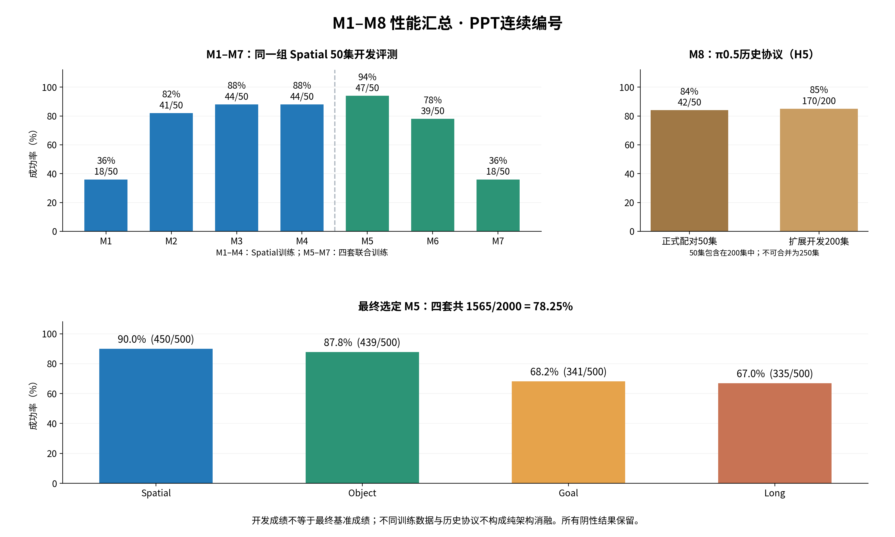

# M1至M8性能汇总

按用户PPT连续编号整理，基础主线核对日期2026-10-27，配对续训及固定适配骨干Flow结果更新于2026-10-30。PPT M6是冻结VLM，M7是Flow，M8是π0.5；不使用旧实验目录里的模型编号作为展示编号。用户已表示全部课程完成，本次仅整理既有结果，不启动训练或评测。

## 主线模型的Spatial成绩

M1–M7为固定Spatial50开发对照。M8是独立历史π0.5训练与评测协议，单独解释，不把相同“50集”当成全部实验条件一致。

| PPT编号 | 模型与主配置 | 训练数据 | 成功数 | 成功率 |
|---|---|---|---:|---:|
| M1 | 小CNN＋单动作MLP（K1/H1） | Spatial：384训练/48离线验证示范 | 18/50 | 36.00% |
| M2 | 动作分块（K10/H5） | Spatial：384训练/48离线验证示范 | 41/50 | 82.00% |
| M3 | ImageNet预训练ResNet18 | Spatial：384训练/48离线验证示范 | 44/50 | 88.00% |
| M4 | Transformer融合＋动作查询 | Spatial：384训练/48离线验证示范 | 44/50 | 88.00% |
| M5 | M4架构四套联合训练 | 四套：1506训练/187离线验证示范 | 47/50 | 94.00% |
| M6 | 冻结SmolVLM＋回归动作头 | 四套：1506训练/187离线验证示范 | 39/50 | 78.00% |
| M7 | 同冻结SmolVLM＋Flow动作头 | 四套：1506训练/187离线验证示范 | 18/50 | 36.00% |
| M8 | π0.5微调30k（K10/H5） | Spatial：432条示范 | 42/50 | 84.00% |

M1–M4训练用384条Spatial示范，48条独立示范做离线验证；M5–M7用1506条四套联合示范，187条做离线验证。π0.5本轮用432条Spatial示范、30000更新，不能与Mini VLA的50epoch视为等预算训练。

## 不能省略的对照

| 配置 | 成功数 | 成功率 |
|---|---:|---:|
| M1 未训练初始化 | 0/50 | 0.00% |
| M2 同一个K10模型，执行H1 | 39/50 | 78.00% |
| M3 原小CNN＋RGB通道标准化 | 36/50 | 72.00% |
| M3 随机初始化ResNet18 | 39/50 | 78.00% |
| M8 官方base＋相同Spatial归一化统计 | 0/50 | 0.00% |

M2-H1与H5共用同一个K10模型，区别是每次执行1步还是5步。M3三项对照完整结果为：小CNN加RGB标准化36/50、随机ResNet39/50、预训练ResNet44/50；主表采用路线中的预训练ResNet版本。

## 最终完整评测只运行选定M5

| 配置 | 成功数 | 成功率 |
|---|---:|---:|
| M5 Spatial | 450/500 | 90.00% |
| M5 Object | 439/500 | 87.80% |
| M5 Goal | 341/500 | 68.20% |
| M5 Long | 335/500 | 67.00% |

四套总计1565/2000，78.25%；开发分区629/800，78.625%；确认分区936/1200，78.0%。总成功率按任务聚类的描述性95%区间约71.80%–84.15%。这是一个选定模型的绝对成绩，没有同协议全量基线可以用于证明相对提升，也不称未见任务泛化。

原50集开发记录没有拼入最终2000；正式评测使用冻结的检查点及执行配置。47/50是历史Spatial开发分数，450/500是最终Spatial全量分数，两者不可替换。

## π0.5扩展开发与执行长度对照

| 配置 | 成功数 | 成功率 |
|---|---:|---:|
| M8 ckpt10k_prefix5 | 119/200 | 59.50% |
| M8 ckpt20k_prefix5 | 152/200 | 76.00% |
| M8 ckpt30k_prefix5 | 170/200 | 85.00% |
| M8 ckpt30k_prefix1 | 173/200 | 86.50% |
| M8 ckpt30k_prefix10 | 148/200 | 74.00% |

这些200集配置来自同一历史诊断协议。30k-H5是原基线，170/200为85%；30k-H1为173/200、86.5%，只是多成功3集，不能挑最高值替代主配置或宣称已找到最优策略。原50集包含在200集中，不能合并成250个独立场景。失败后的440步延长只作诊断，晚成功不混入220步主成绩。

π0.5基础模型正式配对为0/50，30k微调后42/50；两者使用相同Spatial归一化统计。该轮有视觉编码器、LoRA与投影/时间模块共同更新，且显式状态条件关闭；差异不能单独归因于LoRA，不代表官方base所有任务能力。

## 根据对照可以怎样解释

- M1→M2：18/50→41/50，增加46个百分点。单看K10监督且H1执行为39/50；H5相对H1再多2集，并显著减少每个环境步所需的策略调用。
- M3预训练ResNet相对随机ResNet：39/50→44/50，配对救回6、损失1；这是本轮支持预训练收益的对照。相对M2-H5总共只增加3集。
- M3→M4：两者均44/50，配对救回3、损失3，没有观测到净成功率提升。
- M4→M5：44/50→47/50，配对救回4、损失1；数据、优化更新数、词表和归一化共同改变，不是纯Transformer架构收益。
- M5→M6：47/50→39/50，救回2、增加失败10。冻结通用VLM的这套实现没有改善开发成绩。
- M6→M7：39/50→18/50，救回1、增加失败22。当前小Flow头的配置表现更差，不能推广为Flow方法普遍无效。
- M8从官方完整VLA权重出发，是历史适配分支，不是沿用M7检查点继续训练；不要把84%减去36%解释为一次单变量升级收益。

PPT略过的空间token分支保留在附录口径：37/50、74%，对应课程M6/旧实验M7a，不占PPT M1–M8主线编号。

## 已记录的推理延迟

以下为各阶段Spatial50运行中的RPC中位时间，包含服务调用开销；机器负载与运行窗口不同，不是严格控制的架构速度基准。M1一次只执行1步，其他主配置执行5步，不能直接把一次调用延迟当每个环境步成本。

| 模型 | RPC中位延迟 |
|---|---:|
| M1 | 3.61 ms |
| M2 | 5.32 ms |
| M3 | 7.64 ms |
| M4 | 7.50 ms |
| M5 | 8.61 ms |
| M6 | 67.77 ms |
| M7 | 82.29 ms |

## PPT图表与原始依据

[PNG](lesson_assets/ppt_m1_m8_performance_20261027/M1_M8_performance.png) · [SVG](lesson_assets/ppt_m1_m8_performance_20261027/M1_M8_performance.svg) · [全部表格CSV](lesson_assets/ppt_m1_m8_performance_20261027/M1_M8_performance.csv)

- M1：[独立验收记录](../results/mini_vla_m1_20261019_run1/review/independent_acceptance.json)
- M2：[独立验收记录](../results/mini_vla_m2_20261019_run1/review/independent_acceptance.json)
- M3：[独立验收记录](../results/mini_vla_m3_20261019_run3/review/independent_acceptance.json)
- M4：[独立验收记录](../results/mini_vla_m4_20261019_run3/review/independent_acceptance.json)
- M5：[独立验收记录](../results/mini_vla_m6_fast50_20261020_run1/review/independent_acceptance.json)
- M6：[独立验收记录](../results/mini_vla_m8_dev50_20261021_run1/review/independent_acceptance.json)
- M7：[独立验收记录](../results/mini_vla_m9_dev50_20261021_run1/review/independent_acceptance.json)
- final：[独立验收记录](../results/mini_vla_final2000_20261021_run3/review/independent_acceptance.json)
- π0.5：[正式配对验收](../results/formal_pipeline_20261013_v2/final_acceptance.json)、[200集诊断原始分析](../results/research_diagnosis_20261014_v3/ANALYSIS.json)
- [编号对照](MINI_VLA_PPT_NUMBERING_20261024.md)；[本次来源哈希与汇总记录](lesson_assets/ppt_m1_m8_performance_20261027/evidence.json)。

## 2026-10-29 M6冻结与LoRA配对续训最终结果

原M6的39/50保持为历史记录。从同epoch12出发，两臂各完整243000帧、1899更新，再用同一Spatial50初态配对评测：

| 配置 | 首动作验证MSE | Spatial成功数 | 成功率 |
|---|---:|---:|---:|
| 原epoch12 | 0.3256385 | 39/50 | 78% |
| 冻结VLM续训动作头一轮 | 0.3177976 | 44/50 | 88% |
| 视觉与文本LoRA r8加动作头续训一轮 | 0.3175933 | 46/50 | 92% |

LoRA相对等量冻结续训救回2集、无新增失败，观察到+4个百分点。任务聚类描述性95%差值区间为0—10个百分点，包含0；一个训练种子、50个已用于开发的场景，不称稳定优越性或完整LIBERO泛化结论。78%→92%的全部14个百分点不能归因于LoRA，因为只续训头已达到88%。原各版本主表和M5最终2000结果保持。

全部100轨迹、队列和初态核对，100视频11623帧完整解码通过。冻结/LoRA训练加验证分别1.94/23.05小时；新100集流水线约17.07分钟。已完成授权范围并关闭本轮队列，不自动再训或全测。详见[配对闭环验收](../results/mini_vla_m6_paired_dev50_20261029_run3/REVIEWED_REPORT.md)，[训练验收](../results/mini_vla_m6_paired_20261028_run1/REVIEWED_REPORT.md)。

## 2026-10-30 固定适配骨干重新训练Flow最终结果

| 系统 | 首动作验证MSE | Spatial成功数 | 成功率 |
|---|---:|---:|---:|
| 原冻结VLM的Flow | 0.503268 | 18/50 | 36% |
| 固定新LoRA骨干，随机重训Flow头50轮 | 0.500068 | 21/50 | 42% |
| 同一LoRA骨干的回归模型 | 0.317593 | 46/50 | 92% |

新Flow对旧Flow救回7集、增加4集失败，净+6个百分点；任务聚类描述性95%差值区间−2至14个百分点，包含0。对同骨干回归救回2集、增加27集失败，净−50个百分点，描述性区间−62至−40个百分点。两种头的训练历史不同，不称严格等预算动作头消融；一个训练种子和50开发初态，不是最终2000或未见任务泛化。

新头50epoch94950更新、epoch43选点，VLM及LoRA不更新。全部50轨迹、1777次噪声与动作队列、初态hash核对；50视频8895帧完整解码通过。特征提取与训练约8.65小时，评测流程约13.11分钟；完整79GiB适配特征已从进程RAM释放，旧缓存不变。授权范围已结束，不自动追加训练或全测。原M1—M8历史主表不覆盖。[完整报告与差异视频](../results/mini_vla_m7_fixed_lora_flow_dev50_20261030_run1/REVIEWED_REPORT.md)。

## 2026-11-03 Flow 固定回合噪声对照

同一适配骨干与epoch43，固定每回合call0噪声7/50（14%），原逐次噪声21/50（42%）。配对救回2、增加失败16，差值−28个百分点，任务聚类描述性95%区间−42.05至−12个百分点。动作预测重叠MSE由0.52181降到0.36115，实际交接动作变化MSE由0.50518降到0.25109，但成功率下降；较平滑不能替代成功率。不采用这个噪声改动，下一尾部输入一致性对照继续原fresh噪声。原模型、全部阴性结果保留。

120线上特征/动作、阳性物理重放、50初态/首调用、2069噪声与动作队列、全部50视频10383帧通过独立验收；另独立复算并查看3组成败差异。0训练更新，监督执行20.97分钟。仅Spatial50开发，一训练种子，不打开旧最终2000。报告：[完整验收](../results/mini_vla_m7_flow_noise_dev50_20261103_run1/REVIEWED_REPORT.md)。

## 2026-11-03 尾部输入一致性训练完成

新头完整50轮94950更新，按完整30465帧验证首动作MSE选第50轮：0.492674，原同骨干Flow为0.500068，离线降低约1.48%。尾部1683帧MSE0.650496→0.599318，非尾部0.491272→0.486438，夹爪符号准确率92.959%→92.900%，不能预言成功率改善。新闭环尚待评测。

四卡完整提取273465帧/1693episode，全部适配特征receipt与原结果一致；本次提取2.33h、50轮训练验证1.08h、监督3.45h，旧单卡迁移/失败/检查成本保留。原始初始权重和全部验证initial预测逐位相同；骨干/LoRA0更新，完整缓存只在RAM且已释放。选定epoch50使用原fresh噪声，不采用固定回合噪声7/50方案。后继四卡按完整任务评测原Spatial50，仍总计50、不访问旧2000。

[训练验收报告](../results/mini_vla_m7_flow_tail_train_20261103_run2/REVIEWED_REPORT.md)。

## 2026-11-03 尾部输入一致性闭环验收

尾部一致性22/50（44%），原同骨干Flow21/50（42%），救回13/新增失败12，净+2个百分点，任务聚类描述性95%区间−12至16个百分点，不能认定稳定提升。输入约定没有解决与回归46/50的主要差距。四worker总共50回合，各120线上门槛与73步阳性重放后统一放行；全部50初态/1766噪声与队列/视频8840帧通过独立验收，另查看3组代表性结果。环境阶段240.32秒、监督6.56分钟，非严格卡数加速实验。原fresh规则继续，固定回合噪声7/50不采用。下一步独立测试Decoder1→2层，其他配置不变。

[闭环报告](../results/mini_vla_m7_flow_tail_dev50_20261103_run1/REVIEWED_REPORT.md)。

## 2026-11-04 双层 Decoder 训练验收

在相同固定适配VLM、尾部输入约定及50轮94,950次更新下，Decoder由1层增至2层，参数432711→697287。全30,465帧验证选中epoch42：首动作MSE 0.492674→0.463634（下降5.89%）；前5步0.475889→0.451414，全块0.475284→0.447184。尾部1683帧0.599318→0.550189，夹爪符号准确率92.900%→93.376%。初始共享参数逐位相同，新增块是独立deepcopy，不是等参数量对照。训练验收PASS，闭环结果待四卡原Spatial50评测，主对照单层22/50；不能把离线改善当成功率提升。

[训练验收报告](../results/mini_vla_m7_flow_depth2_train_20261103_run1/REVIEWED_REPORT.md)。

## 2026-11-04 双层 Decoder 闭环验收

完整原Spatial50：单层尾部22/50→双层28/50（44%→56%），救回17、新增失败11，净+12个百分点；10任务聚类描述性95%区间−6到30个百分点。方向积极但不能确认稳定提升；回归参考46/50，训练历史不同。相对原适配Flow21/50救回14、新增失败7，但同时改变尾部与深度，不能只归因于深度。全部50轨迹/1574噪声与队列/50视频7854帧审核PASS，查看3组成败差异。监督290.11秒，旧客户端身份校验失败87.957秒及审核成本保留；原失败0新回合，无重采。

最后时间条件对照以双层为匹配控制，只新增零初始化逐层时间scale/shift，原query时间编码保留，初始预测恒等；另完整训练50轮和评测50，结束3头/200新回合范围。

[闭环验收报告](../results/mini_vla_m7_flow_depth2_dev50_20261104_run2/REVIEWED_REPORT.md)。

## 2026-11-04 时间条件闭环与本轮改进收尾

逐层时间仿射29/50（58%），原双层28/50；救回9、新增失败8，净+2个百分点，10任务聚类描述性95%区间−20到24个百分点，无稳定增量证据。全30465验证首动作MSE0.466621，对照0.463634。全部50轨迹、1533次噪声/队列、50视频7652帧审核PASS，另看3组代表性时间线；环境210.11秒、监督311.78秒，失败/检查账保留。

完整序列：原Flow21/50，固定回合噪声7/50，尾部22/50，双层28/50，时间条件29/50；回归46/50为训练历史不同的背景。3训练头各50轮、4组200新回合均验收，重复的是相同50初态，不能写成200独立场景或最终2000。完成后关闭当前队列，新架构优化和2000均未自动启动。

[本轮完整总结](MINI_VLA_FLOW_IMPROVEMENT_CLOSEOUT_20261104.md)。

## 2026-11-05 SmolVLM回归头主线训练验收

同适配VLM冻结骨干，两组随机头完整50轮/94,950更新已验收。新单层epoch14首动作MSE0.32756226，新双层epoch7为0.31987897；现有LoRAendpoint为0.31759333，历史不同。双层相对同起点单层离线降低约2.35%，尚无新闭环成功率。原4卡提取，头训练因双卡轨迹门槛及吞吐未过而回退单卡，未改阈值。学习曲线、全部验证/源数据/优化器复核见results/mini_vla_m6_regression_pair_20261104_run2/REVIEWED_REPORT.md。

后继固定四套dev200×3共600回合，执行协议configs/mini_vla_m6_regression_dev200_20261105_v2.json；120预定视频及全部600动作/物理状态日志。首次启动因快照占用在0回合被阶段存储守卫拦截，旧证据保留；v2只减少重复快照及无损保存物理浮点数组，不扩大1GiB阶段产物包。不是2000最终成绩，不承诺80+。π0.5新正式训练尚未启动。

## 2026-11-05 SmolVLM四套开发600回合验收

三组各200回合：现有LoRA141/200（70.5%），新单层126/200（63%），新双层118/200（59%）。每组Spatial/Object/Goal/Long分别为现有40/48/35/18、单层40/41/32/13、双层26/44/36/12（各套50）。双层对同训练单层救回30、新增失败38，净−4pp，任务聚类描述性95%区间[−12.5,+4.5]pp。保持现有LoRA，不采用新头；Long为主要短板。离线MSE改进未转化为闭环收益，负结果保留。

全部600原轨迹/120预定视频验收，另查看24段代表性片段关键帧；耗时42.84分钟。新开发面板与旧Spatial50/seed7最终2000不同，不直接横比旧92%或78.25%。未达到80+目标，最终2000继续后置。π0.5官方base四套/紧凑checkpoint/多GPU预检为已授权后继，正式训练尚未启动。完整证据：reports/MINI_VLA_SMOL_REGRESSION_DEV200_20261105.md。

## 2026-11-05 π0.5工程预检完整产物恢复与正式范围准备

四卡10更新+8恢复、双卡10更新均已完成，原28次不重跑。四卡同配置恢复逐位一致、每步含I/O约1.347秒；双卡虽1.131秒但loss/梯度/更新向量差超过冻结门槛，不采用。原父失败发生于完整结果写出后的非零退出；后续0更新生成补测明确SIGSEGV，完整120输入产物可验收，小型退出诊断未复现大模型故障。完整正式执行器安全退出门槛仍保留。

完整一轮243000帧外推22.73h，三轮68.19h；initial+3整轮全验证9.57h，合计77.76h，另含检查点/真实全量I/O差异/闭环开销。0新成功率，未正式训练或全测2000。现代产物额度仅余约0.76GiB，原子latest+best最低1.36GiB；已准备3轮182250更新及dev200的2.5GiB产物方案，申请仅现代子额度84→86GiB，总140/project240、100GiB保留及最多4共享GPU不变，尚未获批。报告reports/MINI_VLA_PI05_PREFLIGHT_REVIEW_20261105.md，方案reports/MINI_VLA_PI05_FORMAL_RESOURCE_PROPOSAL_20261105.md。
