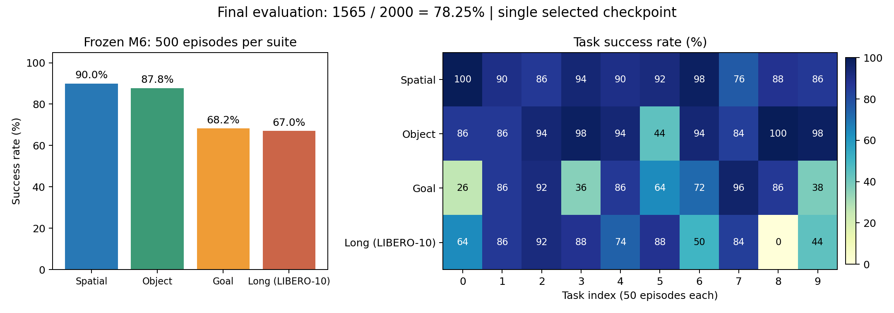

# Mini VLA最终四套件评测：2000/2000，独立验收通过

最终选定模型为M6的epoch3检查点：ImageNet初始化ResNet18、4个观测token的Transformer、10个动作查询、回归动作头，K10/H5。总参数13,666,695。它在四套任务联合示范上训练，而不是预训练VLM模型。

**最终成功1565/2000，四套平均成功率78.25%。** 这是一个预先冻结检查点的全量绝对成绩；没有给其他候选做同协议全量评测，因此不能据此声称相对它们的全量提升。

## 1. 全量结果与数据范围

| 套件 | 成功/总集数 | 成功率 | 开发部分 | 确认部分 |
|---|---:|---:|---:|---:|
| LIBERO-Spatial | 450/500 | 90.0% | 178/200，89.0% | 272/300，90.67% |
| LIBERO-Object | 439/500 | 87.8% | 177/200，88.5% | 262/300，87.33% |
| LIBERO-Goal | 341/500 | 68.2% | 137/200，68.5% | 204/300，68.0% |
| LIBERO-Long（`libero_10`） | 335/500 | 67.0% | 137/200，68.5% | 198/300，66.0% |
| 合计 | **1565/2000** | **78.25%** | **629/800，78.625%** | **936/1200，78.0%** |

每套10个任务，每任务50个初态；共40个任务。四套样本数相同，所以套件宏平均与2000集总成功比例一致。开发/确认划分来自冻结清单；不是事后根据结果重新分组。

按套件分层、以任务为聚类单位进行10000次bootstrap，描述性95%区间为**71.80%—84.15%**，固定随机种子20261021。确认部分对应描述性区间71.5%—84.0%。这反映任务间异质性，不是把2000集当2000个独立任务，也不是对未见任务分布的泛化认证。

完整逐集表：[episodes.csv](review/episodes.csv)。逐任务名称、分数、分区统计、延迟：[独立验收JSON](review/independent_acceptance.json)。可导出图：[PDF](review/final_performance.pdf)。

## 2. 实际核验了什么

本次审核使用独立的CPU逐行状态机，没有调用正式评测的轨迹校验函数，也没有重新运行模型或仿真。统计从全部逐步轨迹重新计算，再与运行端分析逐项比较。

| 项目 | 结果 |
|---|---|
| 场景覆盖 | 2000个唯一场景，四套各500，40任务各50，无缺失或重复 |
| 顺序 | 四份套件日志均为task0…9、init0…49顺序 |
| 执行轨迹 | 392,508步，状态/物理量均有限、维数一致 |
| 策略调用 | 79,163次；调用步、K10/H5队列和每步实际动作一致 |
| 终止 | 每条轨迹成功只出现在最后一步，或到达冻结最大步数 |
| 视频 | 80个预定视频哈希全部匹配，15,246帧全部解码，帧数逐集等于执行步数＋1 |
| 文件与输入绑定 | 56项运行源清单、630项冻结输入绑定验证通过，包括检查点、适配器、任务/初态文件 |
| 旧完整结果 | 161集逐字节保留，未重新询问策略 |
| 旧中断前缀 | 51步、11次旧调用完整保留；第51—54步使用旧第50步调用的剩余4条动作，下一次新调用发生在第55步 |
| 当前审核新增实验 | 0训练更新、0新闭环、0 GPU计算 |

检查点SHA256：`88d410dc3a812713e05a3f0188763b8b000ff638314e4d50d721983b5a7c1b8f`。

有三点证据边界需要保留：

1. 成功标签来自冻结执行器中的原始`env.check_success()`断言及其逐步记录。本次审核确认记录与汇总一致，没有重新仿真2000集来重复检查物理成功谓词。
2. 全部真实调用的输入哈希随轨迹保存，但没有保存所有无损RGB输入。因此本次不能重新从像素计算每一次调用的输入哈希；有冻结的预处理/模型接口、先前阳性重放验收、输入哈希与不可变轨迹文件作为证据。
3. 续跑执行器对已完成轨迹及中断前缀进行了逐步物理重放，qpos/qvel原容差1e-7与成功结果检查保留；随机数状态未单独序列化，不能宣称额外完成了RNG逐位一致性证明。

科学方案中的初始3小时子额度已经被用户明确批准的4小时调配文件覆盖；原科学文件不为修改历史而重写。正式放行、选点、执行器和时间批准链都保留。

## 3. 从结果能确定的优势与短板

**实测优势：**在当前四套训练范围内，Spatial和Object分别为90.0%与87.8%。约1367万参数的小型策略能完成相当一部分机器人操作任务。最终评测覆盖远大于此前Spatial50，且确认部分78.0%与开发部分78.625%接近；不能把这个接近当成所有泛化问题已解决。

**实测短板：**Goal和Long明显较低，任务间差异很大。以下失败集中点来自全量统计，不是挑选失败视频得到的比例：

| 套件/任务 | 原始指令含义 | 成功/50 |
|---|---|---:|
| Long task8 | 把两个摩卡壶都放到炉灶上 | **0/50** |
| Goal task0 | 打开柜子的中间抽屉 | 13/50 |
| Goal task3 | 打开上层抽屉并把碗放进去 | 18/50 |
| Goal task9 | 将酒瓶放到架子上（put the wine bottle on the rack） | 19/50 |
| Object task5 | 把番茄酱放进篮子 | 22/50 |
| Long task9 | 把黄白色杯子放进微波炉并关门 | 22/50 |

不同任务可能同时改变目标、物体、接触需求和动作时长，不能把套件差异全部解释为一个架构缺陷。

本次从已预定的80个视频中，对每套查看一个成功和一个低成功率任务失败案例的起点/中点/终点，共8例24张关键帧。它们用于解释行为，不用于估计全体失败类型占比：

- Spatial task7/init25：末帧目标碗没有完成放到盘上的任务；单视角不足以判断夹爪接触状态。
- Object task5/init0：在最大280步时，篮子任务未完成；不能只凭关键帧断言具体是识别错误还是抓取失败。
- Goal task0/init0：到300步中间抽屉目标未完成；同任务init25则成功打开，说明不是该任务从来无法运行。
- Long task8/init0：末帧可见一个摩卡壶在炉灶区域，另一个仍在桌上；与“两个都放上去”未完成一致。不能据此直接证明模型不理解“两个”。

对应图：[Spatial](review/libero_spatial_review_sheet.jpg)、[Object](review/libero_object_review_sheet.jpg)、[Goal](review/libero_goal_review_sheet.jpg)、[Long](review/libero_10_review_sheet.jpg)。完整视频清单：[video_inventory.json](review/video_inventory.json)。

可能的竞争解释包括示范覆盖、全局视觉压缩、语言均值池化、接触控制误差和长过程的误差累积；本轮没有逐项干预验证它们。确认结果现在用于报告与教学，不自动据此调参或再训练。

## 4. 放回M1到M9的演进中看

| 阶段 | 主要变化 | 历史固定Spatial50 |
|---|---|---:|
| M1 | 小CNN＋平均词向量＋MLP，单动作 | 18/50 |
| M2-H1 / H5 | K10动作块，分别执行1或5步 | 39/50 / 41/50 |
| M3三组 | RGB标准化、随机ResNet、预训练ResNet | 36/50、39/50、44/50 |
| M4 | 4观测token＋Transformer＋动作查询 | 44/50 |
| M5 | 当时的可选生成头阶段跳过 | 无实验结果 |
| M6 | M4架构扩大到四套联合训练 | 47/50 |
| M7a | 两相机各16个空间token | 37/50 |
| M8 | 冻结SmolVLM2-500M＋回归动作头 | 39/50 |
| M9 | 同冻结VLM＋条件flow动作头 | 18/50 |
| 最终 | 根据开发证据选M6，再冻结做四套全测 | **1565/2000** |

M6后的模型都未超过M6的历史开发成功率，负结果完整保留。M8只训练398,663参数的头，M9只训练432,711参数的头，507,482,304参数的VLM冻结；不能称为VLM全量微调，也不能据此否定预训练VLM或flow方法整体。

历史M6的47/50是Spatial开发成绩，不是四套平均；此次Spatial450/500采用正式顺序reset规范，不能把94%→90%直接当作模型退化，更不能把历史50集拼进此次最终2000。

课程与全部代码入口见[完整M1—M9课程总览](../../reports/MINI_VLA_COURSE_M1_M9.md)。

## 5. 成本与运行结束

run3使用物理GPU6、7，执行约91.38分钟。此前失败、预检、两次准入记录和本次审核均保留，最终评测阶段累计约**101.20分钟/240分钟**。这不是只算成功续跑的时间。

M6起始共享账累计约**16.81小时/26小时**，其中现代阶段约**9.92小时/19小时**。M1—M4组件账和旧恢复研究账另行保留，未清零，也不被混称为此次26小时账。

当前项目占用约201.0GiB/240GiB；现代阶段加回已批准退役旧缓存后的记账增长约80.0GiB/84GiB。23:32的文件系统可用空间约331.4GiB，超过100GiB保留线。空间是瞬时状态，不代表其他用户不会继续写入。

各套记录的策略RPC中位延迟约6.43—7.71ms，包含实际运行接口开销；未将它等同于机器人控制频率或真实机器人实时部署认证。没有连续GPU利用率计量，因此不报告伪精确的GPU小时成本。

资源依据：[resource_accounting.json](review/resource_accounting.json)。本轮最终验收结束后关闭Mini VLA自动等卡与实验队列；保留全部数据、检查点、失败记录和负结果，不自动从确认集结果启动新训练。

## 6. 复核与简历表述边界

独立复算脚本：[review_final_complete_v1.py](../../scripts/review_final_complete_v1.py)。从项目根目录使用既有`envs/openpi/bin/python -B scripts/review_final_complete_v1.py`可重新做CPU文件/统计核验；重跑审核也需保留新增审核用时。本次已经完成，不需要为了获得同一个数字重复运行。

可以据此准备的项目描述：搭建模块化语言条件操作策略，完成动作分块、视觉预训练、Transformer融合、空间token及冻结VLM/flow头的逐阶段对照；对最终选定约13.7M参数策略进行四套40任务2000集闭环评测，取得78.25%平均成功率，并实现保留动作队列与物理状态校验的中断恢复。

写入个人简历前，需要自己能够解释并修改相应代码。实验由工具协助完成不等于已独立掌握所有模块。不要写“超过π0.5”“通用机器人泛化”“现代架构逐阶段均提升”或“真实机械臂部署”，这些都不是本轮验证结论。
